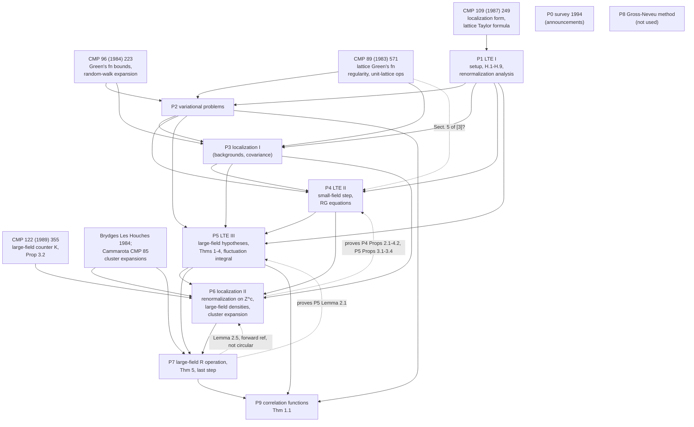
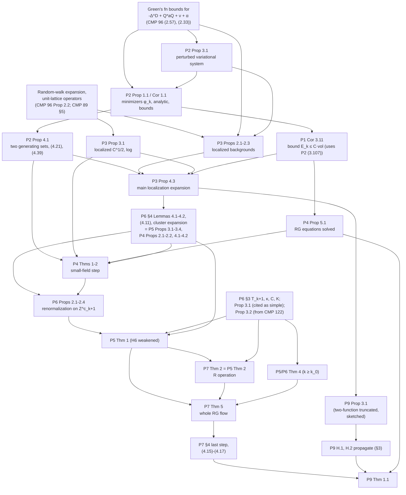

# Balaban's renormalization-group theory of the low-temperature O(N) model: the big picture

Synthesis of the ten per-paper reviews in `papers/P*.md`, of `QC_LOG.md`, and of
direct checks against the PDFs in `../sources/`. Keys P0–P9 are those of
`SOURCES.md`. Page numbers are journal pages as printed unless "PDF p." is
said. Equation numbers are those of the paper named. Where a statement below
was checked against a page image or text layer during this synthesis, it is
marked **[checked]**. Section 7 lists the places where this document corrects a
review or could not confirm one.

Sections 5 and 7 were updated on 2026-10-11 with the external library (E1–E11,
D1–D3; see `LIBRARY.md`); changed items are marked "(updated 2026-10-11 from
E*/D*)".

Contents

1. The model and the main theorems
2. The strategy, in order
3. How the ten papers fit together
4. The parameter hierarchy
5. Prerequisites outside the bundle
6. Context: Fröhlich–Simon–Spencer and modern RG
7. Corrections and unconfirmed claims relative to the reviews

---

## 1. The model and the main theorems

### 1.1 The lattice model

Fix $d\ge3$, $N\ge2$. Let $T$ be a periodic box ("torus") in $\mathbb Z^d$; for
the renormalization group (RG) its side lengths must be multiples of $L^nM$
with $n$ at least the number of RG steps performed ($L$ is the block factor,
$M=L^m$ the size of "large cubes", see §4). A configuration is
$\phi:T\to\mathbb R^N$. After a rescaling of the field that puts the minimum of
the single-site potential at $|\phi|=1$ (P1 (1.2)–(1.4)), the action is
(P1 (1.5), P0 (5), P9 (1.1))
$$
A(\phi)=\tfrac12\|\partial\phi\|^2+\tfrac{\lambda}{8}\,\big\||\phi|^2-1\big\|^2+\tfrac{\nu}{2}\|\phi-h\|^2,
\qquad \|\partial\phi\|^2=\sum_{\langle x,x'\rangle}|\phi(x)-\phi(x')|^2 ,
$$
with $\lambda\in[1,+\infty]$, $\nu\in(0,1]$ (P9 writes $v$ for $\nu$), and
$h\in S^{N-1}$ a fixed unit vector. The finite-volume measure with source
$g:T\to\mathbb C^N$, $\|g\|_{\ell^1}<1$, is
$$
\rho(\phi)\,d\phi=\exp\big[-\beta A(\phi)+\langle g,\phi\rangle-E\big]\,d\phi,\qquad Z(g)=\int\rho\,d\phi,\quad Z(0)=1 .
$$
The case $\lambda=+\infty$ is the hard-spin model: the density is replaced by
$\exp[-\beta(\tfrac12\|\partial\phi\|^2+\tfrac\nu2\|\phi-h\|^2)-E_\infty]\prod_x\delta(|\phi(x)|^2-1)$
(P1 (1.6)). For hard spins $\tfrac12|\phi(x)-\phi(x')|^2=1-\phi(x)\cdot\phi(x')$
and $\tfrac\nu2|\phi(x)-h|^2=\nu(1-h\cdot\phi(x))$, so this is the classical
$O(N)$ ferromagnet $\exp[\beta\sum_{\langle xx'\rangle}\phi(x)\cdot\phi(x')+\beta\nu\sum_xh\cdot\phi(x)]$
at inverse temperature $\beta$ in a magnetic field $\beta\nu h$. **The classical
Heisenberg model is $N=3$, $d=3$, $\lambda=\infty$.** Symmetries: $A(R\phi;Rh)=A(\phi;h)$
for $R\in O(N)$, and invariance under lattice translations, reflections and
coordinate permutations (P1 (1.7)). The term $\frac\nu2\|\phi-h\|^2$ breaks $O(N)$
to the stabilizer of $h$; it selects the phase, and the physical ($\nu=0$) state
is obtained as $\nu\downarrow0$.

"Low temperature" means $\beta$ large. The heuristic ("spin wave picture",
P1 p. 105, P0 Thm 1) is: for $\nu>0$ a unique phase with magnetization
$\approx h$ and truncated correlations decaying at rate $\propto\sqrt\nu$; as
$\nu\downarrow0$ a pure state with transverse correlations
$\sim\beta^{-1}(-\Delta)^{-1}$ (massless Goldstone modes).

### 1.2 The final theorem of the series (P9, Theorem 1.1) **[checked, P9 pp. 493–495]**

Notation: $\langle\cdot\rangle=\lim_T\langle\cdot\rangle_T$ is the thermodynamic
limit along periodic tori at fixed $\nu>0$ (P9 p. 494; existence is used, not
separately proved), $M(x)=\langle\phi(x)\rangle$,
$G(x,y)=\langle\phi(x);\phi(y)\rangle^T=\langle\phi(x)\otimes\phi(y)\rangle-\langle\phi(x)\rangle\otimes\langle\phi(y)\rangle$.

> **Theorem (P9 Thm 1.1, typographical defects repaired).** Let $d\ge3$,
> $N\ge2$. There exist $\beta_0<\infty$ and $\lambda_0<\infty$ such that for
> $\beta_0\le\beta<\infty$, $\lambda_0\le\lambda\le\infty$, $\nu\in(0,1]$ and
> $h\in S^{N-1}$:
> $$M(x)=m(\beta,\nu)\,h,\qquad G(x,y)=G_{tr}(x-y)\,(I-h\otimes h)+G_{lg}(x-y)\,h\otimes h,$$
> and there exist positive constants $c,c',\rho_0$ and a small $\rho_1>0$ such that
>
> (a) for $\nu>0$:
> $\;|m(\beta,\nu)-1|<c\,\beta^{-1+\rho_1}$ and
> $\;|G_{tr}(x-y)|,\ |G_{lg}(x-y)|\le c\,|x-y|^{-(d-2)}\exp[-c'\sqrt\nu\,|x-y|]$;
>
> (b) for the $\nu\downarrow0$ limiting expectations:
> $$G_{tr}(x-y)=\frac{m^2(\beta)}{\beta\,\gamma_\infty}\,(-\Delta)^{-1}(x-y)+R(x-y),\qquad |\gamma_\infty-1|<c\beta^{-1},$$
> $$|R(x-y)|\le c\,(1+|x-y|)^{-(d-2+\rho_0)},\qquad |G_{lg}(x-y)|\le c\,(1+|x-y|)^{-(d-2+\rho_0)} .$$

Remarks on the statement.

- Printed defects (P9 pp. 494–495): part (a) prints "$|G_{tr}(x-y)-|$"; part (b)
  and the abstract print $(1+|x-y|)^{d-2+\rho_0}$ without the minus sign. The
  abstract also prints "$\lambda\ge\infty$" (for $\lambda\le\infty$) and
  "$\langle\phi_1\rangle=1+O(\beta^{-1/2})$", weaker than the theorem.
- Sign of the Laplacian: the abstract writes $\Delta\equiv\partial^*\partial$,
  p. 494 writes $\Delta\equiv-\partial^*\partial$. The intended operator is the
  positive lattice Green's function $(-\Delta_{\rm latt})^{-1}$; it enters through the
  Gaussian RG decomposition P9 (4.17).
- $\gamma_\infty=\lim_k\beta_k/(\beta L^{k(d-2)})$ is the limiting
  renormalization of the inverse temperature (P4 (5.33)); $m(\beta)=\lim_{\nu\downarrow0}m(\beta,\nu)$.
- The quantifier order of $c,c',\rho_0,\rho_1$ relative to $\beta$ is not
  explicit. The proof (P9 §§3–4) gives constants depending on $d,N$ and on the
  RG constants of §4 but not on $\beta\ge\beta_0$, $\nu$, $\lambda$, $x,y$; a
  formal statement should put them before $\beta$ (question for Roland/author).
- Parts (a)–(b) include $\lambda=\infty$ (hard spins). The theorem requires
  $\lambda\ge\lambda_0$ "sufficiently large", whereas P1–P7 claim uniformity in
  $\lambda\in[1,\infty]$; the place where P9 needs $\lambda$ large is not
  identified in the paper.
- What is *not* proved in the bundle: uniqueness of the infinite-volume Gibbs
  state (DLR) for $\nu>0$ (P0 Thm 1 announces "exactly one thermodynamic limit");
  the existence of $\lim_T$ itself is taken for granted (P9 p. 494; P4 p. 720
  says it follows from the tree decay); higher-point functions; any *lower* bound
  on $G_{lg}$ (the "non-canonical $|x|^{-2(d-2)}$" longitudinal behaviour of the
  formal perturbation theory P9 (1.2) is not derived); the expansion of the
  remainder to arbitrary order (announced P0 p. 204, P9 p. 495, not carried out).
- P9 p. 494: for each fixed $\nu>0$ a single cluster expansion works for
  $\beta\ge\beta(\nu)$, but $\beta(\nu)\to\infty$ as $\nu\to0$. The content of the
  theorem is uniformity: one $\beta_0$ for all $\nu\in(0,1]$, and the
  $\nu\downarrow0$ asymptotics.

### 1.3 The intermediate main theorems

**Small-field "Main Theorem" (P1 Thm 2.2, p. 120) [checked].** For the model
with $d\ge3$, $N\ge2$, $\beta>0$, $1\le\lambda\le\infty$, $0<\nu\le1$, define
$\rho_k$ by the *small-field* renormalization transformations
$\rho_k=\chi_kS^{(k-1)}T^{(k-1)}\chi^{(k-1)}\cdots S^{(0)}T^{(0)}\chi^{(0)}\rho_0$
(P1 (1.16)). For $\beta$ sufficiently large there exist constants
$\beta_k,a_k,\lambda_k,\nu_k,E_0,M,\kappa,\alpha_0,\gamma,M_0,\alpha_1$ such that
the $\rho_k$ satisfy (H.1)–(H.9) of P1 as long as $\nu_k\le1$. Not proved in P1
("proved in several stages in the three papers"); its proof is P4 Thms 1–2
together with the deferred localization propositions (P4 p. 682).

**One small-field step (P4 Thms 1–2, pp. 680–681) [checked].** Define
$\mathbb R_k(\beta,a,\lambda,\nu,B,\bar\nu;M,\kappa,\alpha_0,\alpha_1,\gamma,E_0,c_8,c_9)$
as the set of densities satisfying (H.1)–(H.7) of P4 with $\beta_k>B$,
$0<\nu_k\le\bar\nu$ (P4 (1.4)); the torus is a variable, so an element is a
family indexed by admissible tori.

> **P4 Theorem 1.** For any constants $M,\kappa,\alpha_1,\gamma,c_8,c_9$ with
> $0<\gamma<\min\{\frac{d-2}2,\frac12\}$, $M,\kappa$ sufficiently large and
> $\alpha_1,c_8,c_9$ positive and sufficiently small, there exist constants
> $B,\alpha_0,E_0$ such that if $\bar\nu\le\frac78L^{-2}$ then
> $\chi_{k+1}S^{(k)}T^{(k)}\chi^{(k)}$ maps
> $\mathbb R_k(\beta,a,\lambda,\nu,B,\bar\nu;\dots)$ into
> $\mathbb R_{k+1}(\beta,a,\lambda,\nu,BL^{d-2},\bar\nu L^2;\dots)$ with the same
> $M,\kappa,\alpha_0,\alpha_1,\gamma,E_0,c_8,c_9$.

> **P4 Theorem 2.** Under the same assumptions, the step induces a real
> analytic map of the parameter spaces
> $(\beta_k,a_k,\lambda_k,\nu_k,(\mathcal E^{(j)}_k)_{j\le k},(\mathcal M^{(j)}_k)_{j\le k})\mapsto(\dots)_{k+1}$
> with $\mathcal E^{(j)}_{k+1}=\mathcal E^{(j)}_k$, $\mathcal M^{(j)}_{k+1}=\mathcal M^{(j)}_k$
> for $j\le k$ and the RG equations (P4 (1.9))
> $$\beta_{k+1}=\beta_kL^{d-2}-b_{k+1},\quad a_{k+1}=\frac{\beta_kL^{d-2}}{\beta_{k+1}}\frac{aa_k}{aL^{-2}+a_k}-\frac{c_{k+1}}{\beta_{k+1}},$$
> $$\lambda_{k+1}=\lambda_kL^2\frac{\beta_{k+1}+d_{k+1}}{\beta_kL^{d-2}},\qquad \nu_{k+1}=\frac{\beta_{k+1}+b_{k+1}}{\beta_{k+1}+e_{k+1}}\,\nu_kL^2,$$
> where $b,c,d,e$ are real analytic in $(\beta_k,a_k,\lambda_k,\nu_k,(\mathcal E^{(j)}_k))$ and
> $|\beta_{k+1}^{-1}b_{k+1}|,\dots,|\beta_{k+1}^{-1}e_{k+1}|<\frac14c_8L^{-2\gamma(k+1)}$ (P4 (1.10)).

The theorem is existential: the new coefficients and effective actions depend on
a choice of renormalization procedure (P4 p. 680). Theorem 2 is proved in P4
modulo Props 2.1, 2.2, 4.1, 4.2 (localization expansions), which P4 defers.

**The full (large-field) flow (P5 Thms 1–4, pp. 499–500) [checked].** With the
large-field hypotheses H1–H7 of P5 and the space $\mathbb R_k(\beta,a,\lambda,\nu;B,\bar\nu)$ of P5 (1.42):

- *Thm 1.* For $M,\kappa$ large and $\alpha_1,c_8,c_9$ small there exist
  $B,\alpha_0,E_0,B_0$ such that if $\bar\nu\le\beta_k^{-1}\le\frac78L^{-2}$
  (so $k\le k_0$), $S^{(k)}T^{(k)}$ maps $\mathbb R_k$ into the space with
  $k+1,BL^{d-2},\bar\nu L^2$, except that H6 holds only with "$\ge$" in (1.32)
  and the new ($j=k+1$) functions satisfy H2–H4, H7 with $\frac32\kappa$ in place
  of $\kappa$. It induces the map of P4 Thm 2 with the choice $c_{k+1}=0$,
  $d_{k+1}=b_{k+1}$.
- *Thm 2.* For $k<k_0$ there is an operation $R^{(k+1)}$ on the image with
  $R^{(k+1)}S^{(k)}T^{(k)}\rho_k\in\mathbb R_{k+1}$ (all of H1–H7), the
  normalization $\int R^{(k+1)}\rho_{k+1}=\int\rho_{k+1}$ (1.43), and which is the
  identity on the effective-action data except that it adds a new term
  $\mathcal R''^{(k+1)}_m$ to $\mathcal R^{(k+1)}_m$.
- *Thm 3.* $R^{(k+1)}S^{(k)}T^{(k)}:\mathbb R_k\to\mathbb R_{k+1}$ for $k<k_0$
  (composition of 1 and 2).
- *Thm 4.* Starting from $\rho_{k_0}\in\mathbb R_{k_0}(\beta,a,\lambda,\nu;B,\beta_{k_0}^{-1})$,
  the densities $\rho_k=\prod_{j=k-1}^{k_0}S^{(j)}T^{(j)}\rho_{k_0}$ (no $R$)
  satisfy H1–H5, H7, and the large-field operators satisfy (1.31) with
  $\ell=1$, as long as $\nu_k\le1$. Here $k-k_0<\log\beta_{k_0}$ (p. 500).

Attribution (P5 p. 501, with the plan on p. 486): Thms 1 and 4 are proved in
P5 §§2–3 and P6; Thm 2 in P7 §§2–3; Thm 3 is the composition.

**P7 Theorem 5 (p. 497) [checked]** combines these: for $k<k_0$,
$R^{(k+1)}S^{(k)}T^{(k)}$ maps $\mathbb R_k$ into the space with
$k+1,BL^{d-2},\bar\nu L^2$; for $k\ge k_0$ the plain steps preserve H1–H5, H7
with (1.31), $\ell=1$, as long as $\nu_k\le1$; "thus the densities of the whole
renormalization group flow $\{\rho_k\}$, obtained by applying the
renormalization transformations to the initial density $\rho_0$ … satisfy all
the above conditions … with $B$ sufficiently large and $\bar\nu$ sufficiently
small". This is the "RG flow exists" theorem. Its base case (the first step
from $\rho_0$, where $\lambda_0=\lambda$ may be infinite) is treated only for the
small-field part (P4 (2.42)–(2.50), pp. 691–694) and narratively for the
large-field decomposition (P5 pp. 486–487); no theorem states $\rho_1\in\mathbb R_1$.

**The last step and the generating functional.** Let $k_f$ be the first index
with $\nu_k>\frac78L^{-2}$ (P4 §6, P7 §4, P9 p. 515). Then $\chi_{k_f}$ confines
$\psi_{k_f}$ to $|\psi_{k_f}-h|<O(1)\beta_{k_f}^{-1/2}p_0(\beta_{k_f})$, the
remaining fluctuation integral has a mass of order one, and after a final
polymer expansion of the large-field remainders (P7 (4.9)–(4.17), P9 (4.4)–(4.7)):
$$
\log Z(g)=\mathcal F_{k_f+1}(h,g)+\mathcal R^{(k_f+1)}(h,g)+\mathcal P^{(k_f+1)}(g),
\qquad
\mathcal F_{k_f+1}(h,g)=\langle g,h\rangle+\sum_{j}\langle g,\mathcal M^{(j)}(h,g)\rangle+\dots
$$
P5 (1.45)–(1.46) asserts that $\mathcal F(h,g;0+)=\lim_{\nu\downarrow0}\lim_{T\to\mathbb Z^d}\mathcal F(T;h,g;\nu)$
exists with the same representation ($k=\infty$), giving a nonzero one-point
function and correlations decaying with a power law; P9 makes this quantitative.

### 1.4 General versus Heisenberg-specific

Every theorem in P1–P7 and P9 is stated for $d\ge3$, $N\ge2$; nothing is
special to $N=3$, $d=3$. The dimension enters through power counting:
$\beta_k\approx\beta L^{k(d-2)}$, the analyticity radii
$\varepsilon_j\propto L^{-j((d-2)/2-\gamma)}$ and the gap exponent
$\gamma<\gamma_0=\min\{\frac{d-2}2,\frac12\}$, which equals $\frac12$ for every
$d\ge3$ (P4 (H.1), P9 p. 495; P1 p. 147). For $d=3$ the two constraints in
$\gamma_0$ coincide, so $d=3$ is the tightest case. $N$ enters only through the
$O(N)$ symmetry arguments: invariant-tensor reduction under the stabilizer of
$e_1,e_2$ (P1 (3.67)–(3.79)), the Ward identity (P1 (3.122)–(3.124)), and the
local analytic choice of $R(\psi_0)\in O(N)$ with $Re_1=\psi_0$ in P7 (pp.
520–521); $N\ge2$ is needed for the transverse direction $e_2$ in the
renormalization conditions. $\lambda=\infty$ is covered by working with
$1/\lambda\in[0,1]$ throughout; the only place where it requires a separate
argument is the first step (P4 pp. 691–694).

---

## 2. The strategy, in order

### 2.1 Block averaging and the renormalization transformation

For a density $\rho(\phi)$ on a lattice of spacing 1 (P1 (1.11), P0 (10)–(11)):
$$
(T\rho)(\psi)=\int d\phi\prod_{y}\Big(\tfrac{\beta aL^{d-2}}{2\pi}\Big)^{N/2}
\exp\Big[-\tfrac12\beta aL^{d-2}\,|\psi(y)-(Q\phi)(y)|^2\Big]\rho(\phi),
\qquad (Q\phi)(y)=L^{-d}\!\!\sum_{x\in B(y)}\!\phi(x),
$$
with $y$ running over centres of $L$-blocks $B(y)$. $\int T\rho\,d\psi=\int\rho\,d\phi$.
Only the plain block average and Gaussian kernels are used. The scaling $S$
maps the $L$-lattice to the unit lattice without rescaling spin values (spins
keep $|\phi|\approx1$), so couplings scale canonically:
$\beta\to\beta L^{d-2}$, $\lambda\to\lambda L^2$, $\nu\to\nu L^2$ (P1 (1.9)–(1.10)).
After $k$ steps $\rho_k=(ST)^k\rho_0$ lives on the unit lattice $T_1^{(k)}$; it is
convenient to view the original lattice as $T_\eta$, of spacing $\eta=L^{-k}$,
inside a fixed continuum torus. The running constants satisfy
$\beta_k\approx\beta L^{k(d-2)}$, $\lambda_k=\lambda L^{2k}$, $\nu_k\approx\nu L^{2k}$,
and $a_k$ follows the "free flow" $a_{k+1}=aa_k/(a_k+aL^{-2})$, i.e.
$a_k=a\frac{1-L^{-2}}{1-L^{-2k}}$, produced by composing Gaussian kernels
(P2 (4.2)–(4.4), P4 (2.9)). Since $\beta_k\to\infty$, the effective temperature
goes to zero (the nonlinear sigma-model coupling is irrelevant for $d>2$),
while $\nu_k$ grows; the flow is run until $\nu_k\approx1$, i.e. for about
$\log_L\nu^{-1/2}$ steps, after which a single massive integration remains.

### 2.2 The spherical constraint

The constraint is never solved by angular coordinates in the bulk of the
analysis. The model keeps the barrier $\frac{\lambda_k}8\||\phi|^2-1\|^2$ with
$\lambda_k=\lambda L^{2k}\to\infty$, and the variational problems are linearized
by an auxiliary scalar field $\alpha$ (P2 (1.7)–(1.10)):
$$
J=\tfrac12\langle\psi-Q\phi,a(\psi-Q\phi)\rangle+\tfrac12\|\partial^\eta\phi\|^2+\tfrac12\langle\alpha,|\phi|^2-1\rangle-\tfrac1{2\lambda}\|\alpha\|^2+\tfrac\nu2\|\phi-h\|^2,
\qquad A=\sup_\alpha J,
$$
so at the critical point $\alpha=\frac\lambda2(|\phi|^2-1)$ and $\lambda$ appears
only through $1/\lambda\in[0,1]$. All bounds are claimed uniform in
$\lambda\in[1,\infty]$. The block spins $\psi$ are unconstrained vectors in
$\mathbb R^N$ (block averages of unit vectors are not unit vectors); the small-field
conditions keep $||\psi|^2-1|$ small. The first step from $\rho_0$, where
$\lambda_0=\lambda$ may be infinite, is done separately by splitting the
fluctuation $\phi'=\chi\,(\phi_1)_0+\phi''$ into radial and orthogonal parts
and solving $2|\phi_1|\chi+\chi^2+|\phi''|^2=2|\phi_1|\chi'$ (P4 (2.44)–(2.50));
the resulting integrand is analytic in $\lambda_0^{-1/2}$ uniformly.

### 2.3 Background configurations: the variational problems (P1 §2, P2)

On the small-field set the integrand of each step has exactly one critical
point, a minimum, and the effective density is organized around it. With
$\eta=L^{-k}$, $\psi$ on $T^{(k)}_1$, $\phi$ on $T_\eta$ (P1 (2.1)):
$$
A_k(\psi,\phi;h,a,\lambda,\nu)=\tfrac a2\|\psi-Q_k\phi\|_1^2+\tfrac12\|\partial^\eta\phi\|^2+\tfrac\lambda8\||\phi|^2-1\|^2+\tfrac\nu2\|\phi-h\|^2,
\qquad \phi_k(\psi)=\operatorname*{argmin}_\phi A_k(\psi,\phi).
$$
The intermediate fields $\psi_k^{(j)}(\psi)$ on $T^{(j)}$ ($j<k$) solve the
"connecting problem" P1 (2.6), and the composition identity
$\phi_j(\psi^{(j)}_k(\psi))=\phi_k(\psi)$ (P1 (2.8), P2 (4.39)) holds exactly
when the coefficients follow the free flow (P1 (2.9)–(2.11)). Thus the
"background field" at every earlier scale is a function of the current block
spin.

P2 solves the general multiscale version: given a decreasing sequence of
domains $\Omega_1\supset\dots\supset\Omega_k$ (a "generating set"
$\mathbb B_k$, P2 (1.1)–(1.3)) and data $\psi$ on the layers, minimize
$A(\mathbb B_k;\psi,\phi)$ over $\phi$ on $\Omega_1$. **P2 Prop 1.1 (p. 611)
[QC-checked]:** for complex data $(\psi+\psi',h+h')$ in
$\tilde\Psi^c(\mathbb B_k;\delta,\varepsilon)$ with $0<\delta\le\varepsilon\le c_0$,
$\delta\le c_1$, $\nu\varepsilon^2\le\delta^2$, the Euler–Lagrange system has a
solution, unique among $|\alpha|<(L^j\eta)^{-2}c_0$, analytic in the data,
with the scale-weighted bounds P2 (1.15)–(1.16) (e.g. $|\partial^\eta\phi|$,
$|\Delta^\eta\phi|$, $|\alpha|$ bounded by $K_1(L^j\eta)^{-1}\delta$,
$K_1(L^j\eta)^{-2}\delta$, $K_1(L^j\eta)^{-2}\delta$ on $\Omega_j$, a Hölder
bound with $C_\alpha=O(\alpha^{-d-1})$), and for real data it is the unique
minimum. The constants are uniform in $\frac12<a<\frac32$, $1\le\eta^2\lambda\le\infty$, $0<\nu\le1$.
The proof:

1. constant configurations are solved by algebra in the $O(N)$ invariants
   $U=|\psi+\psi'|$, $V$, $W^2$ and a scalar implicit equation (P2 §2,
   Prop 2.1, Lemma 2.1);
2. constant solutions frozen at block centres are patched by a partition of
   unity and projected to the sphere, giving an approximate solution with
   residual $O((L^j\eta)^{-2}\delta)$ (P2 Lemma 3.1);
3. the exact solution is a perturbation solved by contraction (P2 Prop 3.1,
   Lemma 3.2), using bounds on
   $G(\alpha)=(-\Delta^{D,\eta}_{\Omega_1}+Q^*aQ+\nu+\alpha)^{-1}$ in scale-weighted
   sup and Hölder norms. These Green's function bounds are quoted from
   Balaban's gauge-theory paper CMP 96 (1984) 223, eq. (2.57) — the main
   external input of P2.

The "singular" point: the $\alpha$-equation's linear part
$\phi_0\cdot G\phi_0+\frac1\lambda$ is not uniformly invertible as
$\lambda\to\infty$. Balaban applies $G^{-1}(\alpha_0)$ and moves derivatives onto
the smooth $\phi_0$ by a discrete Leibniz rule, turning the Laplacian into the
leading term, then inverts $1+\frac1\lambda(-\Delta+Q^*aQ+\nu)$ by
$\lambda G(\lambda)$ with $|\lambda G(\lambda)f|\le O(1)|f|$ uniformly (P2
(3.31)–(3.43)). P2 proves this bound only for $\lambda\eta^2\ge8dL^2+2$ and defers
the rest; P3 (2.31)–(2.34) supplies it. P2 Prop 3.1 treats the data
$(\delta\psi,\phi_0,\alpha_0,f_1,\alpha_1)$ as independent variables; it is the
workhorse reused in P3–P7 (fluctuation fields, renormalized backgrounds,
large-field backgrounds). P2 §4 (Lemmas 4.1–4.4, Prop 4.1) handles two nested
generating sets and gives the explicit formula (4.21)
$\psi(\mathbb B_j,\mathbb B'_k;\psi')=Q(\mathbb B_j)\phi+\frac1{a(\mathbb B_j)}Q^*(\mathbb B'_k,\mathbb B_j)a(\mathbb B'_k)(\psi'-Q(\mathbb B'_k)\phi)$,
used in every later localization argument.

### 2.4 The small-field inductive description

The effective density after $k$ steps, in the small-field approximation, is
(P1 (H.1), P4 (H.1)) **[checked]**
$$
\rho_k(\psi)=\chi_k(\psi)\exp\Big[-\beta_kA_k\big(\psi,\phi_k(\psi);h,a_k,\lambda_k,\nu_k\big)+\mathcal E_k(\psi,h)-E_k|T_1^{(k)}|+\mathcal F_k(\psi,h,g)\Big],
$$
where:

- the main term is the classical action on the background field (a
  "spin-wave" Gaussian-like term);
- $\chi_k$ is the indicator of the small-field set
  $\Xi_k(1,\beta_k^{-1/2}p(\beta_k))$, $p(\beta)=A_0(\log\beta)^{p_0}$ (P4 p. 679,
  P1 (2.30)): pointwise bounds
  $|\psi-Q_k\phi_k|,|\partial^\eta\phi_k|,|\Delta^\eta\phi_k|,|\tfrac{\lambda_k}2(|\phi_k|^2-1)|<\beta_k^{-1/2}p(\beta_k)$
  and $|\phi_k-h|<\nu_k^{-1/2}\beta_k^{-1/2}p(\beta_k)$;
- $\mathcal E_k(\psi,h)=\sum_{j=1}^k\mathcal E^{(j)}(\psi^{(j)}_k(\psi,h),h)$: each
  step $j$ contributed a function $\mathcal E^{(j)}$ of its own block spin, now
  evaluated at the background $\psi_k^{(j)}(\psi)$;
- each $\mathcal E^{(j)}=\sum_{y}\sum_{X\ni y}\mathcal E^{(j)}(y,X;\psi_j,h)$ is a
  *localization expansion* over connected unions $X$ of large cubes, terms
  depending only on $\psi_j|_X$, analytic on a complex neighbourhood
  $\Xi^c_j(\mathbb B_j(X);1,\varepsilon_j)$ of the real small-field set, and
  bounded by $E_0e^{-\kappa d_j(X)}$, where $d_j(X)$ is the length of the
  shortest tree in $X$ meeting all its cubes, in units of $M$ (P1 (2.27));
- the analyticity radius at scale $j$ is
  $\varepsilon_j=\alpha_{0,k}\,L^{-j\alpha}$, $\alpha=\frac{d-2}2-\gamma$, $0<\gamma<\frac12$:
  larger than the typical fluctuation $\beta_j^{-1/2}\propto L^{-j(d-2)/2}$ by
  the factor $L^{j\gamma}$ (the "irrelevancy gap", stressed in P9 p. 495);
- $O(N)$ invariance and lattice Euclidean covariance hold for all pieces;
- renormalization conditions (below) remove relevant and marginal parts;
- $\beta_k=\beta L^{k(d-2)}\gamma_k$, $\nu_k=\nu L^{2k}\delta_k$ with
  $\gamma_k^{\pm1},\delta_k^{\pm1}<\exp(c_8\sum_{j\le k}L^{-2\gamma j})$ (P4 (H.6));
- $\mathcal F_k(\psi,h,g)=\langle g,\phi_k\rangle_1+\sum_j\mathcal F^{(j)}(\psi^{(j)}_k,h,g)$,
  $\mathcal F^{(j)}=\langle g,\mathcal M^{(j)}\rangle_1$ with localized
  $\mathcal M^{(j)}$ bounded by $c_9\xi^{\frac{d-2}2+\gamma-\alpha_1}e^{-\kappa d_j(X)}$ (P4 (H.7)).

The hypotheses are numbered differently in the four papers that state them.
Concordance **[checked against P0 pp. 210–213, P1 pp. 110–120, P4 pp. 676–679, P5 pp. 488–497, P9 pp. 496–497]**:

| Content | P0 | P1 | P4 | P5 | P9 |
|---|---|---|---|---|---|
| Form of $\rho_k$ (small field), $\chi_k$, coefficient ranges | H.1 | H.1 (+ $\chi_k$ (2.30)) | H.1 | H1 (sum over large-field regions $Z_k$); H2 (main action restricted to $Z_k^c$) | — |
| $\mathcal E_k=\sum_j\mathcal E^{(j)}(\psi^{(j)}_k)$ | H.2 | H.2 | H.2 | H2 via "(H.2)–(H.5) [4]", restricted by (1.7)–(1.8) | — |
| Analyticity domain of $\mathcal E^{(j)}$ | in H.2 ($\Phi^c_j(\epsilon_j)$) | H.3 ($\Xi^c_j(1,\varepsilon_j)$) | in H.1/H.2; larger domain $\Xi^c_j(\mathbb B_j(X))$ in H.4 | via [4] | — |
| Localization expansion, $E_0e^{-\kappa d_j(X)}$ | H.3 | H.5 | H.4 | via [4] | — |
| $O(N)$ and Euclidean symmetry | H.4 | H.4 | H.3 | via [4] | — |
| Renormalization conditions: $\mathcal V=0$, $\partial_h\mathcal V\cdot e_1=0$, $\partial_\psi\mathcal V\cdot e_1=0$ | H.5 | H.6 | H.5 | via [4] | — |
| Renormalization condition: transverse second moment | H.5 | H.7 | H.5 | via [4] | — |
| Running coefficients $\beta_k,a_k,\lambda_k,\nu_k$ | H.6 | H.8 | H.6 (with $c_8$ bounds) | via [4]; free flow (1.40) | — |
| Generating functional $\mathcal F_k$, $\mathcal M^{(j)}$ | H.7 | H.9 | H.7 | H3 (restricted to $Z_k^c$) | refined by P9 H.1, H.2 |
| Reduced-symmetry terms $\mathcal R^{(k)}_n$ | — | — | — | H4 | — |
| Large-field densities $\rho'_k=\sum\mathbb T_k e^{\mathcal B^{(k)}}$ | — | — | — | H5 | — |
| Step counter $K(Z,\mathbb A_k\cap Z)>0$ | — | — | — | H6 | — |
| Boundary terms $\mathcal B^{(k)}$ | — | — | — | H7 | — |
| One-point data $M_k=m_k\phi_k+\sum\beta_{j-1}^{-1/2}M^{(j)}$ | — | — | — | — | H.1 |
| Two-point data $G_k=C_k+R_k$ | — | — | — | — | H.2 |

Note that P0 and P4 also differ (localization is H.3 in P0, H.4 in P4;
symmetry the reverse). The $\mathcal F$ normalization differs: P0 (H.7) and P1
(H.9) write $\sum_j\beta_{j-1}^{-1/2}\mathcal F^{(j)}$ with
$|\mathcal M^{(j)}|\le M_0\xi^{\gamma-2\alpha_1}e^{-\kappa d}$; P4 (H.7) drops the
$\beta$ prefactor and puts the smallness into $c_9\xi^{\frac{d-2}2+\gamma-\alpha_1}$.
P5's citation "(H.x) [4]" always means P4's numbering.

### 2.5 Why the effective action stays bounded: renormalization conditions (P1 §3)

The localization bound alone gives only $|\mathcal E_k|\le(L^d-1)^{-1}E_0K_0|T_1|$
— proportional to the volume of the *original* lattice (P1 p. 118). The
renormalization analysis shows that after renormalization each scale
contributes $O((L^j\eta)^{d+\alpha_3})$ per coarse block, so that (P1 Cor 3.11,
(3.131))
$$
|\mathcal E_k(\psi+\psi',h+h')|\le C\,E_0\,|T_1^{(k)}|\quad\text{on }\Xi^c_k(1,\varepsilon_k),
$$
a constant times the volume of the *current* lattice, uniformly in $k$. The
mechanism:

1. **Effective potential.** For constant $\psi$, $\mathcal V^{(j)}(\psi,h)=\mathcal E^{(j)}(y;\psi,h)$
   (thermodynamic limit, P4 (1.2)) is by $O(N)$ invariance a function
   $f(|\psi|,\nu\psi_0\cdot h,\nu^2(|h|^2-(\psi_0\cdot h)^2))$ (P1 (3.28)). The
   conditions $\mathcal V(e_1,e_1)=0$, $\partial_h\mathcal V\cdot e_1=0$,
   $\partial_\psi\mathcal V\cdot e_1=0$ make $f$ vanish to second order at
   $(1,\nu,0)$; Cauchy estimates on polydiscs and the small deviations of
   $\psi_k^{(j)}(\psi)$ from the sphere then give $(L^j\eta)^{d+\alpha_2}$,
   $\alpha_2=2(1-\gamma)$ (P1 Prop 3.4, Cor 3.5).
2. **Gradient expansion.** Each localized term is Taylor expanded to fourth
   order around the constant configuration $\psi(y)$ along lattice paths in $X$
   (the path length $\le2dLM+dMd(X)$ is why tree size controls everything);
   the third- and fourth-order terms are irrelevant; first- and second-order
   tensors are reduced by invariance under the stabilizer of $e_1,e_2$ (P1
   (3.67)–(3.79)); a discrete Taylor formula (from CMP 109) isolates the only
   marginal term $\frac12(v_0^{(\infty)}-v_1^{(\infty)}+\nu v_2^{(\infty)})\|\partial\psi\|^2$
   (P1 Lemmas 3.6–3.9).
3. **Ward identity.** Differentiating $O(N)$ invariance along a one-parameter
   rotation relates this coefficient to the transverse second moment
   $\sum_x\mathrm{tr}[\partial^2_{\psi(x)\psi(0)}\mathcal E^{(j)}(e_1,e_1)(e_2\otimes e_2)]|x|^2$,
   which vanishes by the last renormalization condition (P1 (3.121)–(3.125),
   Prop 3.10).
4. **Summation.** The last $n_1$ scales ($k-j<n_1$, a fixed number) are
   bounded crudely; the rest form a geometric series
   $\sum_j(L^j\eta)^{d+\alpha_3}|T^{(j)}_1|$, $\alpha_3=2(\gamma_0-\gamma)-\alpha_1>0$.

The relevant and marginal directions correspond exactly to the running
parameters: vacuum energy (constant $E_k$), $\||\psi|^2-1\|^2$-type mass term
($\lambda$), $h\cdot\psi$ ($\nu$), $\|\partial\psi\|^2$ ($\beta$), plus the kernel
coefficient $a$ and a rescaling $z$ of the block spin.

### 2.6 One RG step in the small-field region (P4)

Applying $T^{(k)}$ to $\rho_k$ gives, at fixed new block spin $\theta$, an
integral over $\psi$ of
$\exp\{-\beta_k[\frac12aL^{-2}\|\theta-Q\psi\|^2_L+A_k(\psi,\phi_k(\psi))]+\mathcal E_k(\psi)+\mathcal F_k\}$.

1. *Critical point.* The bracket has a unique minimum $\psi^{(k)}(\theta)$ (P2
   Prop 4.1), and $\phi_k(\psi^{(k)}(\theta))=\phi_{k+1}(\theta)$ with the free-flow
   coefficient $a_{k+1}$ (P4 (2.8)–(2.14)). Write $\psi=\psi^{(k)}(\theta)+\psi'$.
2. *Quadratic form and covariance.* The bracket equals
   $A^{\eta}_{k+1}(\theta,\phi_{k+1}(\theta))+\frac12\langle\psi',(aL^{-2}Q^*Q+\Delta^{(k)})\psi'\rangle+V^{(k)}(\psi')$
   with $V^{(k)}=O(|\psi'|^3)$ (P4 (2.19)–(2.27)). $\Delta^{(k)}$ is explicit in
   terms of $G_k(\alpha_{k+1})$ (P4 (2.23)); comparing with the purely Gaussian
   RG gives $\frac12aL^{-2}\|Q\psi'\|^2+\frac12\langle\psi',\Delta^{(k)}\psi'\rangle\ge\frac12\gamma_0L^{-2}\|\psi'\|^2$
   uniformly in $k$ (P4 (2.24)–(2.25)), so
   $C^{(k)}=(aL^{-2}Q^*Q+\Delta^{(k)})^{-1}$ has a uniformly exponentially decaying
   kernel (via a theorem on unit-lattice operators, see §7 item 6).
3. *Fluctuation integral.* Substituting $\psi'=\beta_k^{-1/2}C^{(k)1/2}\psi$
   gives (P4 (2.41))
   $$\chi_{k+1,u}\exp\big[-\beta_kA^\eta_{k+1}(\theta,\phi_{k+1})+\mathcal E_k(\psi^{(k)}(\theta))+\mathcal F_k-E''_k|T^{(k)}_1|+\tfrac12\log\det C^{(k)}\big]\int d\psi\,\chi^{(k)}e^{-\frac12\|\psi\|^2-\beta_kV^{(k)}(\beta_k^{-1/2}C^{(k)1/2}\psi)+\delta\mathcal E_k+\delta\mathcal F_k},$$
   where $\chi^{(k)}$ restricts $|\psi|<p_1(\beta_k)$ and
   $\beta_kV^{(k)}(\beta_k^{-1/2}\cdot)=O(\beta_k^{-1/2}|\psi|^3)$. The integral is a
   small perturbation of a product Gaussian. Its logarithm is written by
   interpolation formulas (P4 (2.51)–(2.55)) as new contributions
   $\mathcal E_0^{(k+1)}=\frac12\log\det C^{(k)}+\mathcal E_1^{(k+1)}$ and
   $\mathcal F_0^{(k+1)}=\langle g,\beta_k^{-1/2}\mathcal M_0^{(k+1)}\rangle$.
4. *Scaling* $S^{(k)}$ (P4 §3) produces unrenormalized coefficients
   $\beta_{k+1,u}=\beta_kL^{d-2}$, $\lambda_{k+1,u}=\lambda_kL^2$, $\nu_{k+1,u}=\nu_kL^2$.
5. *Renormalization* (P4 §4): set $\theta=z_{k+1}\psi_{k+1}$ and
   $\beta_{k+1,u}=\beta_{k+1}+b$, $\beta_{k+1,u}a_{k+1,u}=\beta_{k+1}a_{k+1}+c$,
   $\beta_{k+1,u}/\lambda_{k+1,u}=(\beta_{k+1}+d)/\lambda_{k+1}$,
   $\beta_{k+1,u}\nu_{k+1,u}=(\beta_{k+1}+e)\nu_{k+1}$ (P4 (4.1)); re-expand the
   main action around the *new* minimizer, producing a local counterterm
   $C^{(k+1)}$ (P4 (4.14)); the new $\mathcal E^{(k+1)}$ is (4.22).
6. *RG equations* (P4 §5): the renormalization conditions for
   $\mathcal E^{(k+1)}$ are three equations (the vacuum-energy condition is met by
   a constant) for five unknowns $(\zeta,b,c,d,e)$; $c,d$ are fixed by a free
   choice ($c=ab,d=b$; or $c=0,d=0$; P5/P6 use $c=0,d=b$, which P4 p. 717 says
   works equally, without writing it out). The $3\times3$ system has triangular
   linear part with diagonal bounded away from 0 for $1<a<\frac32$ and is
   solved by contraction on a polydisc (P4 Prop 5.1); the solution is
   $O(\beta^{-1}L^{-2\gamma(k+1)})$, which gives (H.6) and the limits
   $\gamma_\infty,\delta_\infty$ (P4 (5.33)). The second-moment equation is
   computed by Fourier analysis of translation-invariant operators built from
   $G_{k+1}$ and $Q$ (P4 (5.6)–(5.14)).

Proved in P4 modulo the localization expansions of the new terms (Props 2.1,
2.2, 4.1, 4.2) and the inequality $|Y|\le(3LM)^d(1+d(Y))$, all deferred.

### 2.7 Localization expansions (P3, P6 §4)

Everything above produces non-local functions: $\phi_k(\psi)$, $\psi_k^{(j)}(\psi)$,
$C^{(k)1/2}$ and $\log\det$ depend on the field everywhere. The inductive form
requires sums of terms localized in domains $Y$, each term depending only on the
field in $Y$, analytic and exponentially small in $d(Y)$ — "complete
localization", which Balaban calls the strongest restriction among RG methods
(P6 p. 3).

- **Random-walk expansion with decoupling parameters (P3 §2).** Cover
  $\Omega_1$ by overlapping cubes $\square_z$ of size $3ML^j\eta$ with a quadratic
  partition of unity $\sum h_z^2=1$; write
  $G(\alpha)=\sum_\omega h_{\omega_0}G(\square_{\omega_0})h_{\omega_0}K_{\omega_1}G(\square_{\omega_1})\cdots$,
  $K_z=2\nabla h_z\cdot\nabla+\Delta h_z-[Q^*aQ,h_z]$ of norm $O(M^{-1})$, with local
  Green's functions having exponential decay (from CMP 96 (2.33)); attach
  $s_\square\in\mathbb C$ to each large cube outside a core $X_1$ and weight a walk
  by $\prod_{\square\subset X_\omega\cap X_1^c}s_\square$. The resulting
  $\delta\phi_k(s),\delta\alpha_k(s)$ are analytic in $|s_\square|\le e^{\kappa_1}$,
  equal the true ones at $s=1$, and at $s_\square=0$ on a family $\mathscr C$
  depend only on the component of $(\bigcup\mathscr C)^c$ containing the core
  (P3 Props 2.1–2.3). The nonlinear $\alpha$-equation needs the same
  Laplacian-absorbing trick as in P2, with walks becoming trees (P3 (2.24)–(2.45)).
- **Covariance (P3 §3).** $C^{1/2}$ and $\log$ of the fluctuation operator via
  resolvent integrals $\frac1\pi\int_0^\infty x^{-1/2}(A+x)^{-1}dx$, an explicit
  Gaussian formula for the resolvent (P3 (3.9)), and a 12-type walk expansion
  (P3 Prop 3.1).
- **Main expansion (P3 Prop 4.3, p. 81) [checked].** For $\mathcal E(X;\psi_j)$
  analytic on $\Xi^c_j(\mathbb B_j(X);1,\varepsilon_j)$ with
  $|\mathcal E|<Ee^{-(\kappa-1)d_j(X)}$:
  $$\mathcal E\big(X;\psi^{(j)}_k(\psi^{(k)}(\theta)+\psi')\big)=\sum_{Y\in\mathscr D(\mathbb B_{k+1}),\,X_1\subset Y}\mathcal E(X,Y;\theta,\psi'),\qquad |\mathcal E(X,Y)|<E\,e^{-\kappa_0d_j(X)-2\kappa\tilde d_{k+1}(Y)},$$
  with $\kappa\ge3\kappa_0+3$, $\kappa_1\ge4d(2L+1)^d\kappa$, $M/M_1=L^{m_0}\ge14d$.
  The proof is the Mayer-type identity
  $F(1)=\sum_{\mathscr C}\prod_{\square\in\mathscr C}\int_0^1ds_\square\partial_{s_\square}F|_{s(\mathscr C^c)=0}$,
  Cauchy bounds on circles $|s_\square|=e^{\kappa_1}$, and a resummation over
  domains, with a tree-length geometry (P3 (4.41)–(4.50)). Its key structural
  trick is the composition formula P3 (4.16), which isolates the non-local part
  into a small *linear* correction so that the parameters $s$ can be inserted
  without leaving the analyticity domains. The "doubling" $2\kappa$ for $Y$ is
  what lets the decay rate survive rescaling by $L$ at each step.
- **Expectations of fluctuation measures (P6 §4).** After rescaling the
  Gaussian is a product measure $\chi^{(k)}e^{-\|\psi\|^2/2}d\psi$, and the
  covariance sits inside the interaction. The interaction $\mathcal U$ is
  localized (P6 Lemma 4.1, via P3), each localized term $\mathcal U(Y)$ gets a
  decoupling parameter $t_Y$, and the Mayer expansion over families of domains
  factorizes over connected components because the measure is a product. The
  normalization is bounded below by a convergent polymer expansion (P6
  (4.46)–(4.51)). A complex parameter $\sigma$ multiplying $\beta_k^{-1/2}$
  gives, by Cauchy's formula in $\sigma$, the extra powers of $\beta_k^{-1/2}$
  needed for the $\mathcal M$ bounds (P6 (4.58)–(4.67)). Decay rates degrade
  ($2\kappa\to2\kappa-3-6\kappa_0$, etc.), which is why $\kappa$ must be large.

### 2.8 Large fields (P5, P6 §3, P7)

Configurations outside the small-field set are not small perturbations of a
Gaussian; they are controlled by the cost of violating a small-field condition.

- **Decomposition.** At each step a decomposition of unity on cubes into
  small-field conditions (e.g. $|\theta-Q\psi_k|<2\delta_k$,
  $\delta_k=(\beta_ka)^{-1/2}p_0(\beta_k)$) and their complements defines new
  large-field cubes $P,Q,R,S$ (P5 (2.5)–(2.14), (2.43); P6 (2.1)). The small-field
  region $\Omega_{k+1}$ is kept at distance $\gtrsim LMR_k$,
  $R_k=R_0(\log a\beta_k)^2$, from the old large-field region, so boundary
  effects carry $e^{-R_k}<\beta_k^{-K}$ for any $K$ (P5 (2.19), (2.31)–(2.32)).
- **Form of the density (P5 H1, H5).**
  $\rho_k=\sum_{Z_k}\rho'_k(Z_k)\chi_k(Z_k^c)\exp[\mathcal A_k+\mathcal F_k+\mathcal R^{(k)}](Z_k^c)$
  with $\rho'_k(Z_k)=\sum_{\mathbb A_k}\mathbb T_k(Z_k,\mathbb A_k)e^{\mathcal B^{(k)}(Z_k,\mathbb A_k)}$:
  the integrations over large-field regions are left undone inside explicit
  integral operators $\mathbb T_k$ with non-negative kernels, indexed by
  "multi-indices" $\mathbb A_k$ (the nested sequences of regions); $\mathcal B^{(k)}$
  are boundary terms coupling the two regions; on $Z_k^c$ the small-field
  description of P4 holds, restricted, with the cancellation term in P5 (1.8).
- **Smallness.** A violated condition on a cube costs, by the lower bound on the
  action (P6 Prop 3.1: $\beta_{k+1}A^*\ge\gamma_0\sum_j\beta_j\sum_b|\partial\psi_j(b)|^2+\dots$),
  a factor $\exp(-c\,p_0(\beta_k)^2)=\exp(-cA_0^2(\log\beta_k)^{2p_0})$ per large cube
  (P6 (3.7)–(3.9)). This beats the entropy of choosing regions
  ($C(\mathbb A)\le\exp O(|Z|/M^d)$, P5 (1.28)) and the per-cube losses of order
  $\log\beta_k$ from normalizations. The accumulated exponent $\kappa_k(Z,\mathbb A_k)$
  (P6 (3.10)) yields the key bound (P5 (1.30)–(1.31)):
  $$\sum_{\mathbb A_k\cap Z}\int d\psi_k|_Z\,|\mathbb T_k(Z,\mathbb A_k\cap Z)F|\le\exp\big(-\ell p_2(\beta_k)-H_k|Z|\big)\sup\chi|F|,\qquad p_2(\beta)=A_2(\log\beta)^{p_2},\ H_k=H_0\log\beta_k .$$
- **The problem.** If no new large-field cubes appear near a component for many
  steps, $\kappa$ decreases by $(O(1)\log\beta_k+{\rm const})$ per cube per step,
  while the component shrinks by the factor $L$ under scaling; eventually (1.30)
  fails (P7 pp. 494–495). The integer $K(Z,\mathbb A_k\cap Z)$ counts how many more
  steps (1.30) with $\ell=2$ survives; H6 demands $K>0$. P6 Prop 3.2 (taken from
  Balaban's gauge-theory paper CMP 122 (1989) 355, pp. 383–387, not proved in
  the bundle) shows that $K$ drops to 0 only after more than
  $\log\beta_{k_1}a$ steps without new large fields, when the region is a
  rectangular parallelepiped of diameter below the critical size
  $12M[R]$ (P6 p. 22).
- **The large-field renormalization operation $R^{(k)}$ (P7).** On components
  with $K=0$ ("second kind"), insert a restriction $\chi_{Z_0}$ on a small box
  $Z_0$ ($\mathrm{diam}<15$) by the exact ratio (P7 (1.6)) **[checked]**
  $$R^{(k)}\rho_k=\sum_{Y_k,Z_k,\mathbb A''_k}\rho_{k,0}(Z_k)\,\frac{\int d\psi_k|_{Z_{k,0}}\rho''_k(Y_k,Z_k,\mathbb A''_k)}{\int d\psi_k|_{Z_{k,0}}\rho_{k,0}(Z_k)},\qquad
  \rho_{k,0}(Z)=\chi_{Z_0}e^{-\beta_kA^*_k(Z;\psi_k,\phi_k(\mathbb B_k(U);\tilde\psi_k))},$$
  which preserves $\int\rho_k$ identically (P7 (1.7)). Then either new
  large-field conditions fail somewhere (a fresh factor
  $\exp(-c(\log\beta_ka)^{2p_0-4})$ that controls more than $\log\beta_ka$ further
  steps; the component becomes "first kind"), or all hold, in which case the
  main actions of numerator and denominator cancel around a background
  $\psi^0_k$ solving a Dirichlet problem on a box of diameter $<15$ (P7 Lemma
  2.1, (2.53)–(2.58)), and the rest is exponentiated by a polymer expansion into a
  new term $\mathcal R''^{(k)}_m$ of the effective action (P7 (3.26)–(3.29)). The
  analyticity of the result needs a trick: integrate over the coset
  $\{R\in O(N):Re_1=\psi_0\}$ to remove the non-analytic dependence through the
  reference direction $\psi_0$ (P7 Lemma 3.1, pp. 520–525).
- **Reduced symmetry.** $\mathcal R^{(k)}_n$ ($1\le n\le m$, $L^m=M$) are
  invariant only under translations of the coarser lattice $T^{(k+n)}_{L^n}$; each
  RG step improves the symmetry by one level; after $m$ steps they are merged
  into $\mathcal E$ (P5 H4, (3.10)–(3.11)).
- **The regime $k>k_0$.** $k_0$ is the last index with $\nu_k\beta_k\le1$ (P5
  p. 490). Before $k_0$ the backgrounds are computed with $\nu_k=0$ and the field
  term is a perturbation; after $k_0$ the field enters the variational problems,
  fewer than $\log\beta_{k_0}$ steps remain (P5 p. 500), and the bound at $k_0$
  suffices without $R$ (P6 Thm 4: the counter with $\ell=1$ exceeds the number of
  remaining steps).

### 2.9 From the flow to correlation functions (P4 §6, P7 §4, P8, P9)

At $k_f$ the restriction gives $|\psi_{k_f}-h|\lesssim\beta_{k_f}^{-1/2}p_0$, the
fluctuation operator has a lower bound $\frac78\gamma_0L^{-2}$ (P4 (6.5)), so one
more fluctuation integral and a final polymer expansion give
$\log Z(g)=\mathcal F_{k_f+1}(h,g)+\mathcal R^{(k_f+1)}(h,g)+\mathcal P^{(k_f+1)}(g)$
with $|\mathcal P(Y;g)|<\beta_k^{-2}e^{-\kappa d(Y)}$ (P9 (4.4)–(4.7)). Correlation
functions are $g$-derivatives at $g=0$ (P9 (4.8)–(4.9)). P9 refines the
$g$-dependence: $\mathcal F_k=\langle g,M_k\rangle+\frac12\langle g,G_kg\rangle+O(|g|^3)$ (P9 (2.1)) with
- $M_k=m_k\phi_k+\sum_j\beta_{j-1}^{-1/2}M^{(j)}(\psi_k^{(j)})$, renormalization
  condition $M^{(j)}(x;h,h)=0$, $m_k=1-\sum_j\beta_{j-1}^{-1/2}m^{(j)}_0$ (P9 (2.2)–(2.9));
- $G_k=C_k+R_k$, $C_k=\sum_j\beta_{j-1}^{-1}m_kG^{(j)}m_k$,
  $G^{(j)}=H_{j-1}C^{(j-1)}H^*_{j-1}$, $H$ the linearized background map and
  $C$ the fluctuation covariance (P9 (2.10)–(2.14)); $R^{ij}$ carries
  $\beta^{-1/2+\rho_1}\xi^{\rho_0}e^{-\delta_0L^{-i}|x-x'|}$.

P9 §3 shows these descriptions survive one RG step, using a localization
expansion for truncated expectations of *two* localized functions (P9 Prop 3.1
(3.13), new, argued in two sentences). At $\psi=h$ all background fields are
constant, $M_k=m_kh$, and the transverse block is explicit (P9 (4.12)–(4.14)):
$$C_{k,tr}=m_k\sum_{j=0}^{k-1}\beta_j^{-1}a_j^2G_jQ_j^*C^{(j)}_{tr}Q_jG_j\,m_k,\qquad G_j=(-\Delta^{L^{-j}}+a_jQ_j^*Q_j+\nu_j)^{-1}.$$
For $\nu>0$ the exponential decay of $G_j$ at rate $\delta(\sqrt\nu+L^{-j})$ gives
part (a). For $\nu\downarrow0$, the purely Gaussian RG gives the exact
decomposition (P9 (4.17), cited from Parisi)
$(-\Delta)^{-1}=\sum_{j\ge0}L^{-j(d-2)}a_j^2G_jQ_j^*C^{(j)}_{tr}Q_jG_j$, and
$\beta_j^{-1}=(\beta\gamma_\infty)^{-1}L^{-j(d-2)}+O(\beta^{-1})L^{-j(d-2+2\gamma)}$
(P9 (4.18), from the RG equations) turns $C_{k,tr}$ into
$\frac{m^2}{\beta\gamma_\infty}(-\Delta)^{-1}$ plus a remainder whose decay is
$(1+|x|)^{-(d-2+\rho_0)}$ by the summation Lemma 1 (P9 (2.19)). The longitudinal
part carries $\lambda_j^{-1}$ factors and is subdominant (P9 p. 519). P8 (Gross–Neveu,
fermionic, $d=2$) presents the same idea — correlation functions from the last
effective action by Gaussian translation formulas — in a different model; P9
does not cite P8.

---

## 3. How the ten papers fit together

### 3.1 Paper-level dependency diagram

### 3.2 Core result-level diagram

### 3.3 What each paper supplies, and to whom

**P0** (Springer proceedings, pp. 201–218; P5 p. 488 identifies it as the
survey given at the Constructive Physics conference, Palaiseau 1994, which
fits Lecture Notes in Physics 446). A proof-free announcement: Thm 1 (spin-wave
picture), Thm 2 (variational problem), Thm 3 (bound on $\mathcal E_k$ from
renormalization conditions), Thm 4 (small-field hypotheses hold), Thm 5
(one-step stability with the RG equations (29)), Thm 6 (large fields, "only an
idea of a theorem"). Useful only as a reading guide and for the first
formulation of (H.1)–(H.7). Nothing depends on it logically.

**P1** (CMP 167, 52 pp.). Fixes the model, the transformations $T,S$, the
small-field restrictions, the variational problems and the analyticity domains
$\Phi,\Xi,\Psi,\bar\Psi$, the localization classes $\mathcal D_j$ and tree size
$d_j$, and the hypotheses (H.1)–(H.9). States the small-field Main Theorem 2.2
without proof. Proves the *renormalization analysis* (§3): if the
$\mathcal E^{(j)}$ satisfy (H.3)–(H.7) then $\mathcal E_k$ decomposes into a
potential part, a vanishing marginal part and irrelevant parts, and
$|\mathcal E_k|\le C|T^{(k)}_1|$ (Prop 3.10, Cor 3.11), conditional on the
second-derivative bound (3.107) for $\psi^{(j)}_k$ from P2. Supplies
definitions to all later papers; Lemma 3.1 to P2, P5, P7; (3.106) $v_1,v_2$ to P5
(1.8); (3.127)–(3.131) to P6 §4.2 and P7 §3.

**P2** (CMP 175, 36 pp.). Existence, uniqueness, analyticity and bounds for the
multiscale variational problems (Prop 1.1, Cor 1.1), the perturbed system with
independent data (Prop 3.1), constant solutions and effective potential bounds
(Props 2.1, 2.2 — proof of 2.2 omitted), and the two-generating-set problem
(Prop 4.1, formula (4.21), identities (4.39)). Depends on Green's function bounds
from CMP 96 (1984) 223 and the Hölder constant from CMP 89 (1983) 571. Supplies
the background-field calculus used by P1 (Cor 1.1, bound (3.107)), P3, P4, P5,
P6, P7, P9.

**P3** (CMP 182, 33–82, 50 pp.). Localization of functions of background
configurations: decoupling parameters in random-walk expansions of $G(\alpha)$
(Props 2.1–2.3), localization of $C^{(k)1/2}$ and $\log$ (Prop 3.1), the main
localization expansion (Prop 4.3), the uniform bound on $\lambda G(\lambda)$
(completing P2 (3.41)), and the enlarged analyticity spaces
$\Xi^c_j(\mathbb B_j(X);1,\varepsilon_j)$ that P4 adopts in its (H.4). Depends on
CMP 96 and CMP 89 for the random-walk expansions. Supplies P4 (spaces,
$B_4$, $C^{(k)}$), P5 (localized minimum (2.18), localized covariance (2.34)),
P6 §4 (Prop 4.3 underlies every expansion), P7, P9 (localization of $H$, $C$).

**P4** (CMP 182, 675–721, 48 pp.). The sharpened small-field hypotheses
(H.1)–(H.7), Theorems 1–2 (one small-field step), the fluctuation integral (2.41)
including the special first step (2.42)–(2.50), the renormalization operation
(§4), the RG equations and their solution (§5, Prop 5.1, limits
$\gamma_\infty,\delta_\infty$), and the last step in the small-field setting
(§6). Its localization propositions 2.1, 2.2, 4.1, 4.2 are deferred and proved in
P6 §4 in the generalized form of P5 Props 3.1–3.4. Supplies P5–P7, P9.

**P5** (CMP 196, 37 pp.). The full inductive description H1–H7 with large-field
regions, the density spaces (1.42), the main Theorems 1–4 of the series, the
free-flow choice (1.40)–(1.41), the case split at $k_0$, the transformation
$T^{(k)}$ with new small/large field regions and localized backgrounds and
covariances (§2), and the classification of fluctuation-integral contributions
(§3, Props 3.1–3.4, proofs deferred). Lemma 2.1 is proved in P7 (Lemma 2.5).
Supplies statements to P6, P7, P9.

**P6** (CMP 198, 1–45). Renormalization of the new contributions restricted to the
final small-field domain $Z^c_{k+1}$ (§2, Props 2.1–2.4), the inductive
definition of the large-field operators, the functions $\kappa$, $C$, $K$, the
action lower bound Prop 3.1 (cited as "very simple", proof not given) and Prop
3.2 (cited from CMP 122, 355), the proofs of P5 Thms 1 (with H6 weakened) and 4
(§3), and the localization and cluster expansions for expectations of fluctuation
measures, i.e. the proofs of P5 Props 3.1–3.4 and P4 Props 2.1–4.2 (§4). Uses
P7 Lemma 2.5 by forward reference (not circular, §7 item 10). Supplies P7, P9.

**P7** (CMP 198, 493–534). The large-field renormalization operation $R^{(k)}$:
definition and normalization (1.6)–(1.7), the cancellation problem, new
restrictions and small factors (§2, Lemmas 2.1–2.5), the analytic coset trick
and the polymer expansion (§3, Lemma 3.1), proof of P5 Thm 2 (=P7 Thm 2), the
combined flow theorem (Thm 5), and the last integration with the generating
functional (§4). Supplies P9.

**P8** (Ann. Phys. 260, 8 pp.). The two-dimensional Gross–Neveu model
(fermionic), not O(N); derives two-point functions from the last effective action
of Gawedzki–Kupiainen's RG via Gaussian decomposition and translation formulas.
Not cited by P9; not part of the logical chain.

**P9** (CMP 199, 28 pp.). The endpoint: inductive description of the one- and
two-point parts of $\mathcal F_k$ (H.1, H.2), propagation through one RG step
(§3, with the two-function truncated localization expansion Prop 3.1 sketched),
the last step, and the derivation of Theorem 1.1 (§4). Uses all of P1–P7.

---

## 4. The parameter hierarchy

No paper states a global order of choice. Theorems fix it only locally: P4 Thm 1
and P5 Thm 1 take $M,\kappa,\alpha_1,\gamma,c_8,c_9$ as given (with $M,\kappa$
large, $\alpha_1,c_8,c_9$ small) and produce $B,\alpha_0,E_0$ (and $B_0$). The
table collects the constants and the constraints found in the papers.

| Symbol | Meaning | Constraints found | Where |
|---|---|---|---|
| $d,N$ | dimension, components | $d\ge3$, $N\ge2$ | all |
| $\lambda$ | barrier coupling | $[1,\infty]$ in P1–P7; $[\lambda_0,\infty]$ in P9 | P1 (1.5), P9 Thm 1.1 |
| $\nu$ ($v$) | field strength | $(0,1]$; stop when $\nu_k>\frac78L^{-2}$ | P4 §6 |
| $\beta$ | inverse temperature | $\ge\beta_0$, chosen last | all |
| $L$ | block factor | integer, $L\ge3$ used in P2 (4.26); no explicit largeness condition found | P1, P2 |
| $a$ | kernel coefficient | $\frac12<a<\frac32$; P4 §5 needs $1<a<\frac32$, best $a=(1-L^{-2})^{-1}$; free flow $a_k=a\frac{1-L^{-2}}{1-L^{-2k}}$ | P4 (5.22), P5 (1.41) |
| $\gamma$, $\alpha$ | analyticity gap, $\alpha=\frac{d-2}2-\gamma$ | $0<\gamma<\min\{\frac{d-2}2,\frac12\}$ (P1 p. 147, P4 (H.1)); P0 had $\min\{\frac{d-2}2,1\}$, reachable by "lengthy" extra symmetry analysis (P1 p. 145, P9 p. 495) | P4 (H.1) |
| $\alpha_0$ | size in $\varepsilon_k=\alpha_{0,k}\eta^\alpha$, $\alpha_{0,k}=\alpha_0(1+\sum_{n\ge k}n^{-2})$ | small; an *output* of P4 Thm 1 | P4 (H.1) |
| $\alpha_1$ | small loss exponent in (H.7) | small; $\alpha_1(d-2)\le\gamma$ (P3 p. 76) | P4 (H.7) |
| $M=L^m$ | large-cube size | large: P3 $M\ge2(7L)^d\kappa_1/\gamma_0^{\rm (P3)}$, $8dB_0c_1(2L+1)^dM^{-1/2}\le1$; P7 (2.70) "one of the strongest conditions on $M$" | P1 p. 117, P3 §2 |
| $M_1$, $m_0$ | auxiliary cube size in P3, $M=L^{m_0}M_1$ | $L^{m_0}\ge14d$; $6M_1\le M$; $M_1$ large for (4.38) | P3 pp. 68, 81 |
| $\kappa$ | localization decay rate | $\kappa\ge\kappa_0(d)$ for $K_0=\sum_{X\ni y}e^{-\kappa d(X)}<\infty$; $\kappa\ge3\kappa_0+3$ (P3); $\kappa-5-8\kappa_0\ge\frac12\kappa$ (P6); "arbitrarily large depending on $M$" | P1 (2.28), P3 p. 81, P6 p. 43 |
| $\kappa_0$ | decay given up in P3 Prop 4.3 | fixed by P3 | P3 |
| $\kappa_1$ | radius $e^{\kappa_1}$ of decoupling parameters | $\kappa_1\ge4d(2L+1)^d\kappa$, $\kappa_1\ge8dm_0\log(2L+1)$ | P3 p. 81 |
| $r_0$, $R$, $R_0$ | buffer widths; $R_j=R_0(\log a\beta_j)^2$ | $r_0\ge5$; $R_0\ge6K_1K_6$ | P3 (2.14), P5 (1.2), P7 p. 514 |
| $c_8$ | bound on $\gamma_k,\delta_k$ fluctuations | small; forces $\beta\ge16B_6K_5/(\alpha_0^2c_8)$ | P4 (H.6), §5 |
| $c_9$ | amplitude in (H.7) | small; finally $c_9=\beta^{-1/4}$ | P4 (5.40) |
| $E_0$ | amplitude in (H.4) | output: $E_0\ge4C_4B_6K_0K_5$ | P4 (5.39) |
| $B_0$ | amplitude of boundary terms (H7) | output; fixed at end of P7 as a constant independent of $B_0$ | P5 (1.39), P7 p. 529 |
| $p_0$, $A_0$ | small-field threshold $\delta_k=(\beta_ka)^{-1/2}A_0(\log\beta_ka)^{p_0}$ | $p_0$ even; $2p_0-4\ge2d+2$; $A_0$ large (P7 p. 505, depends on $M,L,K_1,R_0$) | P1 (1.15), P5 p. 498, P7 |
| $p_1$, $A_1$ | fluctuation restriction $\lvert\psi\rvert<A_1(\log\beta_k)^{p_1}$ | $p_1\le p_0$, $4K_2B_5A_1=A_0$ | P5 (2.42), P7 p. 513 |
| $p_2$, $A_2$ | large-field smallness $\exp(-\ell p_2(\beta_k))$ | $p_2\ge2d+2$ (e.g. $p_0-2d-2$), $A_2$ large | P5 (1.30) |
| $H_0$ | volume factor $H_k=H_0\log\beta_k$ | $H_0>2B_0K_0M^{-d}$; "expressible via $E_0,B_0$" | P5 p. 495, P7 (1.2) |
| $m$ | reduced-symmetry levels | $L^m=M$ | P5 H4 |
| $n_1$ | "gap" index in P1 §3 | $L^{n_1}\ge7C_0K_1L^{3/2}/\alpha$ | P1 p. 130 |
| $B$, $\bar\nu$ | $\beta_k>BL^{k(d-2)}$-type lower bound; upper bound for $\nu_k$ | $B$ large depending on all above; $\bar\nu\le\frac78L^{-2}$ (P4), $\bar\nu\le\beta_k^{-1}$ (P5) | P4 (1.4), P5 (1.42) |
| $k_0$, $k_f$ | last step with $\nu_k\beta_k\le1$; first with $\nu_k>\frac78L^{-2}$ | $k_f-k_0<\log\beta_{k_0}$ | P5 pp. 490, 500 |
| $\rho_0,\rho_1,\rho_2,\delta_0$ | P9 exponents, $\delta_0=\kappa/M$ | $\rho_1\ge3\rho_2$; $\rho_0\le\min\{\frac{d-2}2,1\}-3(d-2)\rho_2$; $\rho_0\le\gamma$; $\gamma>2(d-2)\rho_2$ | P9 p. 511 |
| $K_0,K_1,\dots,B_1,\dots,C_0,\dots,c_0,\dots$ | derived constants | depend on $d$, $L$ (sometimes $M$) | P1–P7 |

Notation clashes to watch: $\gamma_0$ means the bound on $\gamma$ (P1, P4, P9),
the Green's function decay rate (P3), and the positivity constant of P4 (2.25)
/ P6 Prop 3.1 ($\frac1{7d+4}$); $\delta_0$ is a decay rate in P9 (2.18) and an
analyticity bound on P9 p. 500; $R$ is a rotation, a buffer width, a region and
the operation $R^{(k)}$; $E_k$ is both the effective action and a constant.

**Reconstructed order of choice** (not stated in any paper; to be re-derived
and checked during formalization):

1. $d,N$; the model data $\lambda\in[\lambda_0,\infty]$, $\nu\in(0,1]$, $h$.
2. $L$ (fixed integer $\ge3$) and $a\in(1,\frac32)$.
3. $\gamma\in(0,\frac12)$ (hence $\alpha$), then $\alpha_1$ small.
4. $M_1$, $m_0$, $M=L^{m_0}M_1$ large; $\kappa$ large depending on $M$; $\kappa_1$
   depending on $\kappa,L,m_0$; $r_0$, $R_0$.
5. Large-field exponents $p_0,p_1,p_2$ and $A_0,A_1,A_2,H_0$ ($A_0$ depending on
   $M,L,R_0$).
6. $c_8,c_9$ small.
7. $\alpha_0$ small; $E_0$, $B_0$ determined.
8. $B$ (hence $\beta_0$) large depending on everything above; $\bar\nu$.
9. For P9: $\rho_2$, then $\rho_1,\rho_0$; enlarge $\beta_0$.

Points where the order is delicate: $H_0$ is said to depend on $E_0,B_0$
(P5 p. 495) while $B_0$ is fixed at the end of P7 by a bound "independent of
$B_0$" (P7 p. 529); $M$ must be large for P3 (in terms of $\kappa_1$, hence
$\kappa$) while $\kappa$ is "arbitrarily large depending on $M$" (P1 p. 118,
P4 (H.4)). These are consistent only if each condition is monotone in the right
direction; nobody has written the full chain.

---

## 5. Prerequisites outside the bundle

(updated 2026-10-11 from E*/D*) All external papers named below with an E- or
D-key are now in the library and have been reviewed (`SOURCES.md`,
`LIBRARY.md`, `papers/E*.md`, `papers/D*.md`); titles are confirmed from the
title pages. The summary table says what the bundle actually uses from each;
the items below give the details.

| Key | Paper | Cited by (as printed) | What the bundle uses | Needed for the formalization? |
|---|---|---|---|---|
| E5 | CMP 96 (1984) 223 | P2 [2(b)], P3 [2b] | multiscale scalar Green's function bounds (Prop 2.2, (2.67)), local cube bound (2.43), random-walk expansion (2.50), distance lemma (Lemma 2.1) | the bounds as stated do not cover the operator used; replaced by own proofs (FORMALIZATION_ROADMAP §3.4) |
| E3 | CMP 89 (1983) 571 | P1 [2c], P2 [2(a)], P3 [2a], P4 "[2c]" and "[3]", P5 [5a], P6 [6a], P9 [12] (defective) | unit-lattice operator theorem (§5, (5.17)); Gaussian lower bound (1.22); Hölder constant (implicitly) | the §5 theorem as an interface (G-4); the rest replaced by own proofs |
| E10 | CMP 122 (1989) 355 | P5 [5d], P6 [6d] | functions $\kappa_k$ and the step counter (P6 Prop 3.2, "pp. 383–387") | the counting argument, rewritten for O(N) (reconstruction) |
| E11, E1 | Brydges, Les Houches 1984; Cammarota CMP 85 (1982) 517 | P5 [6], P6 [7], P7 [9] (E11); P6 [9], P7 [11], P4 [5] (E1) | "standard" polymer exponentiation | replaced by one Kotecký–Preiss-type theorem (roadmap §5) |
| E6 | CMP 109 (1987) 249 | P1 [2d] | form of $\mathcal E_k$, localization format, lattice Taylor formula | no (P1 restates everything) |
| E2 | CMP 85 (1982) 603 | P1 [2a]; P4's printed [3] (stale) | definition of $T$ | no |
| E8, E9 | CMP 119 (1988) 243; CMP 122 (1989) 175 | P5 [5b,c], P6 [6b,c] (bibliographies; P6 p. 18) | origin of the large-field representation and of $R$ | templates (large-field operators, base case, "new conditions imply old") |
| E4, E7 | CMP 95 (1984) 17; CMP 116 (1988) 1 | none in P0–P9 text (E7 = P1 [2e], generic) | — | background |
| D1–D3 | Dimock, RMP 2013, JMP 2013, AHP 2014 | — (they cite P1–P7, P9) | — | templates (Gaussian skeleton, large-field bookkeeping, last step) |

**Essential (cannot be avoided without re-proving their content).**

1. T. Balaban, "Propagators and renormalization transformations for lattice gauge
   theories. II", Commun. Math. Phys. **96** (1984) 223–250 = **E5**. Cited as P2
   [2(b)], P3 [2b] (P3 misprints the year as 1982). Contents: Section A, the
   gauge-fixed variational problem (algebra only); Section B, the scalar operator
   $G'=(\Delta+Q'^*aQ')^{-1}$ on nested domains $\Omega_1\supset\dots\supset\Omega_k$
   with the separation condition (2.2) — the geometry of P2's generating sets —
   with a random-walk expansion over mixed-scale cubes (2.50), the multiscale
   distance (2.46), the summation Lemma 2.1 ((2.60)–(2.63), p. 234) and
   Prop 2.2 with the weighted sup, gradient and Hölder bounds (2.67) (p. 234);
   the single-cube bound (2.43) is imported from E3; Section C is
   gauge-specific. **What the bundle cites is there, under shifted numbers:**
   P2's "Sect. B, Prop. 2.1 and (2.57)" is E5 Prop 2.2, (2.67); P3's "(2.33)",
   "(2.40)", "(2.50)–(2.53)", "(2.57)", "Sect. A" are E5 (2.43), (2.50),
   (2.60)–(2.63), (2.67), Sect. B — an offset of +10, most likely a preprint
   numbering. **What is not there:** E5 treats only $a=1$, no mass $\nu$, no
   complex potential $\alpha$, Dirichlet conditions only as a remark (p. 248),
   and the Hölder bounds only as "similar" (p. 234). So the bounds P2 §3 and P3
   §2 use are not proved in E5 (or E3); the roadmap states them as an interface
   to be proved by standard methods (Roland: "different proofs are fine, in fact
   encouraged"). (updated 2026-10-11 from E5, E3)
2. T. Balaban, "Regularity and decay of lattice Green's functions", Commun.
   Math. Phys. **89** (1983) 571–597 = **E3**. Contents: for the single-scale
   covariant Neumann operator $-\Delta^N_A+aP_k(A)+m^2$, positivity (1.8), decay
   and Hölder bounds of the Green's function and its derivative (Theorem,
   p. 573), the unit-lattice propagators (Prop 2.3 of Higgs I, (1.15)–(1.20)),
   the Gaussian lower bound (1.22) (Prop 3.1′, proved in §4), and §5, "A General
   Theorem on Unit Lattice Operators" (p. 594): a symmetric operator with
   $A\ge\gamma_0$ and exponentially decaying kernel has an exponentially
   decaying inverse with a random-walk (localization) representation (5.17);
   §5 is fully proved. Uses in the bundle: P3 §3 and P4 pp. 687, 693 (the §5
   theorem and (5.17)); P4 "[2c]" (p. 687) = (1.22) at $A=0$; P2 p. 611 attributes
   $C_\alpha=O(\alpha^{-d-1})$ to it, but no power of $\alpha$ is stated in E3
   (it can be reconstructed from (2.39), (2.51) as $O((1-\alpha)^{-d-1})$ in E3's
   convention); P6 p. 30 cites "Sect. 4 of [6a]" for its action lower bounds,
   which E3 §4 supplies only as a technique. Not covered: Dirichlet conditions,
   variable or complex potentials, the multiscale $Q^*(\mathbb B_k)aQ(\mathbb B_k)$;
   the $j$-uniform analytic strip of Lemma 2.4 is asserted without proof
   (p. 586); several steps import formulas of the Higgs papers I–III. P9's
   "[12]" prints this paper but the context calls for a paper on O(N)
   correlations (probably Fröhlich–Pfister, CMP 89 (1983) 303; inference).
   (updated 2026-10-11 from E3)
3. T. Balaban, "Large field renormalization. II. Localization, exponentiation,
   and bounds for the R operation", Commun. Math. Phys. **122** (1989) 355–392 =
   **E10**. Contents: the completion of the gauge $R$ operation — cancellation
   of the main (Wilson) actions around a critical configuration (pp. 356–368),
   re-localization around the new background (pp. 369–378), the large-field
   operators $\mathbf T'_k$ (1.71) with positivity under complex perturbations
   (1.73)–(1.75), the large-field factor bound (1.79), the step-counting induction
   (1.80)–(1.89) (pp. 383–387), and a polymer expansion with connectivity modulo
   the remaining large-field components, with written activity bounds
   (1.90)–(1.101); an alternative representation (1.104). Uses in the bundle:
   P5 p. 496 ("we will use here the results of [5d]"), P6 pp. 18–19 (the functions
   $\kappa_k$) and p. 21 (Prop 3.2, "Details can be found in [6d], on pp. 383–387").
   **E10 does not contain P6 Prop 3.2 as stated:** its $K$ is geometric ("the
   smallest positive integer" such that the shadow $S^K(Z)$ satisfies E9's
   conditions (i), (ii)), (1.80) bounds $\kappa_j(Z)$ from below by the cost of
   $K$ steps, and the induction uses the slow (logarithmic) running of the gauge
   coupling; P6's analytic $K$ (via $\kappa_{k,n}-\ell p_2(\beta_{k+n})$), its
   properties (i)–(iii), the critical size and the bound $\log\beta_{k_1}a$ are
   not in E10. The O(N) version must be written as a separate lemma
   (FORMALIZATION_ROADMAP §4.3). (updated 2026-10-11 from E10)
4. A cluster (polymer) expansion theorem with exponentiation for activities on
   connected unions of cubes, including connectivity modulo $\Omega^c$. In the
   library: D. Brydges, "A short course on cluster expansions" (Les Houches 1984,
   Elsevier 1986) = **E11** (connected parts $\psi'_c$ = P6's $\rho^T$, tree
   formula, criterion (3.10), polymer-log bound Thm 3.4, pp. 141–142; cited P5
   [6], P6 [7] pp. 22, 35, 38–39, P7 [9]); C. Cammarota, CMP **85** (1982) 517–528
   = **E1** (Thm 2, p. 519, cardinality-graded criterion; cited generically by P6
   [9], P7 [11]; P4's [5] is never cited in P4's text); Balaban's gauge version
   E7 §2; Dimock's D1 Thm 27 (proved except the Penrose tree bound) and D2 Thm
   F.1 (with holes; sketched). None of E1, E7, E11 has connectivity modulo a set
   or the transfer of tree-length decay to the localized logarithm, which P6
   (4.46)–(4.51), P7 (3.27)–(3.28), (4.14) and P9 (4.4)–(4.6) need. The roadmap
   (§5) states one Kotecký–Preiss-type theorem covering all uses; Kotecký–Preiss,
   CMP 103 (1986) 491, is to be obtained. (updated 2026-10-11 from E1, E7, E11,
   D1, D2)

**Cited for structure or specific formulas (templates; not needed as
dependencies).**

5. T. Balaban, "Renormalization group approach to lattice gauge field theories.
   I. Generation of effective actions in a small field approximation and a
   coupling constant renormalization in four dimensions", Commun. Math. Phys.
   **109** (1987) 249–301 = **E6** = P1 [2d]. P1 cites it on p. 113 (form of
   $\mathcal E_k$ = E6 (0.22)–(0.23), p. 256), p. 117 (localization format,
   "Sect. 0 in [2d]" = E6 (0.24)–(0.25), p. 257) and p. 144 (the lattice Taylor
   formula P1 (3.97) = E6 (4.30), p. 288). P1 restates all three; no theorem of
   E6 is load-bearing. Note that P1 (2.26)–(2.27) uses overlapping $LM$-cubes
   where E6 uses a partition into $M$-cubes, and neither proves the counting
   bound $K_0<\infty$ (P1 (2.28) "well known"). E6 Thm 3 (p. 264) fixes the order
   "$\kappa\ge\kappa_0$, $M\ge M(\kappa)$". (updated 2026-10-11 from E6)
6. T. Balaban, "(Higgs)$_{2,3}$ quantum fields in a finite volume. I. A lower
   bound", Commun. Math. Phys. **85** (1982) 603–626 = **E2** = P1 [2a]. Used only
   for the definition and composition law of the transformation $T$ (E2 §2,
   (2.4)–(2.16)), which P1 (1.11) restates; E2's layer decomposition (2.43) is the
   identity behind P9 (4.17). P4's printed entry [3] points to it, but none of
   P4's seven "[3]" citations refers to E2 (§7 item 6). Not needed. (updated
   2026-10-11 from E2)
7. T. Balaban, "Convergent renormalization expansions for lattice gauge
   theories", Commun. Math. Phys. **119** (1988) 243–285 = **E8**, and "Large field
   renormalization. I. The basic step of the R operation", **122** (1989) 175–202
   = **E9** (P5 [5b,c], P6 [6b,c]). E8: the YM$_4$ inductive description keeping
   all large-field regions, with a complete first step with large fields (§1,
   (1.1)–(1.30)) and large-field operators factorized over components and levels
   ((2.18)–(2.22)); beyond $\mathbf T_1$ they "are left undefined, only their
   basic general properties are formulated" (p. 254); no $\kappa$, $C$, $K$ or $R$.
   E9: the heuristic $R$ (0.3)–(0.6), the class of components to which it applies
   (conditions (i), (ii), p. 177), the undoing of $N$ preparatory steps, the
   identities (1.29), (1.89) (new restrictions imply the old ones, proved in full)
   and the normalized ratio $R'$ (1.100)–(1.102). The bundle cites no specific
   item of either; P6 p. 18's statement that "the same functions [$\kappa_k$]
   have been used in the papers [6b,c,d]" holds only for [6d] = E10. Templates
   for P5's operators $\mathbb T_k$, the base case and P7 Lemma 2.5; E10 is the
   original of $\kappa$ and $K$, and P7 is the O(N) adaptation of E9–E10.
   (updated 2026-10-11 from E8, E9, E10)
8. T. Balaban, "Propagators and renormalization transformations for lattice gauge
   theories. I", Commun. Math. Phys. **95** (1984) 17–40 = **E4** (not cited by any
   P-paper; precursor of E5): the Woodbury representation (1.76), (1.134) that P4
   p. 710 uses unattributed, the multiscale decomposition (1.135), and the remark
   (p. 36) that conjugation by $e^{\langle q,x\rangle}$ (a Combes–Thomas argument)
   is "probably the simplest proof" of exponential decay. CMP **116** (1988) 1 is
   **E7** (P1 [2e]), Balaban's cluster-expansion paper for the gauge small-field
   step: background. CMP 86 (1982) 555 (Higgs II, P1 [2b]) and
   Balaban–Imbrie–Jaffe CMP 97 (1985) 299, CMP 114 (1988) 257 (P1 [1a,b]) are cited
   only generically (P1 pp. 106–107); not needed. (updated 2026-10-11 from E4, E7,
   E2, E6)
9. D. Brydges, J. Dimock, T. Hurd, "Weak perturbations of Gaussian measures"
   (CRM Proceedings): context for one-scale RG.
10. G. Parisi, *Statistical Field Theory* (1987): cited by P9 for the
    decomposition (4.17) of $(-\Delta)^{-1}$, which is an identity of the Gaussian
    block-spin RG, already E2 (2.43) and E4 (1.135), and can be proved directly.
    (updated 2026-10-11 from E2, E4)
11. K. Gawedzki, A. Kupiainen, CMP 102 (1985) 1–30: input of P8 only.
12. J. Dimock, "The renormalization group according to Balaban", I. Small fields,
    Rev. Math. Phys. 25 (2013) 1330010; II. Large fields, J. Math. Phys. 54
    (2013); III. Convergence, Ann. Henri Poincaré 15 (2014) 2133–2175 = **D1–D3**:
    an exposition of Balaban's method for the $\phi^4_3$ ultraviolet problem,
    citing P1–P7 and P9 (not E8–E10). D1: one small-field step (Thm 14) and the
    flow (Thm 24), a fully written Combes–Thomas $L^2$ decay (Lemma 30, valid for
    Dirichlet and mixed conditions), the cluster expansion Thm 27; pointwise and
    Hölder Green's function bounds cited to E3. D2: a complete large-field
    induction (Thm 3.1), an explicit base case (§3.4), a cluster expansion with
    holes (Thm F.1, sketched), a dictionary to P5–P7 (p. 84); no step counter, no
    admissibility and no $R$ operation ("This difficult step is not necessary for
    this model", p. 31). D3: the last step and a one-pass summation over
    large-field histories (Lemmas 14–15), which works because at most
    $-\log\lambda_i$ steps remain after scale $i$ — the analogue of the O(N) regime
    $k\ge k_0$, which is why $R$ is needed for O(N) when $k<k_0$; no global order
    of constants (Thm 1, p. 3). Templates, not dependencies. (updated 2026-10-11
    from D1, D2, D3)

**Context only.** Fröhlich–Simon–Spencer CMP 50 (1976) 79; Bricmont–Fontaine–
Lebowitz–Spencer CMP 78 (1980) 281, 363; Bricmont–Fontaine–Lebowitz–Lieb–Spencer
CMP 78 (1981) 545; Fröhlich–Pfister CMP 89 (1983) 303; Schor–O'Carroll CMP 138
(1991) 487; Bleher–Major; Glimm–Jaffe–Spencer Ann. Phys. 101 (1976); Glimm–Jaffe,
*Quantum Physics*.

**Still to obtain** (updated 2026-10-11 from E*/D*). All items v1 called
essential are in the library. Recommended: Kotecký–Preiss, CMP 103 (1986)
491–498 (the hypothesis form of the polymer theorem); Abdesselam–Rivasseau, Rev.
Math. Phys. 9 (1997) (P7 [13], an explicit large/small-field cluster expansion);
Balaban, "Ultraviolet stability of three-dimensional lattice pure gauge field
theories", CMP 102 (1985) 255–275 (E6 [16]; the prototype of the large-field
factors behind P6 (3.4)–(3.9), cited by E10 p. 380). Background only: Higgs II
(CMP 86, 555) and III (CMP 88, 411 — E6 prints 89); Benfatto et al., CMP 59 (1978),
CMP 71 (1980) (origin of the $R$ idea, E9 p. 176).

---

## 6. Context

**Fröhlich–Simon–Spencer (1976).** For nearest-neighbour $O(N)$ models in
$d\ge3$, reflection positivity gives the infrared bound
$\langle|\hat\phi(p)|^2\rangle\le N/(2\beta E(p))$ for $p\neq0$
($E(p)=\sum_\mu2(1-\cos p_\mu)$), and the sum rule $\langle|\phi|^2\rangle=1$ then
forces long-range order for $\beta$ larger than an explicit constant. This is a
short proof (about ten pages) of spontaneous magnetization, including the
Heisenberg case. What it does not give, and Balaban does:

- the leading asymptotics of the transverse two-point function,
  $\frac{m^2}{\beta\gamma_\infty}(-\Delta)^{-1}(x)$ with a remainder of order
  $|x|^{-(d-2+\rho_0)}$ (FSS gives an upper bound in Fourier space only);
- exponential clustering at rate $\propto\sqrt\nu$ for $\nu>0$, uniformly in
  $\beta\ge\beta_0$, and the $\nu\downarrow0$ limit of the states;
- $|m-1|\le c\beta^{-1+\rho_1}$ from a convergent expansion, together with a
  multiscale representation of $\log Z(g)$ (analytic in $g$, uniform in the
  volume), from which corrections can in principle be computed to any order;
- independence of reflection positivity: the method is a constructive
  renormalization group, intended to extend to models without that symmetry
  (P0 p. 203).

So a formalization of Balaban is not justified by the magnetization statement;
it is justified by the method and by the Goldstone asymptotics.

**Modern RG.** The Bauerschmidt–Brydges–Slade framework (*Introduction to a
renormalisation group method*, Lecture Notes in Math. 2242, 2019) uses
finite-range decompositions of the covariance, polymer activities with
field-dependent norms and large-field regulators instead of an explicit
small/large-field partition, and has been carried out for near-Gaussian critical
models in $d=4$. It does not, to our knowledge, treat the low-temperature phase
of the $O(N)$ model, where the RG must follow fluctuations around the sphere and
the background field is the solution of a nonlinear constrained problem.
Balaban's method — block spins with Gaussian kernels, exact minimizers as
background fields, analyticity domains with a gap, localization by decoupling
parameters, and the $R$ operation for large fields — is the same machinery as in
his YM$_3$/YM$_4$ papers (CMP 109, 116, 119, 122; the propagator papers CMP 95,
96), which is what makes this series a pilot for those. For formalization the
practical differences are: Balaban's approach needs explicit Green's function
bounds and many nested-domain constructions; the BBS approach needs a heavy
normed-algebra apparatus but no phase-cell geometry. A formalization of Balaban's
O(N) series would build the Balaban-specific apparatus (multiscale variational
problems, decoupled random-walk expansions, the $\kappa$/$K$/$R$ large-field
calculus) that YM would reuse.

---

## 7. Corrections and unconfirmed claims relative to the reviews

Corrections (checked against the PDFs):

1. **P6 Theorem 1 constant.** The P6 review transcribes "an improved constant
   $\frac35\kappa$". The text layer of P6 p. 2 reads $\frac32\kappa$ (the same
   as P5 Thm 1, p. 499), and "improved" only makes sense for $\frac32\kappa$.
2. **P4 Theorem 1 quantifiers.** The P4 review says $\alpha_0$ is listed both as
   an input and an output. As printed (p. 680): given $M,\kappa,\alpha_1,\gamma,c_8,c_9$,
   there exist $B,\alpha_0,E_0$. The phrase "$\alpha_0$ positive and small" belongs
   to (H.1), not to the theorem's hypotheses.
3. **"First two papers" in P5 p. 501.** P5's plan (p. 486) describes "these three
   papers": P5 §§2–3, "the next paper" §§2–4 (=P6), "the third paper" ($R^{(k)}$
   and the last step, =P7). So Thms 1, 4 are proved in P5+P6 and Thm 2 in P7. P6's
   abstract confirms ("completes proofs of Theorems 1 and 4 in [5]").
4. **Hypothesis numbering.** QC_LOG implies that P0 and P4 share one numbering.
   They do not: localization is (H.3) in P0 and (H.4) in P4, symmetry the reverse
   (P0 p. 211, P4 p. 677). See the concordance in §2.4.
5. **P1 (H.9) prefactor.** The P1 review writes $\beta_{j-1}^{-1}$; the page
   image (p. 119) shows $\beta_{j-1}^{-1/2}$, consistent with the stated bound
   $M_0K_0\beta^{-1/2}$ and with P0 (H.7).
6. **P4's reference [3].** Settled (updated 2026-10-11 from E2, E3). P4's
   printed entry [3] ("CMP 85, 603 (1982)" = E2) is stale. P4 uses "[3]" seven
   times: "Sect. 4 of [3]" (p. 677), "localization expansions constructed in [3]"
   (p. 687) and "Sect. 3 of [3]" (p. 696) are P3; "the theorem in Sect. 5 of [3] on
   unit lattice operators" (p. 687), "the theorem on unit lattice operators in
   [3]", "(5.17) in [3]" and "see [3] for a proof" (all p. 693) are E3 §5 (titled
   "A General Theorem on Unit Lattice Operators", p. 593; (5.17) is its random-walk
   representation, p. 595) and E3 (1.8)/(2.28); "representations derived in [3]"
   (p. 710, the Woodbury formula for $G$) is unattributed and elementary (E4
   (1.76), (1.134)). None refers to E2. P4's "[2c]" (p. 687) uses P1's numbering:
   [2c] = E3, and the cited lower bound is E3 (1.22) (Prop 3.1′, p. 574, proved in
   §4) at $A=0$. (The P4 review's "P2 [2c]" should read P1 [2c].)
7. **P9 remainder bounds (P9 review, weak spot 7).** The extra terms
   $\partial^2_g\mathcal R^{(k+1)}$, $\partial^2_g\mathcal P^{(k+1)}$ in (4.9) are bounded by
   $O(1)\beta^{-2}L^{-(k+1)\frac{d-2}2}|x-x'|^{-\frac{d-2}2}e^{-\frac12\delta_0L^{-(k+1)}|x-x'|}$
   (P9 p. 517). For $\nu\downarrow0$, $k(\nu)\to\infty$ and these terms tend to
   0 at fixed $x-x'$, so they do not contribute to $R$ in part (b); for fixed
   $\nu>0$ the exponential at scale $L^{k(\nu)}\sim\nu^{-1/2}$ gives the form of
   part (a). So this is not a gap, though the paper does not spell it out.
8. **P3's strengthened (H.5).** The P3 review asks whether the stronger
   analyticity hypothesis is re-established later. It is built into P4's (H.4)
   (P4 pp. 677–678) and re-established through P6's proofs of the localization
   propositions.
9. **P2 (3.41)** (uniform bound on $\lambda G(\lambda)$, deferred in P2) is
   proved in P3 (2.31)–(2.34).
10. **P6's forward reference to P7.** P6 p. 30 says a modification of P3 Lemma
    4.2 "follows from a proof of a more general result of this type given in the
    next paper, see Lemma 2.5 there". P7 Lemma 2.5 (p. 512) is proved from P2
    Props 1.1 and 3.1, P4 (4.11), (5.31) and P7 Lemmas 2.1–2.4; it does not use
    P6 §4. Not circular, but the P6 application is "a similar argument", not
    written out. P7 Lemma 2.5 also contains the proof of P5 Lemma 2.1 (P7 p. 512).
11. **P5's "Proposition 5.2 in Sect. 3 of the next paper"** (p. 495) is P6
    Prop 3.2 (numbering mismatch).
12. **P1 [2d].** Settled (updated 2026-10-11 from E6). CMP 109 (1987) 249 = E6,
    "Renormalization group approach to lattice gauge field theories. I.
    Generation of effective actions in a small field approximation and a
    coupling constant renormalization in four dimensions" (title page checked).
    "Averaging operations for lattice gauge theories" is CMP 98 (1985) 17–51. P1's
    list (p. 154): [2a] = E2, [2b] = CMP 86, 555 (Higgs II, not in the library),
    [2c] = E3, [2d] = E6, [2e] = E7; [1a,b] = Balaban–Imbrie–Jaffe CMP 97, 114.
13. **P5/P6 renormalization choice $c=0$, $d=b$.** P4 Prop 5.1 is proved for
    $c=ab,d=b$ and remarked for $c=0,d=0$; P4 p. 717 adds that "mixed" choices
    such as $c=0,d=b$ also work, without details. Not a contradiction, but the
    case actually used later is not written out.
14. **P9 abstract/theorem sign and constant defects** are as listed in §1.2; the
    factor $\frac{N-1}{2\beta}$ in the transverse line of P9 (1.2) is inconsistent
    with the theorem's $\frac1{\beta\gamma_\infty}$ (motivation only).

Could not confirm or settle:

15. Whether P9's requirement $\lambda\ge\lambda_0$ large is needed or an artefact;
    P1–P7 claim $\lambda\in[1,\infty]$.
16. Where the base case $\rho_1\in\mathbb R_1$ (with large fields) is established;
    only the small-field first step (P4 pp. 691–694) and a narrative (P5 pp.
    486–487) exist. Also the case $k_0\le0$ (field already strong at the start). (updated 2026-10-11 from E8, D2) The library supplies templates but no O(N)
    base case: E8 §1 ((1.1)–(1.30)) is a complete gauge first step with large
    fields, D2 §3.4 (p. 32) a complete $\phi^4_3$ one, E10 (1.82) the base of the
    counting induction. $\mathbb A_1$, $\mathbb T_1$, $\kappa_1$, $C(\mathbb A_1)$
    and $\mathcal B^{(1)}$ are defined nowhere in P5–P7, and P7 Thm 5 starts from
    $\rho_0$, which has no $\chi_0$; a reconstruction is needed.
17. The existence of the thermodynamic limit (used in P9 and P5 (1.46)); it is
    asserted to follow from torus-independence of localized terms (P4 p. 720).
18. P9 Prop 3.1 (3.13), the localization expansion of truncated expectations of
    two functions, is argued in two sentences and "not proved in [5]"; it is the
    one genuinely new technical input of P9.
19. P6 Prop 3.1 (action lower bounds) and P2 Prop 2.2 (effective-potential
    bounds) are stated without proof; both are elementary but load-bearing for
    every large-field estimate. (updated 2026-10-11 from E3, E10, D3) No source in the library proves
    (3.5)–(3.6): E3 §4 proves only a Gaussian two-block lower bound (the technique
    for the quadratic part), P7 (2.37)–(2.38) a Dirichlet Poincaré inequality on a
    small box, D3 Lemma 20 (App. C) the $\phi^4_3$ analogue; E10 p. 380 obtains its
    large-field factors "almost exactly as in [16]" (CMP 102, 255, not in the
    library).
20. Admissibility of multi-indices is never defined in one place: P5 p. 495
    describes it as geometric conditions "but also other conditions connected
    with bounds" including $K(Z_j\cap Z,\cdot)>0$ for all $j\le k$ (p. 496); the
    operators $\mathbb T_k$ are defined by an explicit induction (P6 (3.1)–(3.3)),
    not by properties. (updated 2026-10-11 from E8, D2) The library does not help: E8 also defines
    its large-field operators only by construction (p. 254), P5 p. 493 defers
    "remaining parts of [the] definition", and D2 has no admissibility condition
    at all (Dimock's histories are arbitrary nested sequences with buffers).
21. The global order of constants (§4) and the consistency of the conditions on
    $M$, $\kappa$, $\kappa_1$, $A_0$, $H_0$, $B_0$. (updated 2026-10-11 from D1–D3, E6) No source states a global order; D3 Thm 1
    (p. 3) has only "$L$ sufficiently large, $M$ sufficiently large (depending on
    $L$), $\lambda_k$ sufficiently small (depending on $L,M$)". The "delicate point"
    of §4 ($M$ versus $\kappa$) is resolved by reading P1 p. 118 / P4 (H.4) as an
    upper constraint: $\kappa$ is chosen first and $M\ge M(\kappa)$, as in E6
    Thm 3 (p. 264), P3 (2.19) and Dimock (D2 pp. 19, 78); see
    FORMALIZATION_ROADMAP §4.4.
22. Venue of P0: consistent with LNP 446 (*Constructive Physics*, Palaiseau 1994)
    via P5 p. 488, not seen on the page images.

Settled or found with the external library (each item: updated 2026-10-11 from
E*/D*; details in the E/D reviews and FORMALIZATION_ROADMAP §§3.4, 4, 5, 12):

23. **P2's and P3's citations of CMP 96 = E5.** The content exists in E5 under
    numbers shifted by +10: P3 "(2.33)" = E5 (2.43) (single-cube bound), "(2.40)"
    = (2.50) (random-walk expansion), "(2.50)–(2.53)" = (2.60)–(2.63) (Lemma 2.1),
    "(2.57)" = (2.67) (Prop 2.2 bounds), "Sect. A" = Sect. B; P2 p. 622's "Prop.
    2.1 … (2.57)" = E5 Prop 2.2, (2.67). So the references in §§2.3, 2.7 and 3.2
    above to "CMP 96 (2.57), (2.33)" mean E5 (2.67), (2.43). E5 itself covers only
    $a=1$, no $\nu$, no complex $\alpha$, Dirichlet as a remark. (from E5)
24. **Green's function coverage.** E3 and E5 together do not prove the bounds P2
    §3 and P3 §2 use (Dirichlet conditions, $\nu$, complex $\alpha$, general $a$ on
    multiscale generating sets); P2 p. 622 and P3 p. 63 ("can be easily extended")
    assert the extension. $C_\alpha=O(\alpha^{-d-1})$ (P2 p. 611) is not stated in
    E3. (from E3, E5)
25. **P6 Prop 3.2 versus E10.** E10 pp. 383–387 prove (1.80) for a geometric
    counter, by an induction that uses the slow running of the gauge coupling;
    P6's analytic $K$ and properties (i)–(iii) are not in E10, and "the results of
    [6d] hold without changes" (P6 p. 21) is not literal for the geometric
    running of $\beta_k$. P6 Prop 3.2 (iii) refers to "(5.1)" for (3.1), and P5
    p. 495 to "Proposition 5.2": P6 §3 was numbered §5 in a preprint. (from E10)
26. **Proof of P6 Thm 4 (p. 22).** Its last inequality,
    $2p_2(\beta_{k+K})-{\rm const}'(\log\beta_{k+K}a)^{2d+2}>p_2(\beta_{k+n})$ for
    $n\le K+\log\beta_{k+K}a$, fails as printed: the ratio
    $p_2(\beta_{k+n})/p_2(\beta_{k+K})$ is about $(1+(d-2)\log L)^{p_2}\ge1.69^8$
    there, independently of $A_2$. Freezing the threshold at $p_2(\beta_{k_0})$
    for $k\ge k_0$ appears to repair it (to be confirmed). (found while comparing
    with E10 and D3)
27. **P6 p. 18** attributes "the same functions $\kappa_k$" to [6b,c,d]; only
    [6d] = E10 has them. This corrects item 7 of §5 in its v1 form. (from E8, E9)
28. **E8 p. 254**: beyond $\mathbf T_1$ the gauge large-field operators "are left
    undefined, only their basic general properties are formulated" (corrects the
    E8 review). (from E8)
29. **Dimock and the $R$ operation.** D2 p. 31: the $R$ operation "is not
    necessary for this model" ($\phi^4_3$). D3's one-pass summation works because
    at most $-\log\lambda_i$ steps remain after scale $i$ (D3 (205), p. 30); in the
    O(N) flow this holds only for $k\ge k_0$, which is why P7's $R$ is needed for
    $k<k_0$. (from D2, D3)
30. **The $\sqrt\nu$ decay rate (§2.9).** No separate Green's function estimate is
    needed: for $j<k(\nu)$, $\nu_j\le\frac78L^{-2}$, so $\sqrt\nu\le L^{-j}$ and
    the unit-scale decay of $G_j$, $C^{(j)}$ already gives the rate
    $\delta(\sqrt\nu+L^{-j})$ in original units. (from E5 review N7, D1 p. 45)
31. **P9 (4.6)** prints $|\mathcal P^{(k+1)}(Y;g)|<\beta_k^{-2}e^{-2\kappa d_{k+1}(Y)}$
    (§2.9 above has $e^{-\kappa d}$, which is weaker). P9's "[12]" (CMP 89,
    571 = E3) is defective in context; probably Fröhlich–Pfister CMP 89, 303. (from
    E3; text layer of P9)
32. **P9 Prop 3.1 (item 18).** The truncated expectation of two localized
    functions is a derivative of the logarithm of a polymer partition function with
    two marked activities; with a polymer theorem that transfers tree-length decay
    (FORMALIZATION_ROADMAP §5) it follows. Not proved in any source. (from E7,
    E11, D1)
33. **Polymer theorems in the library.** None of E1, E7, E11 has connectivity
    modulo $\Omega^c$ (needed in P6 p. 44, P7 (3.27)–(3.28), (4.11)–(4.14)) or the
    transfer of tree-length decay; D2 Thm F.1 states the version with holes with
    a sketched proof; D1 Thm 27 is proved except the Penrose tree bound. P7
    (3.28) is over $X\in\mathcal D_k({\rm mod}\,\Omega_k^c\cap Y_k)$. (from E1, E7,
    E11, D1, D2)
34. **Order of $\kappa$ and $M$ (§4).** E6 Thm 3 (p. 264): "$\kappa\ge\kappa_0$,
    $M\ge M(\kappa)$"; Dimock: $\kappa\ge16\kappa_0+16$, $e^{\kappa_1}\le M^{1/2}$ (D2
    pp. 19, 78); P3 (2.19): $M\ge2(7L)^d\kappa_1/\gamma_0$. Consistent with
    "$\kappa$ first"; see item 21. (from E6, D1, D2)
