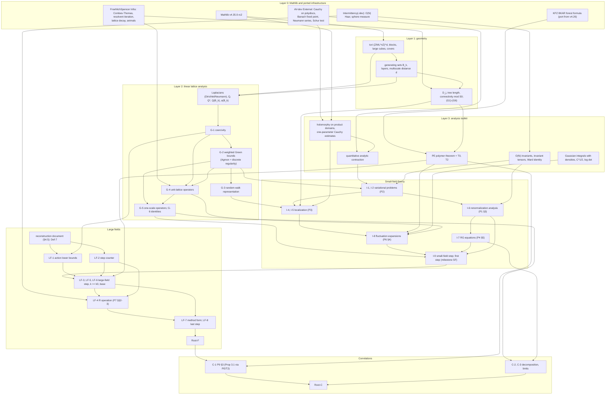

# Formalizing Balaban's low-temperature O(N) theory in Lean 4: roadmap (v2)

Version 2, 2026-10-11. Replaces v1 (commit 2f3ba12). Companion to
`BIG_PICTURE.md` (read §§1–4 there first; "BIG §n" points to it) and to
`LIBRARY.md` (the annotated index of all sources). Keys P0–P9 (the O(N) bundle),
E1–E11 (Balaban's earlier papers, Cammarota, Brydges) and D1–D3 (Dimock) as in
`SOURCES.md`; page numbers are journal pages (arXiv pages for D1–D3). Inputs for
this version: Roland's answers (`ROLAND_ANSWERS.md`), the fourteen reviews of the
external library (`papers/E*.md`, `papers/D*.md`), `QC_LOG.md` Phase 3, and new
checks against the PDFs made for this version by six readers working for the
synthesis (large fields; Dimock; cluster expansions; earlier Balaban papers;
Green's functions; infrastructure), with the decisive passages re-checked
(marked [checked]).

Methodology as in v1 (Scott's skills `lean-project-architecture`,
`lean-orchestrator`, `build-proof-dependency-graph`, `lean-learnings`): a small
author-approved frozen surface of exact Lean declarations (roots and major
interfaces), keystone theorems frozen early with a registered draft body,
definitions given by their mathematics, source-defined unique objects admitted
only after a proved `∃!` theorem, a source dependency graph built after the
anchors exist, and every `.lean` file a module.

Contents

0. Changes from v1
1. What Roland wants, and the committed headline
2. Scope
3. Candidate frozen surface (3.4: the Green's function interface)
4. The large-field calculus: which source to follow
5. Cluster expansions: one abstract theorem
6. Component dependency graph
7. Infrastructure
8. Phasing and milestones
9. Size estimate and risk register
10. Sources: what is still missing, and what no source proves
11. Questions for Roland
12. Corrections and unconfirmed points

---

## 0. Changes from v1

1. **Large fields are committed.** Roland: "Large field is essential. That is the
   crux of the matter." v1's recommendation (commit to the small-field flow, gate
   large fields) is withdrawn. The committed headlines are the full RG flow with
   large fields in observable form (Root-F) and the correlation theorem P9 Thm 1.1
   (Root-C); the method form P7 Thm 5 is a frozen interface; the small-field flow
   is an internal milestone (§1). Naming: v1's Root-C (the small-field flow) and
   Root-B are retired; "Root-C" now denotes the correlation root, v1's Root-A.
2. **Model fixed:** hard spins $\lambda=\infty$, general $d\ge3$, $N\ge2$, tori with
   bounds uniform in the volume, infinite volume only in Root-C (§2.1). For hard
   spins the $\lambda\ge\lambda_0$ hypothesis of P9 is satisfied.
3. **Green's function interface rewritten** as exactly the bounds the series
   consumes (fourteen consumption sites, six interface statements G-1…G-6), to be
   proved by standard methods (Agmon/Combes–Thomas, block Neumann series,
   discrete elliptic regularity, Schur complements), as Roland encourages. E3
   and E5 together do not cover the operator the series uses (§3.4). No separate
   $\sqrt\nu$-rate estimate is needed.
4. **New section on the large-field calculus** (§4): component by component,
   what P5–P7, E8–E10 and D2–D3 supply. Main findings: P6 Prop 3.2 (step
   counter) is cited to E10, which proves a different, geometric statement; the
   proof of P6 Thm 4 contains an inequality that fails as printed (repair
   proposed); Dimock has no $R$ operation and explains why it is not needed for
   $\phi^4_3$, which also shows why it is needed for O(N); no source gives a
   global order of constants, but the local conditions are consistent with
   "$\kappa$ before $M$, $\beta$ last".
5. **New section on cluster expansions** (§5): one abstract Kotecký–Preiss-type
   theorem with holes (connectivity modulo a set) and transfer of tree-length
   decay, with companion lemmas; its marked corollary proves P9 Prop 3.1, which
   P9 leaves unproved. Relation to the KPZ BKAR formalization made precise.
6. **Phasing changed**: no stop/go gate; the large-field reconstruction is
   written on paper in phase 1, in parallel with the Lean early wins (§8).
7. **Infrastructure survey re-verified** (all v1 paths checked); additions:
   AV-dev's polydisc Cauchy estimates and fixed-point/Neumann/Schur tools,
   Intermittency-dev's $O(d)$ Haar measure, a continuum Agmon template;
   corrections to three paths, one toolchain, two sizes, and Mathlib's
   orthogonal-group instances (§7).
8. **Sources**: all v1 "essential" missing papers obtained; citations settled
   (P4 "[3]"/"[2c]", P2/P3 "[2(b)]" offsets, P1 "[2d]"); a list of the gaps no
   source in the library closes (§10.2); questions for Roland updated (§11).

---

## 1. What Roland wants, and the committed headline

### 1.1 Roland's answers

Roland answered the six questions of v1 §9 on 2026-10-11 (`ROLAND_ANSWERS.md`):

| v1 question | Answer |
|---|---|
| 1. Method or Goldstone theorem? Is the small-field flow an acceptable first deliverable; is the $R$ operation essential? | "Large field is essential. That is the crux of the matter." |
| 2. Hard spins $\lambda=\infty$, general $d\ge3$, $N\ge2$? | Yes. |
| 3. Finite volume on tori, uniform in the volume; infinite volume only in the final correlation theorem? | Yes. |
| 4. External propagator theory: formalize in full, or allow other proofs? | "Different proofs are fine, in fact encouraged. These are Green's function estimates, which he probably proved in a strange way." |
| 5. Errata, copies of the gauge papers | Open (Roland will look into it). The copies have since been obtained (E1–E11). |
| 6. Constants in P9 Thm 1.1; why $\lambda\ge\lambda_0$ | Open. |

### 1.2 Interpretation

- **The target is Balaban's method including large fields.** v1 proposed to
  commit only to the small-field flow (tier C) and to decide on large fields at a
  gate. Answer 1 removes that option: the large-field calculus — regions,
  characteristic functions, the functions $\kappa_k$ and the step counter $K$,
  the integral operators $\mathbb T_k$, and the large-field renormalization
  operation $R^{(k)}$ of P7 — is the part Roland regards as the substance. It is
  also the part that a YM$_4$ programme would reuse most directly (E8–E10 are its
  gauge-theory originals; §4).
- **The large-field calculus is the least documented part of the series.** The
  library now shows exactly how much: P5–P7 cite the step counter from E10, which
  proves a different, geometric statement (QC_LOG Phase 3; §4.3 below); Dimock's
  exposition (D2) has a complete large-field induction for $\phi^4_3$ but no
  $R$ operation ("not necessary for this model", D2 p. 31, verified by the
  orchestrator); no source gives a global order of constants. A committed
  large-field campaign therefore commits to a written reconstruction of this
  calculus before Lean work on it starts (phase 1, §8).
- **Answer 4 changes the Green's function layer.** v1 treated CMP 96 / CMP 89
  (E5 / E3) as essential external theorems to be specialized. The library shows
  that E3 and E5 together do not cover the operator P2/P3 use (Dirichlet
  conditions, mass $\nu$, complex potential $\alpha$, general $a$ on a multiscale
  generating set; QC_LOG Phase 3). With Roland's permission the interface is now
  stated as exactly the bounds the series consumes, to be proved by standard
  methods of our choosing (§3.4).
- **Answers 2 and 3 fix the model** (§2.1).

### 1.3 The committed headlines

The campaign commits to two roots, both frozen in phase 0:

1. **Root-F (the full RG flow, observable form).** For the hard-spin model on the
   tori $\mathbb T_n$, with $\beta\ge\beta_0$ and every $\nu\in(0,1]$, the
   generating functional $\log\big(Z_n(g)/Z_n(0)\big)$ has Balaban's multiscale
   representation (P7 (4.15)–(4.17), refined in P9 (4.4)–(4.7)): a sum over scales
   $j$ of terms localized in connected unions of scale-$j$ cubes, analytic in $g$,
   with tree-length decay, bounds uniform in $n$ and $\nu$. Precise statement in
   §3.2.
2. **Root-C (correlation functions, P9 Thm 1.1).** For the hard-spin model, the
   infinite-volume one- and two-point functions obtained as limits along
   $\mathbb T_n$ satisfy $|m-1|\le c\beta^{-1+\rho_1}$, $\sqrt\nu$-clustering
   uniform in $\beta$, and the Goldstone asymptotics of the transverse two-point
   function as $\nu\downarrow0$. Precise statement in §3.2.

The **method form** of the flow (P7 Thm 5: every density of the flow lies in
P5's large-field class) is a frozen major interface (LF-7, §3.3), not a root.

Justification.

- *Root-F certifies the large-field method and needs no internal definitions.*
  The representation concerns $Z_n(g)$, the integral over **all**
  configurations; it cannot be obtained from a small-field analysis, and with
  bounds uniform in $\nu\in(0,1]$ it cannot be obtained from a single cluster
  expansion either (P9 p. 494: a single expansion works only for
  $\beta\ge\beta(\nu)$ with $\beta(\nu)\to\infty$). Its statement uses only the
  model, the lattice geometry (scale-$j$ cubes, connected unions, tree length)
  and analyticity — objects an auditor can check against P1 (2.26)–(2.27) and P4
  (H.7) without reading P5–P7.
- *The method form is too definition-heavy to be a root.* P7 Thm 5 asserts
  membership in P5's spaces $\mathbb R_k$ (P5 (1.42)), whose meaning depends on
  the multi-indices $\mathbb A_k$, the operators $\mathbb T_k$, the functions
  $\kappa_k$, $C$, $K$ and admissibility — all defined inductively across P5,
  P6 and E10 and never in one place (BIG §7 item 20). Those definitions will be
  reconstructed (§4); freezing them as the *meaning* of a root would make the
  root's correctness depend on the reconstruction. As an interface (frozen when
  the reconstruction is approved) it still fixes the proof architecture.
- *Root-C is the statement that is new relative to Fröhlich–Simon–Spencer* (BIG
  §6) and is cheap given Root-F: P9 adds 28 pages, one sketched proposition (P9
  Prop 3.1), the exact Gaussian decomposition of $(-\Delta)^{-1}$ (P9 (4.17)),
  and the thermodynamic and $\nu\downarrow0$ limits. For hard spins the
  hypothesis $\lambda\ge\lambda_0$ of P9 Thm 1.1 is satisfied ($\lambda=\infty$),
  so question 6 affects only the quantifier order of the constants (§11).
- *Order of delivery.* Root-F is the main deliverable (milestone M6); Root-C is
  the final one (M7). Both are committed; there is no stop/go gate on large
  fields. There is a review point after M3 (small-field flow) to re-estimate
  size, not to decide scope.

### 1.4 What the small-field flow becomes

The small-field flow (P1 Thm 2.2 via P4 Thms 1–2; v1's Root-C/tier C) is an
**internal milestone**, not a deliverable:

- it is not a statement about the model (the truncated densities discard the
  large-field configurations), so it is not a root;
- P4 Thms 1–2 and the small-field part of P6 §4 remain frozen interfaces
  (I-9, I-8), because P5 Thm 1 reuses them on the small-field region $Z_k^c$
  (P5 H2–H3; P6 §2);
- reaching it (milestone M3) is the natural point to compare actual Lean size
  with the estimate of §9.

---

## 2. Scope

### 2.1 Fixed model choices (Roland, answers 2–3)

- **Hard spins.** $\lambda=\infty$: configurations $\phi:\mathbb T_n\to S^{N-1}$,
  a priori measure $\prod_x\sigma_{N}(d\phi_x)$ (normalized surface measure),
  weight $\exp[\beta\sum_{\langle xy\rangle}\phi_x\cdot\phi_y+\beta\nu\sum_xh\cdot\phi_x+\langle g,\phi\rangle]$,
  which equals P1 (1.6) up to normalization.
- **General $d\ge3$, $N\ge2$.** Nothing in P1–P9 simplifies at $d=N=3$ (BIG §1.4);
  $d=N=3$ instances of the roots are one-line corollaries for display.
- **Finite volume.** Tori $\mathbb T_n=(\mathbb Z/ML^n\mathbb Z)^d$; every flow
  statement holds for all $n$ with bounds uniform in $n$, and localized terms
  are torus-independent (they are defined on finite subsets of $\mathbb Z^d$
  and pushed to the torus). Infinite volume enters only in Root-C, as limits
  along $\mathbb T_n$, whose existence is part of the campaign (C-3).
- **Fields.** $\nu\in(0,1]$, $h\in S^{N-1}$; sources $g:\mathbb T_n\to\mathbb C^N$,
  $\|g\|_{\ell^1}<1$ (P9 (1.1)).

Consequences of $\lambda=\infty$ (with references):

- every $\lambda_k=\lambda L^{2k}$ is $\infty$; the coefficient $1/\lambda_k$ is 0
  throughout, and the RG equation for $\lambda$ (P4 (1.9)) is vacuous;
- the uniform bound on $\lambda G(\lambda)$ (P2 (3.40)–(3.41), P3 (2.31)–(2.34))
  is not needed;
- the auxiliary field $\alpha$ stays, and the constraint equation is singular
  exactly at $\lambda=\infty$, so the Leibniz-rule device of P2 (3.31)–(3.38)
  and P3 §2.3 remains;
- the first step is written in a chart of the sphere instead of P4's
  $\lambda_0$-uniform change of variables (P4 (2.42)–(2.50)); no source writes
  this version (§10.2);
- P9's longitudinal Gaussian part $C_{lg}$, bounded by $c\beta^{-1}\lambda^{-2}$
  (P9 p. 519), vanishes; $G_{lg}$ comes from the remainder terms only.

### 2.2 Tiers

| Tier | Content | Status | Headline |
|---|---|---|---|
| **F** | complete RG flow with large fields, last step, generating functional on tori | committed (main deliverable) | Root-F |
| **C** | correlation functions in infinite volume and the $\nu\downarrow0$ limit | committed (final) | Root-C |
| SF | small-field flow (P4 Thms 1–2 iterated) | internal milestone M3 | interface I-9 |
| W | self-contained components (Gaussian RG, propagators, polymer theorem, RG equations, step counter, variational problems) | early wins, phase 1 | interfaces G-*, PE, LF-2, I-7 |
| X | extensions: soft spins $\lambda<\infty$; expansion of the remainder to higher order (P0 p. 204, P9 p. 495); uniqueness of the Gibbs state for $\nu>0$; lower bound on $G_{lg}$; YM | not committed | — |

What each committed tier requires:

- **Tier F.** P1 (definitions, §3 renormalization analysis); P2 (variational
  problems); P3 (localization I); P4 (small-field step, RG equations, first step);
  P5 (large-field inductive description, Thms 1–4, fluctuation integral); P6 (§2
  renormalization on $Z^c$, §3 large-field operators and counter, §4 localization
  and cluster expansions); P7 ($R$ operation, Thm 5, last step); our own proofs of
  the Green's function bounds (§3.4); one abstract polymer theorem (§5); the
  reconstructions listed in §10.2 (step counter, admissibility, base case with large
  fields, action lower bounds, hard-spin first step, global constants).
  Source: about 420 pages including the used parts of E3, E5, E8–E10 and D1–D3.
- **Tier C.** Tier F plus P9: one- and two-point inductive descriptions (H.1)–(H.2),
  their propagation (P9 §3, including the sketched Prop 3.1 (3.13)), the
  Gaussian-RG decomposition of $(-\Delta+\nu)^{-1}$, the asymptotics of $\beta_j$
  (P9 (4.18)), and the thermodynamic and $\nu\downarrow0$ limits (not written in
  the bundle). Source: about 450 pages.

v1's warm-up list (its items "D1"–"D7", not to be confused with Dimock's papers
D1–D3) survives as the phase-1 targets W1–W6 (§8) with these changes: the
propagator warm-up is now the interface G-1…G-6, proved by our own methods; the
polymer warm-up is the theorem PE of §5; the step-counting lemma LF-2
(model-independent combinatorics, §4.3) is a new early target; P8's method is
dropped.

---

## 3. Candidate frozen surface

In mathematical form. The Lean declarations must be written, audited against
the sources (`lean-statement-audit`) and approved by Scott before freezing. Two
roots, about twenty theorem interfaces, and the meaning-carrying definitions.
The phase in which each item is frozen is given in brackets; the roots are
frozen in phase 0 with a registered draft body (`DRAFT_SORRY`).

### 3.1 Definitions to freeze

- **Def-1 Model [0].** Tori $\mathbb T_n=(\mathbb Z/ML^n\mathbb Z)^d$ with
  nearest-neighbour bonds; hard-spin configurations $\phi:\mathbb T_n\to S^{N-1}$;
  a priori measure $\prod_x\sigma_N(d\phi_x)$; partition function
  $Z_n(g)=\int\exp[\beta\sum_{\langle xy\rangle}\phi_x\cdot\phi_y+\beta\nu\sum_xh\cdot\phi_x+\langle g,\phi\rangle]\prod_x\sigma_N(d\phi_x)$
  for $g:\mathbb T_n\to\mathbb C^N$; finite-volume expectations
  $\langle\cdot\rangle_n$, one-point function and truncated two-point function.
- **Def-2 Geometry [0].** Scale-$j$ lattices $T^{(j)}$, $L$-blocks, large cubes
  of side $L^jM$ and their covers; localization domains $\mathcal D_j$
  (connected unions of scale-$j$ large cubes) and tree length $d_j(X)$ (P1
  (2.26)–(2.27)); torus-independence via domains in $\mathbb Z^d$.
- **Def-3 RG transformation [1].** Block average $Q$, the Gaussian kernel
  operator $T^{(k)}$ with parameters $(\beta_k,a)$, scaling $S$; normalization
  $\int T\rho=\int\rho$ (P1 (1.11)).
- **Def-4 Small-field sets [2].** $\Phi_j,\Xi_j,\Xi^c_j(\mathbb B_j(X);1,\varepsilon_j)$
  (P1 (2.15), (2.20); P3 §4), $\chi_k$ (P4 p. 679), $\chi^{(k)}$ (P4 (2.39)–(2.40));
  generating sets $\mathbb B_k$ (P2 (1.1)–(1.3)).
- **Def-5 Background fields [2].** $\phi_k(\psi)$, $\psi^{(j)}_k(\psi)$,
  $\phi(\mathbb B_k;\psi)$, $\psi(\mathbb B_j,\mathbb B'_k;\psi')$, each defined only
  after its `∃!` theorem (I-1, I-2) and landed with a characterization theorem.
- **Def-6 Small-field class $\mathbb R^{\rm sf}_k$ [3].** P4 (H.1)–(H.7) and (1.4),
  for $\lambda=\infty$, as a predicate on families of densities indexed by tori
  (numbering per the concordance BIG §2.4).
- **Def-7 Large-field class $\mathbb R_k$ [4].** P5 H1–H7 and (1.42), with the
  reconstructed definitions of the regions, multi-indices $\mathbb A_k$,
  operators $\mathbb T_k$, functions $\kappa_k$, $C$, $K$ and admissibility
  (§4). Frozen only after the phase-1 reconstruction document is approved.

Def-1 and Def-2 are all that the roots need.

### 3.2 Roots

Constants. Both roots are stated with the constants in front:
"there exist $L,M,\kappa,\gamma,\alpha_1,c_9$ and $\beta_0$, depending only on
$d,N$, such that for all $\beta\ge\beta_0$, …". Whether $c,c',\rho_0,\rho_1$ of
P9 may be chosen independently of $\beta$ is question 6 (§11); the draft puts
them before $\beta$, which is what P9 §§3–4 give (BIG §1.2).

**Root-F (full flow, observable form; P7 (4.15)–(4.17), P9 (4.4)–(4.7), P4 (H.7)).**
Fix $d\ge3$, $N\ge2$. There exist an integer $L\ge2$, $M=L^m$, $\kappa>0$, $\gamma\in(0,\frac12)$,
$\alpha_1,c_9>0$ and $\beta_0<\infty$, depending only on $d,N$, such that for
every $\beta\ge\beta_0$, $\nu\in(0,1]$, $h\in S^{N-1}$ there is an integer
$k_f=k_f(\beta,\nu)$ (the first $k$ with $\nu_k>\frac78L^{-2}$; $k_f\le c(1+\log\nu^{-1})$)
with the following property. For every $n>k_f$ and every $g$ with
$\|g\|_{\ell^1}<1$,
$$
\log\frac{Z_n(g)}{Z_n(0)}=\langle g,h\rangle+\sum_{j=1}^{k_f+1}\ \sum_{x\in\mathbb T_n}\ \sum_{X\in\mathcal D_j,\ X\ni x}\big\langle g(x),\mathcal M^{(j)}(x,X;g)\big\rangle+\sum_{Y\in\mathcal D_{k_f+1}}\mathcal P(Y;g),
$$
where

- each $\mathcal M^{(j)}(x,X;g)$ depends only on $g|_X$, is analytic in
  $\{\|g\|_{\ell^1}<1\}$, does not depend on $n$ when $X$ does not wrap around
  the torus, and satisfies $|\mathcal M^{(j)}(x,X;g)|\le c_9\,\xi_j^{\frac{d-2}2+\gamma-\alpha_1}e^{-\kappa d_j(X)}$
  with the scale factor $\xi_j$ of P4 (H.7);
- the $j=k_f+1$ terms include the reduced-symmetry pieces $\mathcal M^{(k_f+1)}_{n'}$,
  $0\le n'\le m$, of P7 (4.17), with their bounds;
- $\mathcal P(Y;g)$ depends only on $g|_Y$, is analytic, vanishes at $g=0$, and
  $|\mathcal P(Y;g)|\le\beta^{-2}e^{-\kappa d_{k_f+1}(Y)}$ (P9 (4.6));
- covariance: $\mathcal M^{(j)}(x,X;Rg)=R\,\mathcal M^{(j)}(x,X;g)$ for $R$ in the
  stabilizer of $h$, and the Euclidean covariance of P4 (H.7).

The exact normalization of $\xi_j$, of the $\beta$-prefactors of P9 (H.1)–(H.2)
and of the reduced-symmetry pieces is fixed when the Lean statement is
authored; the shape above is that of P4 (H.7) [checked, P4 p. 679] and P7
(4.17) [checked, P7 p. 533].

**Root-C (P9 Thm 1.1, hard spins).** There exist $\beta_0<\infty$ and
$c,c',\rho_0,\rho_1>0$, depending only on $d,N$, such that for all
$\beta\ge\beta_0$, $\nu\in(0,1]$, $h\in S^{N-1}$:

1. the limits $M(x)=\lim_n\langle\phi_x\rangle_n$ and
   $G(x,y)=\lim_n\langle\phi_x;\phi_y\rangle_n$ exist;
2. $M=m(\beta,\nu)h$ with $|m-1|\le c\beta^{-1+\rho_1}$, and
   $G(x,y)=G_{tr}(x-y)(I-h\otimes h)+G_{lg}(x-y)\,h\otimes h$ with
   $|G_{tr}(x)|,|G_{lg}(x)|\le c|x|^{2-d}e^{-c'\sqrt\nu|x|}$;
3. as $\nu\downarrow0$, $m(\beta,\nu)\to m(\beta)$ and $G_{tr},G_{lg}$ converge
   pointwise, and there is $\gamma_\infty(\beta)$ with $|\gamma_\infty-1|\le c\beta^{-1}$
   such that
   $G_{tr}(x)=\frac{m(\beta)^2}{\beta\gamma_\infty}(-\Delta)^{-1}(0,x)+R(x)$ and
   $|R(x)|,|G_{lg}(x)|\le c(1+|x|)^{-(d-2+\rho_0)}$.

$\gamma_\infty$ is stated existentially, which keeps the root free of RG-internal
definitions; $(-\Delta)^{-1}$ is the positive lattice Green's function on
$\mathbb Z^d$ (BIG §1.2 on the sign conventions of P9).

### 3.3 Major interfaces

About two dozen theorem interfaces, grouped by layer. Brackets give the phase in
which each is frozen. "Reconstruction" means that no source proves the statement
as needed (§10.2).

**Green's functions [1]** — stated in §3.4: G-1 (coercivity), G-2 (weighted
Green's function bounds on generating sets and cubes), G-4 (unit-lattice
operators), G-5 (translation-invariant one-scale operators). G-3 (random-walk
representation) and G-6 (exact identities) are editable targets derived from
them.

**Polymer expansions [1]** — PE, the abstract theorem of §5, with its marked
corollary for truncated expectations.

**Background fields [2]**

- **I-1 (P2 Prop 1.1 / Cor 1.1, Prop 3.1).** For generating sets $\mathbb B_k$ and
  data in $\tilde\Psi^c(\mathbb B_k;\delta,\varepsilon)$ with
  $0<\delta\le\varepsilon\le c_0$, $\delta\le c_1$, $\nu\varepsilon^2\le\delta^2$,
  the Euler–Lagrange system (with $\lambda=\infty$) has a unique solution
  $(\phi,\alpha)$ with $|\alpha|_2<c_0$, analytic in the data, with the bounds
  P2 (1.15)–(1.16); for real data it is the unique minimizer (`∃!` form). The
  perturbed system with independent data (Prop 3.1) is part of the interface,
  since P3–P7 reuse it.
- **I-2 (P2 Prop 4.1).** Existence and uniqueness of
  $\psi(\mathbb B_j,\mathbb B'_k;\psi')$, formula (4.21), and the composition
  identities (4.39).

**Localization [2]**

- **I-4 (P3 Props 2.1–2.3, 3.1).** Analytic decoupling extensions of
  $\delta\phi_k,\delta\alpha_k$, $\psi(\mathbb B_j,\mathbb B'_k)$ and $C^{(k)1/2}$
  in $|s_\square|\le e^{\kappa_1}$, with their localization property and bounds.
- **I-5 (P3 Prop 4.3).** The localization expansion of
  $\mathcal E(X;\psi^{(j)}_k(\psi^{(k)}(\theta)+\psi'))$ with bound
  $Ee^{-\kappa_0d_j(X)-2\kappa\tilde d_{k+1}(Y)}$, including the "simple
  variations" of P3 p. 81 used in P6 Lemma 4.1.

**Small-field theory [3]**

- **I-6 (P1 Prop 3.10 / Cor 3.11).** Renormalization analysis: from the
  analyticity, symmetry, localization and renormalization hypotheses,
  $|\mathcal E_k|\le CE_0|T^{(k)}_1|$ on $\Xi^c_k(1,\varepsilon_k)$ (genuine
  premises; a source lemma of that form).
- **I-7 (P4 Prop 5.1, (5.31)–(5.33)).** The RG equations have a unique small
  solution; (H.6) holds with limits $\gamma_\infty,\delta_\infty$. For $\lambda=\infty$
  the $\lambda$-equation is vacuous; the choice $c=0$, $d=b$ used by P5–P7 must be
  written out (BIG §7 item 13).
- **I-8 (P6 §4 = P4 Props 2.1, 2.2, 4.1, 4.2 and P5 Props 3.1–3.4).**
  Localization and cluster expansions of the fluctuation integrals, with the
  stated analyticity and bounds; proved from I-5, PE and P6 (4.11).
- **I-9 (P4 Thms 1–2, internal milestone SF).** One small-field step
  $\mathbb R^{\rm sf}_k\to\mathbb R^{\rm sf}_{k+1}$ with the RG equations
  (1.9)–(1.10). It may not take I-8's conclusions as hypotheses.

**Large fields [4]** — all frozen after the reconstruction document (§4.5).

- **LF-1 (P6 Prop 3.1; reconstruction).** The lower bounds (3.5)–(3.6) on
  $\beta_{k+1}A^*_{k+1}$, for hard spins.
- **LF-2 (P6 Prop 3.2 and the $\ell=1$ bound of Thm 4; reconstruction).** The
  step-counting lemma of §4.3.
- **LF-3 (P5 Thm 1).** One full step with H6 weakened, for $k<k_0$.
- **LF-4 (P5 Thm 2 = P7 Thm 2).** The operation $R^{(k+1)}$, with normalization
  P5 (1.43) and the preservation of H1–H7.
- **LF-5 (P5/P6 Thm 4).** The regime $k\ge k_0$ with (1.31), $\ell=1$, in the
  repaired form.
- **LF-6 (base case; reconstruction).** $\rho_1\in\mathbb R_1$ for the hard-spin
  $\rho_0$, including $\mathbb A_1,\mathbb T_1,\kappa_1,C(\mathbb A_1),\mathcal B^{(1)}$,
  the sphere-chart small-field part, and the case $k_0\le0$.
- **LF-7 (P7 Thm 5, method form).** Every density of the flow lies in
  $\mathbb R_k$ (Def-7) for $k\le k_0$, and satisfies H1–H5, H7 with (1.31),
  $\ell=1$, for $k_0<k\le k_f$. LF-3 and LF-5 may be merged into LF-7 when the
  statements are authored.
- **LF-8 (P7 §4, last step).** The representation (4.15)–(4.17) of
  $\int\rho_{k_f}$ with uniform bounds; with the normalization (4.16) this
  implies Root-F.

**Correlation functions [5]**

- **C-1 (P9 §3).** The one- and two-point inductive descriptions (H.1)–(H.2)
  survive one step, including P9 Prop 3.1 (3.13), proved from the marked
  corollary of PE (§5).
- **C-2 (P9 (4.17)–(4.18)).** The exact Gaussian decomposition of
  $(-\Delta)^{-1}$ (from G-5, G-6) and
  $\beta_j^{-1}=(\beta\gamma_\infty)^{-1}L^{-j(d-2)}+O(\beta^{-1})L^{-j(d-2+2\gamma)}$
  (from I-7).
- **C-3.** Existence of the thermodynamic limit along $\mathbb T_n$ and of the
  $\nu\downarrow0$ limit of the one- and two-point functions (P5 (1.45)–(1.46);
  not proved in the bundle; P4 p. 720 says it follows from torus-independence of
  the localized terms).

### 3.4 The Green's function interface

Roland's answer 4 allows our own proofs. The interface is therefore stated as
exactly the bounds the series consumes, read off the PDFs of P2, P3, P4, P6, P7,
P9 (pages checked by the Green's function reader: P2 pp. 611, 621–630; P3 pp.
36–40, 46–48, 55–56, 59–67; P4 pp. 686–694, 709–711, 719–720; P6 pp. 16–17,
29–30; P9 pp. 517–519; E5 pp. 230–234; D1 pp. 45–47).

**What the series consumes.**

| # | Where | Consumed | At $\lambda=\infty$ |
|---|---|---|---|
| C1 | P2 (3.22), (3.27)–(3.38), (3.46)–(3.47), pp. 622–627 (cited as "[2(b)] Sect. B, Prop. 2.1, (2.57)" = E5 Prop 2.2, (2.67)) | $G(\alpha)=(-\Delta^{D,\eta}_{\Omega_1}+Q^*aQ+\nu+\alpha)^{-1}$: $\lvert Gf\rvert_0,\lvert\partial Gf\rvert_1,\lvert\Delta^DGf\rvert_2\le B_0\lvert f\rvert_2$, $\lvert\partial Gf\rvert_{(\alpha),2-\alpha}\le C_\alpha B_0\lvert f\rvert_2$; Neumann series in complex $\alpha$, $\lvert\alpha\rvert_2<\gamma_1$ | unchanged (the singular $\alpha$-equation still uses it) |
| C2 | P2 (3.48), p. 628 | positivity for real small $\alpha$ | unchanged |
| C3 | P2 (3.40)–(3.41); P3 (2.31)–(2.34) | $\lvert\lambda G(\lambda)f\rvert\le O(1)\lvert f\rvert$ | **disappears** |
| C4 | P3 (2.5), p. 37 (cited "[2b] (2.33)" = E5 (2.43)) | local cube bound, mixed Neumann/Dirichlet, complex $\alpha$: $\ell_j\lvert\chi\partial G\chi f\rvert+\lvert\chi G\chi f\rvert\le B_0e^{-\gamma_0d(y,y')}\ell_{j'}^2\lvert\chi f\rvert$, uniform in $M$ | unchanged |
| C5 | P3 (2.6)–(2.11), (2.16)–(2.23), (2.52)–(2.56) | walk expansion converging in four norms, including local Hölder | unchanged |
| C6 | P3 (3.8)–(3.20), pp. 62–66 | $G_{k,x}$: Combes–Thomas form bound (3.10), $L^2$ block bound (3.11) with $B_0=15L^2/a_{k+1}$, $\gamma_0=L^{-2}/5d$, uniform in $x\ge0$ | $\lambda_kG_{k,x}(\lambda_k)\to I$ |
| C7 | P4 (2.23)–(2.25), pp. 686–687 | exponentially decaying unit-lattice kernels of $Q_kG_k(\alpha)Q_k^*$ and of the $[\lambda^{-1}+\phi\cdot G\phi]^{-1}$ term; effective form $\ge\frac12\gamma_0\langle\psi,(-\Delta+\nu_k)\psi\rangle$ ("[2c]" = E3 (1.22)); decay of $C^{(k)}$ (E3 §5) | $[\phi\cdot G\phi]^{-1}$ needs gradient bounds |
| C8 | P4 (2.48)–(2.50), p. 693 | $G_1^{-1}(\alpha_1)\ge\gamma_0$; (2.49) $\ge\gamma_0$; E3 §5, (5.17) | (2.49) $=P^\perp G_1^{-1}P^\perp+P$ |
| C9 | P4 (6.5), pp. 719–720 | $\Delta^{(k_1)}\ge\frac78\gamma_0L^{-2}$ | same |
| C10 | P4 (5.12)–(5.13), pp. 710–711 | Woodbury formula; Fourier symbols on $\mathbb Z^d$ and their Taylor data | $\lambda$-factors become 1 |
| C11 | P6 Prop 3.1 (3.5)–(3.6) | multiscale action lower bounds | same (LF-1) |
| C12 | P6 p. 29; P3 Prop 3.1 | $C^{(k)1/2}$ bounds uniform in $\Omega_{k+1}$ | same |
| C13 | P7 (2.37)–(2.38) | $\Delta^{(k)}\ge\gamma_0/72$ on a Dirichlet box of diameter $<15$ | same |
| C14 | P9 (4.12)–(4.17), pp. 517–519 | decay of $G_jQ_j^*$ and $C^{(j)}_{tr}$, uniform in $\nu_j\in(0,1]$, continuity as $\nu_j\to0$; (4.17) | longitudinal parts trivial |

Notation: $\ell(x)=L^j\eta$ on $\Omega_j\setminus\Omega_{j+1}$; $\Delta(y)$ the
$j$-block of $y\in\Lambda_j$ and $\tilde\Delta(y)$ the union of blocks touching
it; $d$ the multiscale distance of P3 (2.4); $H_D(\alpha)=-\Delta^\eta_{D}+(Q^*aQ)_D+\nu+\alpha$.
Domains $\mathcal D$: $\Omega_1$ with Dirichlet conditions (including
$\Omega_1=T_\eta$, the P4 case); cubes $\square\cap\Omega_1$ of side $3M\ell_j$
with Neumann conditions on $\partial\square\cap\Omega_1$ (P3 (2.3)); the
$\mathbb B_{k+1}$ variant (P3 p. 59); the $x$-variant $G_{k,x}$ (P3 (3.8)).
Parameters: $a\in(\frac12,\frac32)$ with layer coefficients $a_j$ of the free
flow, $\nu\in[0,1]$, complex $\alpha$ with $|\alpha|_2<\gamma_1$, separation
$(L^j\eta)^{-1}{\rm dist}(\Omega_j^c,\Omega_{j+1})>RM$ (P2 (1.1)) with
$RM\ge R_0(d,L)$. "Uniform" means: constants depend on $d,L$ only (and on the
Hölder exponent), not on $k,\eta$, the volume, $M$, the generating set or $x$.

**G-1 (coercivity).**
(a) ${\rm Re}\langle u,H_D(\alpha)u\rangle\ge c_1(\|\partial^\eta u\|^2+\|\ell^{-1}u\|^2)$
for $D\in\mathcal D$ and $|\alpha|_2\le c_1/2$; the same for $G_{k,x}$,
uniformly in $x\ge0$.
(b) On the unit lattice, $\Delta^{(k)}:=a_k-a_k^2Q_kG_k(0)Q_k^*\ge\gamma_0(-\Delta^1+\nu_k)$;
hence $aL^{-2}Q^*Q+\Delta^{(k)}(\phi,\alpha)\ge\gamma_0L^{-2}$ for $|\alpha|\le c$,
$-\Delta^1+aL^{-2}Q^*Q+\nu_0+\alpha_1\ge\gamma_0$, with matching upper bounds and
the Dirichlet-box version of C13.
*Proposed proof:* Neumann bracketing (Dirichlet $\ge$ Neumann $\ge$ direct sum
over $j$-blocks) and the block gap $-\Delta^N_{\rm block}\ge4\ell_j^{-2}(I-P_{\rm block})$
with $Q_j^*Q_j=P_{\rm block}$, giving $\min(4,a_j)\ell_j^{-2}$ (the inequality
printed above P3 (3.10)); for (b), the Schur-complement form
$\langle\psi,\Delta^{(k)}\psi\rangle=\min_\phi[a_k\|\psi-Q_k\phi\|^2+\|\partial\phi\|^2+\nu\|\phi\|^2]$
and a Poincaré inequality on two adjacent blocks. This replaces E3 §4. Risk: low.

**G-2 (weighted Green's function bounds; the core).** For $D\in\mathcal D$,
$|\alpha|_2<\gamma_1$, $y\in\Lambda_j$, $y'\in\Lambda_{j'}$ and $f$ supported in
$\Delta(y')$:
$$
\|\chi_{\Delta(y)}Gf\|_\infty+\ell_j\|\chi_{\Delta(y)}\partial^\eta Gf\|_\infty
+\frac{\ell_j^{2-\alpha}}{C_\alpha}\sup_{x\in\Delta(y),\,x'\in\tilde\Delta(y)}\frac{|\partial^\eta Gf(x)-\partial^\eta Gf(x')|}{|x-x'|^{1-\alpha}}
+\ell_j^2\|\chi_{\Delta(y)}\Delta^\eta_DGf\|_\infty\le B_0e^{-\gamma_0d(y,y')}\ell_{j'}^2\|f\|_\infty ,
$$
together with the $L^2$ block version (P3 (3.11)), the global corollary
$|Gf|_0+|\partial Gf|_1+C_\alpha^{-1}|\partial Gf|_{(\alpha),2-\alpha}+|\Delta^DGf|_2\le B_0|f|_2$
(C1; by summation with E5 (2.60)–(2.61)), locality of $G_D(\alpha)$ in
$\alpha|_D$, and analyticity in $\alpha$.
*Proposed proof:*
1. $L^2$ decay by a quadratic-form Agmon/Combes–Thomas argument: conjugate by
   $e^{\varepsilon\tilde d(\cdot,y')}$ with $\tilde d$ a path version of $d$ (a bond
   of layer $j$ costs $L^{-j}$); the errors $O(\varepsilon\ell^{-1})$ in the gradient
   and $O(\varepsilon)a_j\ell_j^{-2}$ in $Q^*aQ$ are dominated by G-1(a). No
   Hermitian assumption is needed, so complex $\alpha$ is allowed. This is D1
   Lemma 30 (proved in full, with the remark that it holds for Dirichlet and mixed
   conditions) made multiscale, and it is the route Balaban himself calls
   "probably the simplest" (E4 p. 36).
2. The scale mismatch $\ell_j/\ell_{j'}\le L^{|j-j'|}$ is absorbed by the
   separation condition, as in E5 (2.59).
3. Pointwise, gradient and Hölder bounds by local discrete elliptic regularity
   at scale $\ell_j$: discrete maximum principle with the barrier $|x|^2$,
   Caccioppoli on difference quotients plus a discrete Sobolev embedding for the
   harmonic part, and a discrete Campanato iteration for the Hölder bound. The
   block term is bounded by block averages, so no maximum principle is needed for
   it. Near $\partial\Omega_1$ only layer 1 is present (separation), at scale
   $L\eta$, where the bounds are trivial with powers of $L$; Neumann faces of
   cubes are never approached.
*Risks:* step 3 is the largest single formalization item of the Green's function
layer (discrete regularity uniform as the lattice spacing tends to 0). The
constant $C_\alpha=O(\alpha^{-d-1})$ of P2 p. 611 would not be reproduced; the
reviews indicate that only a fixed exponent is used (P3 pp. 76–77, P1 (3.107)),
to be confirmed in phase 1. The alternative — E3's multiscale decomposition
(2.34) with Fourier analysis — is not recommended: E3 asserts the $j$-uniform
analytic strip without proof (E3 p. 586).

**G-3 (random-walk representation; derived).** With the partition of unity
P3 (2.2) and commutators $K_z$ (2.6): $H_{\Omega_1}G_0=I-R$, the expansion (2.8),
absolute convergence in the four norms and in the $s$-weighted form (2.16), the
$L^2$ analogue for $G_{k,x}$, and locality of each walk term. *Proposed proof:*
algebra (discrete Leibniz rule) plus G-2, run as a Neumann series in the Banach
algebra of kernels with norm $\sup_x\sum_ye^{\gamma d(x,y)}|k(x,y)|$ (D1 Lemma 6,
Cor 7). Risk: bookkeeping (P3 never states the index restrictions of its
12-type walk (3.17)).

**G-4 (unit-lattice operators; E3 §5 as an interface).** On
$X\subset T^{(k)}_1$ or $\mathbb Z^d$, for $\mathbb C^N$-valued fields, if
${\rm Re}A\ge\gamma_0$ and $|A(x,x')|\le c_0e^{-\delta_0|x-x'|}$, then for
$\Lambda\subset X$ and $x\ge0$:
$|(A_\Lambda+x)^{-1}(x_1,x_2)|\le c_1(\gamma_0+x)^{-1}e^{-\delta_1|x_1-x_2|}$, the
domain-difference bound E3 (5.8), the perturbation bound (5.10), and the
localization expansion (5.17) (used in P4 (2.50)). The hypotheses are supplied
by G-1(b) and G-2 at unit scale; at $\lambda=\infty$ the term
$[\phi\cdot G\phi]^{-1}=[\phi^2-K(\phi)\cdot G\phi]^{-1}G^{-1}(\alpha)$ (P3 p. 64)
needs the gradient bounds of G-2. *Proposed proof:* operator-norm Combes–Thomas
at unit scale (the gap $\gamma_0L^{-2}$ is comparable to the row sums) and the
geometric resolvent identity. Risk: low.

**G-5 (translation-invariant one-scale operators; P9, P4 §5).** On
$L^{-j}\mathbb Z^d$ or tori: $|a_jG_jQ_j^*(x,y)|\le ce^{-\delta|x-y|}$,
$|C^{(j)}_{tr}(y,y')|\le ce^{-\delta|y-y'|}$, uniformly in $j$ and in
$\nu_j\in[0,1]$, Lipschitz in $\nu_j$, with infinite-volume limits; the
decomposition (4.17); P4's symbols and their Taylor data. No separate
$\sqrt\nu$-rate estimate is needed: for $j<k(\nu)$, $\nu_j\le\frac78L^{-2}$, so
$\sqrt\nu\le L^{-j}$ and unit-scale decay already gives rate
$\ge\frac\delta2(\sqrt\nu+L^{-j})$ in original units (Green's function reader;
this corrects BIG §2.9 and the E5 review's item N7, which treat it as a separate
estimate). *Proposed proof:* G-2 at one scale plus G-4; analyticity of the
symbols in a strip follows from the decay. Risk: reading P4's $c_i(\nu)$; the
infinite-volume setting.

**G-6 (exact identities; derived).** Schur complement
$\Delta^{(k)}=a_k-a_k^2QGQ^*$ with minimizer $a_kG_kQ_k^*\psi$; the free flow and
the composition formula (E3 (3.8)); the resolvent formula P3 (3.8)–(3.9); the
Woodbury formula P4 (5.12) (attributed to "[3]" on P4 p. 710; elementary, E4
(1.76), (1.134)); P9 (4.12)–(4.13) with $H_{j,11}=0$ at $\lambda=\infty$; the
commutator and Leibniz identities P2 (3.31)–(3.33), P3 (2.6), (2.27).
Finite-dimensional block-matrix algebra.

### 3.5 Statement-integrity notes

- **Constants.** Quantifier order follows §4.4; silent dependence of a constant
  on $n$, $k$, $\nu$ or $\eta$ invalidates a root or an interface.
- **Families over tori.** $\mathbb R^{\rm sf}_k$ and $\mathbb R_k$ are existential over
  data and quantify over admissible tori; localized terms are defined on finite
  subsets of $\mathbb Z^d$ and transported, not constrained by a separate
  torus-independence hypothesis.
- **No smuggled premises.** I-6 has genuine premises (a source lemma of that
  form); I-9, LF-3, LF-4 and LF-7 may not take conclusions of I-8, PE or LF-2 as
  hypotheses.
- **Reconstructed interfaces** (LF-1, LF-2, LF-6, C-3, and the parts of LF-4
  marked in §4.2) are statements with no source theorem. Each needs an explicit
  author ruling recording that it is a reconstruction and which source passage
  it replaces.
- **Splits need rulings** (P4 Thms 1/2; P5 Thms 1–4 against P7 Thm 5) on shared
  constants.

---

## 4. The large-field calculus: which source to follow

Large fields are now committed, and the library contains three treatments of
them: Balaban's O(N) papers P5–P7, his gauge-theory originals E8–E10, and
Dimock's $\phi^4_3$ exposition D2–D3. This section records, component by
component, what each supplies and what the formalization follows. It draws on
the reviews of P5–P7, E8–E10, D2–D3 and on checks of the PDFs made for this
version (pages marked [checked]).

### 4.1 What each source is

- **P5–P7 (O(N)).** P5 states the large-field hypotheses H1–H7 and Thms 1–4;
  P6 §§2–3 defines the large-field operators and the functions $\kappa_k$, $C$,
  $K$ and proves Thms 1 and 4; P7 constructs $R^{(k)}$, proves Thm 2 and Thm 5,
  and does the last step. Definitions are spread over the three papers and the
  admissible multi-indices are defined only "by construction" (P5 p. 493 defers
  the "remaining parts of [the] definition" to "the third sections of the next
  two papers").
- **E8 (CMP 119).** The YM$_4$ inductive description keeping all large-field
  regions: a complete first step with large fields (§1, (1.1)–(1.30)), and the
  representation of $\rho_k$ as a sum over domain sequences with large-field
  operators factorized over components and levels ((2.18)–(2.22)) [checked].
  E8 p. 254 says that beyond $T_1$ these operators "are left undefined, only
  their basic general properties are formulated" [checked]; there is no
  $\kappa$, $C$, $K$ or $R$ in E8.
- **E9 (CMP 122:175).** The first half of the gauge $R$ operation: the class of
  components to be treated (conditions (i), (ii), p. 177), the undoing of $N$
  preparatory steps, the identities (1.29), (1.89) ("new restrictions imply the
  old ones", proved in full), and the normalized ratio $R'$ (1.100)–(1.102).
- **E10 (CMP 122:355).** The completion of $R$: cancellation of the main actions,
  re-localization around the new background, the operators $\mathbf T'_k$ (1.71)
  with positivity under complex perturbations (1.73)–(1.75), the step-counting
  induction (1.80)–(1.89) on pp. 383–387 [checked by the orchestrator, p. 384],
  and a polymer expansion with connectivity modulo the remaining large-field
  regions, with written activity bounds (1.90)–(1.97). Its bare references
  follow E6's bibliography: [10] = E4, [11] = E5, [26] = Cammarota = E1.
- **D2 (Dimock II).** A complete induction for the large-field representation of
  $\phi^4_3$ (Thm 3.1, p. 29): nested regions $\Lambda_0\supset\Omega_1\supset\Lambda_1\supset\dots$
  with buffers $r_j=(-\log\lambda_j)^r$ ((143)–(148), p. 20), three large-field
  families $P,Q,R$ per step, unintegrated large-field measures with explicit
  weights ((201)–(203), (218)–(220)), the assembled characteristic functions
  ((390)–(393), p. 55), an explicit base case (§3.4, p. 32), and a dictionary
  to P5–P7 (App. A, p. 84, "It is not exact"). D2 has no step counter, no
  admissibility condition and no $R$ operation: "in Balaban's models these $R_k$
  terms get additional contributions from a recycling operation … (the
  "R-operation"). This difficult step is not necessary for this model." (D2 p. 31)
  [checked]. D2 cites P1–P7 and P9 but not E8–E10.
- **D3 (Dimock III).** The last step with a massive propagator (§2) and a
  one-pass summation over all large-field histories (§3; Lemma 14 volume bound,
  Lemma 15 small factor, Thm 2 exponentiation).

**Why $R$ is needed for O(N) and not for $\phi^4_3$.** In D3 the cost of a
large-field cube created at scale $i$ is paid by its creation factor
$\exp(-c(-\log\lambda_i)^{2p_0})$ because the number of remaining steps is at
most $-\log\lambda_i$ (D3 (205), p. 30). In the O(N) flow this holds only for
$k\ge k_0$ (fewer than $\log\beta_{k_0}$ steps remain, P5 p. 500), which is
exactly the regime of P6 Thm 4 where no $R$ is used. For $k<k_0$ the number of
remaining steps is of order $\log\nu^{-1}$, not bounded by any power of
$\log\beta_k$, and a per-step loss of order $\log\beta_k$ per cube eventually
exhausts the creation factor (P7 pp. 494–495). That is what $K$ measures and
what $R$ repairs. So Dimock is a template for the bookkeeping and for the
$k\ge k_0$ regime, not for the core of P7.

### 4.2 Component by component

| Component | O(N) source | What the other sources add | Decision |
|---|---|---|---|
| Regions and nesting ($Z_k$, $\Omega_k$, $\Omega''_k$, $P,Q,R,S$, buffers $R_k=R_0(\log a\beta_k)^2$, shadows, critical size) | P5 (1.2)–(1.3), (1.20), (2.2)–(2.14), (2.43)–(2.46); P6 (2.1)–(2.7), (3.1), (3.13)–(3.16), p. 22; P7 (2.1)–(2.5) | D2 (143)–(175): all definitions in one place, polymers with holes and their counting (Lemma E.3); D3 (151) the recursive rule; E8 (2.1)–(2.5) | Follow P5–P7 for content; organize as in D2. Admissible data become an inductive type generated by the construction, invariants as fields. |
| Characteristic functions, decomposition of unity, "new conditions imply old" | P5 (1.19), (2.5)–(2.6), (2.13)–(2.14), (2.42)–(2.43); P6 (2.1)–(2.2); P5 Lemma 2.1 (no proof), proved as P7 Lemma 2.5 ("obviously the same" for one function) | E9 (1.29), (1.89): the inequality chains written in full (gauge); D2 Lemmas 3.11, 3.13, 3.14: the scalar versions | Definitions from P5–P7; reconstruct P7 Lemma 2.5 in full using E9's chains and D2 Lemma 3.13 as models. E9's constants do not transfer (E9 needs $p_1<p_0$ because $g$ runs logarithmically; P7 uses $p_1=p_0$, p. 513). |
| $\kappa_k$, $C(\mathbb A)$, step counter $K$, admissibility | P5 (1.26)–(1.32), pp. 495–496; P6 (3.9)–(3.19), Prop 3.2 (cited, not proved) | E10 (1.80)–(1.89): the only complete step-counting proof, for a geometric $K$ (§4.3); D2/D3: none | Reconstruction (LF-2, §4.3). |
| Large-field integral operators $\mathbb T_k$ | P5 H5 (1.21)–(1.26) (properties); P5 (2.47), P6 (3.2)–(3.3) (definition $\mathbb T_{k+1}=T^{(k)}\mathbb T_k e^{\mathcal B^{(k)}}$); P7 (2.6)–(2.9), (2.74)–(2.75), (3.7), (3.10) after $R$; P7 (4.9)–(4.10) at the end | E8 (2.19)–(2.22): factorization over components and levels, explicit one-step kernel; E10 (1.73)–(1.75): positivity and normalization under complex perturbations; E10 (1.103)–(1.104): a representation in which surviving components carry only multiplication by $\mathbf T'_k(Y)1$; D2 (201)–(203) | Define $\mathbb T_k$ as an inductively defined composition of explicit one-step kernels indexed by level and component (E8's architecture with P5–P7's content); prove factorization, support and positivity as lemmas. Evaluate E10 (1.104) as a simplification during phase 1. |
| The $R$ operation | P7 (1.4)–(1.8) [checked], §2 (2.18)–(2.33), Lemma 2.1 (Dirichlet problem on $Z_0$, diam $<15$), (2.53)–(2.58) (cancellation of main actions), Lemma 2.5, §3 (3.4)–(3.10), Lemma 3.1 (coset average, pp. 520–525) | E9 (0.3)–(0.6), (1.61)–(1.70), (1.100)–(1.102); E10 (1.2)–(1.37) (cancellation), (1.49)–(1.70) (localization), (1.71)–(1.79); none in D2–D3 | Follow P7. The normalization (1.7) is a model-free early lemma. Reconstruct: the coset average of Lemma 3.1 (Haar measure on $O(N)$, local analytic sections of $O(N)\to S^{N-1}$, Jacobians — described only in words), and the claim that every component surviving $R$ has $K>0$ (P7 p. 528, "by construction"). |
| Polymer exponentiation inside the step | P6 §4 (4.39)–(4.54) with connectedness modulo $\Omega_{k+1}$ (p. 44); P7 (3.26)–(3.29) (activity bound "almost completely standard", not given), (4.11)–(4.14) | E10 (1.90)–(1.97): connectivity modulo the remaining large-field components, with written activity bounds; D2 Thm F.1 (p. 91): the only stated theorem with holes, proof sketched | One abstract theorem PE (§5); write the activity bounds of P7 (3.27) following E10 (1.92)–(1.97). |
| Base case ($\rho_1$ with large fields) | P5 pp. 486–487 (narrative); P4 (2.42)–(2.50) (small-field part only). $\mathbb A_1$, $\mathbb T_1$, $\kappa_1$, $C(\mathbb A_1)$, $\mathcal B^{(1)}$ and H6 at $k=1$ are defined nowhere; P7 Thm 5 starts from $\rho_0$, which has no $\chi_0$, so $k=0$ is not an instance of P5 Thm 1 | E8 §1 (1.1)–(1.30): complete gauge first step with large fields; D2 §3.4 (227)–(231): complete scalar base case; E10 (1.82): base of the counting induction | Reconstruction (LF-6): structure from E8 §1, details from D2 §3.4 (drop the $\lvert\Phi_0\rvert$ condition for hard spins), $\kappa_1$ from the action lower bound at $j=0$ as in E10 (1.82); the small-field part in a chart of the sphere. Also treat $k_0\le0$. |
| Last step | P7 §4 (4.3)–(4.17), with P4 §6 (small-field analogue); details "postponed" to P9 (P7 p. 533) | D3 §2 and Lemmas 14–15: a complete scalar model of the final sum over large-field configurations; E8–E10: none | Follow P7 §4 and P4 §6; use D3 Lemmas 14–15 as the model for the final sum. Inherits the defect of §4.3(c). |
| Action lower bounds (P6 Prop 3.1) | P6 pp. 16–17: stated without proof, citing "Sect. 4 of [6a]" (= E3 §4), the proof of P1 Lemma 3.1, and P2 Prop 2.2 (whose proof is also omitted) | E3 §4: a two-block Gaussian lower bound (the technique for the quadratic part); P7 (2.37)–(2.38): a Dirichlet Poincaré inequality on $Z_0$; D3 Lemma 20 (App. C, proved): the scalar analogue; E10 p. 380 cites the missing CMP 102 (1985) 255 | Reconstruction (LF-1). (3.5) is elementary (Cauchy–Schwarz on $\psi_j-Q_j\phi$, path bounds for $\partial Q_j\phi$, canonical scaling of $\beta_j$); (3.6) needs P2 Prop 2.2 or a direct argument. A good early Lean target. |

### 4.3 The step counter

**What P6 states.** For a component $Z$ of the large-field region and an
admissible multi-index, $\kappa_{k,n}(Z,\mathbb A_k\cap Z)$ (P6 (3.19)) is the
accumulated exponent after $n$ further steps without new large fields, and
$K(Z,\mathbb A_k\cap Z)$ is the index with $\kappa_{k,n}-\ell p_2(\beta_{k+n})>0$
for $n\le K$ and $\le0$ for $n>K$, $\ell=2$ (P6 pp. 20–21). P6 Prop 3.2 asserts
properties (i)–(iii) of $K$ (decrease by at most one per step without new large
fields; $K=0$ only after more than $\log\beta_{k_1}a$ such steps, when the
region is a rectangular parallelepiped below the critical size $12M[R]$) and
refers to E10 pp. 383–387 for the proof, adding that "this part of the method
is completely model-independent, and the results of [6d] hold without changes"
(P6 p. 21).

**What E10 proves.** A different statement. E10's $K$ is geometric: "the
smallest positive integer" such that the shadow $S^K(Z)$ (one step without new
large fields: cover by $LMR_{j+1}$-cubes and add ten layers, p. 384) satisfies
E9's conditions (i), (ii). E10 (1.80) shows
$\kappa_j(Z)\ge\sum_{n=j+1}^{j+K}O(1)M^dR_n^{d+1}d'_n(S^{n-j}(Z))$, by induction
on $j$ with an inner induction over a spanning tree of merged domains
((1.81)–(1.88)); $d'_j$ is not defined in E10.

**Why "without changes" is not literal.** E10's merge step uses a reserve
$2p_0(g_{j(Z)})$ fixed when the region was created and the slow variation
$p_0(g_j)\ge(1+\beta_0)^{-1}p_0(g_{j+1})$ of a logarithmically running gauge
coupling. In the O(N) flow the threshold $p_2(\beta_{k+n})=A_2(\log\beta_{k+n})^{p_2}$
grows, since $\log\beta_{k+n}\approx\log\beta_k+n(d-2)\log L$.

**A defect in the proof of P6 Thm 4 [checked, P6 p. 22].** The proof ends with
$$2p_2(\beta_{k+K})-{\rm const}'(\log\beta_{k+K}a)^{2d+2}>p_2(\beta_{k+n})\qquad\text{if }n\le K+\log\beta_{k+K}a,\ p_2\ge2d+2,\ A_2\ \text{large}.$$
As printed this fails: at $n-K\approx\log\beta_{k+K}a$ the ratio
$p_2(\beta_{k+n})/p_2(\beta_{k+K})\approx(1+(d-2)\log L)^{p_2}$ is at least
$1.69^8\approx67$ for $d=3$, $L\ge2$, $p_2\ge8$, independently of $A_2$ (the
large-field reader's arithmetic, re-checked in this synthesis). The conclusion
P6 needs — that the $\ell=1$ bound (1.31) survives the fewer than
$\log\beta_{k_0}$ remaining steps after $k_0$ — can be recovered by freezing the
threshold at $p_2(\beta_{k_0})$ for $k\ge k_0$: P7 (4.13) only needs $e^{-p_2}$
below every power of $\beta_{k_f}^{-1}$, and $\log\beta_{k_f}\le\frac d2\log\beta_{k_0}+O(1)$.
This is a proposed repair, to be confirmed (question 8, §11). A related
mismatch: P6 Prop 3.2 (ii) gives $n_1>\log\beta_{k_1}a$, whereas P7 (2.31)
takes $n_1\log L>\alpha^{-1}\log\beta_{k_1}a$, which needs $\log L\ge1/\alpha$ or a
stronger (ii).

**Proposed lemma (LF-2, reconstruction).** Define $\kappa_k$, $C$, $\kappa_{k,n}$
and $K$ exactly as in P6 (3.9)–(3.19), with the O(N) thresholds. Prove, as the
inductive invariant, an O(N) version of E10 (1.80): for every component $Z$
generated by the construction, the margin $\kappa_{k,n}(Z)-\ell p_2(\beta_{k+n})$
dominates the cost of the future steps up to the geometric time at which the
shadow of $Z$ becomes a parallelepiped below critical size, with the growing
thresholds accounted for; use E10's spanning-tree merge argument. Derive P6
Prop 3.2 (i)–(iii) from it and restate the $\ell=1$ bound of Thm 4 with the
repaired threshold. The lemma is model-independent combinatorics plus real
inequalities, so it can be formalized early (phase 2) against an abstract
"history of regions" interface.

Other gaps in this component: $\kappa_1$ and $C(\mathbb A_1)$ are not defined
(base case); admissibility is circular as written ((1.30) is both an
admissibility condition and a consequence); iterating P6 (3.11) gives P5 (1.28)
only under $L^d\ge4$ and $C(\mathbb A_1\cap Z)=1$ (large-field reader's check).

### 4.4 Order of constants

No source in the library gives a global order. D3 Thm 1 (p. 3) has only "Let $L$
be sufficiently large, let $M$ be sufficiently large (depending on $L$), and let
$\lambda_k$ be sufficiently small (depending on $L,M$)" [checked], plus local
exponent conditions ($p_0<p$, $3r+2<2p_0$, $n_0\ge4$, $\kappa'-4\kappa_0-4\ge\kappa_0$;
D3 pp. 11, 30–33). The local conditions found in all sources point to one
consistent order:

- **$\kappa$ before $M$.** Dimock fixes $\kappa$ by the dimension
  ($\kappa\ge16\kappa_0+16$, D2 p. 78) and takes $M$ exponentially large in
  $L\kappa$ ($e^{\kappa_1}\le M^{1/2}$, D2 p. 19; $\kappa_1=\frac12\log M$, D1 p. 30).
  E6 Thm 3 (p. 264) has "$\kappa\ge\kappa_0$, $M\ge M(\kappa)$" [checked by the
  E6 reader]. P3 needs $M\ge2(7L)^d\kappa_1/\gamma_0$ with $\kappa_1\propto\kappa$
  (P3 (2.19), p. 43; P3 p. 41: "$M$ … sufficiently large, depending on
  $\kappa_1$"). P1 p. 118 and P4 (H.4) say $\kappa$ "can be chosen arbitrarily
  large, depending on $M$"; the consistent reading is that the admissible
  $\kappa$ is bounded by a function of $M$ (since $d_j$ is measured in units of
  $M$, the decay per lattice unit, $\kappa/M$, cannot exceed the propagator
  rate; compare E6 (5.10), $\delta_1=\frac12\min\{\delta_0,\kappa/M\}$). This
  removes the "delicate point" of BIG §4, provided P3's $\kappa_0$ (Prop 4.3)
  does not grow with $M$ — to be checked in phase 1.
- **Large-field constants after $B_0,H_0$.** The per-step loss in $\kappa^{(k)}$
  absorbs ${\rm const}\cdot B_0$ (P6 (2.33), p. 18); $H_0>2B_0K_0M^{-d}$ (P7 (1.2))
  and $H_0$ large against $\varepsilon^{-2}B_0K_0M^{-d}$ with
  $\varepsilon^{-2}=3^dK_0e^{3dL\kappa/2}$ (P7 (4.12)); "$A_2$ large, which means
  $A_0$ large" (P7 p. 520); $A_0$ depends on $M,L,K_1,R_0$ (P7 p. 505);
  $R_0\ge6K_1K_6$ (P7 p. 514); $p_2\ge2d+2$, $2p_0-4\ge2d+2$.
- **$\beta$ last** in every source (couplings small last in E6, E8–E10, D1–D3).

Proposed global order (to be written out and checked in the phase-1 constants
document; not stated in any source):

1. $d,N$; dimension constants $\kappa_0$, $K_0$.
2. $L$ (with $\log L\ge1/\alpha$ if P7 (2.31) is kept), $a\in(1,\frac32)$;
   $\gamma\in(0,\frac12)$, $\alpha=\frac{d-2}2-\gamma$, $\alpha_1$.
3. $\kappa$ (large, depending on $d$ and the losses in P3 Prop 4.3, P6 §4); then
   $\kappa_1$, $m_0$, $M_1$ and $M=L^{m_0}M_1$ (large depending on $\kappa_1$);
   $r_0$, $R_0$.
4. $c_8,c_9$; then $\alpha_0$, $E_0$, $B_0$ (outputs of the small-field step and
   of P7 p. 529 — check that the bound fixing $B_0$ does not depend on $H_0$,
   $A_0$, $p_0$).
5. $H_0$; exponents $p_0,p_1=p_0,p_2$; then $A_2$, $A_0$, $A_1$, $A_3$.
6. $\beta_0$ (equivalently $B$) large depending on everything above.
7. For Root-C: $\rho_2$, then $\rho_1,\rho_0$ (P9 p. 511); enlarge $\beta_0$.

### 4.5 The reconstruction document

Before Lean work on large fields, phase 1 produces a written document (in the
style of a paper section, reviewed independently) that contains, for the
hard-spin O(N) model: the closed definitions of regions, characteristic
functions, admissible histories (as an inductive construction), $\mathbb T_k$,
$\kappa_k$, $C$, $K$; the statements and proofs of LF-1 (action lower bounds),
LF-2 (step counter, with the Thm 4 repair), the "new conditions imply old"
lemma (P7 Lemma 2.5 in full), the base case LF-6, the coset average of P7
Lemma 3.1, and the global constant chain of §4.4. Def-7 (§3.1) is frozen only
after this document is approved. Its sources, in order of use: P5–P7, then E10
§§(1.71)–(1.104), E8 §§1–2, D2 §§3.1–3.4, E9 §1, D3 §3.

---

## 5. Cluster expansions: one abstract theorem

### 5.1 Where the series uses them

| Site | Polymers and connectivity | Conclusion used |
|---|---|---|
| P3 Prop 4.3, (4.41)–(4.52) | no gas: decoupling families $\mathscr C$ of cubes, ordinary connectivity, resummation to multiscale domains | localized expansion with decay $e^{-\kappa_0d_j(X)-2\kappa\tilde d_{k+1}(Y)}$ |
| P6 §4.4–4.5, (4.35)–(4.54) | Mayer expansion in $t_Y$; connected unions in $\mathcal D_{k+1}$; for the boundary measure, connectivity modulo $\Omega^c_{k+1}$ ($Y_1\cap Y_2\cap\Omega_{k+1}\ne\emptyset$, P6 p. 44) | exponentiation of the normalization (4.50), lower bound (4.51), localized marked ratios (4.52), (4.54), complex $\sigma$ (4.58)–(4.67) |
| P7 §3, (3.26)–(3.29) | Mayer expansion of $e^{\mathcal B''}$; gas over disjoint $X_i\in\mathcal D_k({\rm mod}\,\Omega_k^c)$; boundary terms of size $B_0$, **not small** | $\exp\mathcal P^{(k)}$ with localized terms (3.28); activity bound called "almost completely standard", not given |
| P7 §4, (4.11)–(4.14) | the same at scale $k+1$, modulo $\Omega^c_{k+1}$; arbitrarily large large-field regions | (4.14), with smallness $\varepsilon^{-2}e^{-p_2}$, $\varepsilon^{-2}=3^dK_0e^{3dL\kappa/2}$, and the volume term $H_k\lvert Z\rvert$ used for the first time |
| P9 (4.4)–(4.6), Prop 3.1 | as P7 §4; truncated expectation of two localized functions | $\lvert\mathcal P(Y;g)\rvert<\beta_k^{-2}e^{-2\kappa d_{k+1}(Y)}$ (P9 (4.6) prints $2\kappa$), $g$-derivatives; (3.13) "not proved in [5]" |
| E10 (1.90)–(1.101) (gauge precedent) | components joined modulo the remaining large-field regions | written activity bounds (1.92)–(1.97) |

The cited cluster theorems do not cover these uses: Brydges' criterion (E11
(3.10), Thm 3.4, pp. 141–142) and Cammarota's Thm 2 (E1 (1.18)–(1.21), p. 519)
give convergence and the logarithm with cardinality weights, not the transfer of
tree-length decay to the localized logarithm, and none of E1, E7, E11 has
connectivity modulo a set. D2 Thm F.1 (p. 91) states the version with holes but
its proof is a sketch; D1 Thm 27 (p. 39) is proved except for the Penrose tree
bound.

### 5.2 The theorem PE (to prove once)

*Data.* A finite set $\mathcal S$ of cubes and a hole $S_0\subset\mathcal S$
($S_0=\emptyset$ in the ordinary case); a finite set $\mathcal P$ of polymers
with supports in $\mathcal S$; test objects $\mathcal T=\mathcal S\setminus S_0$;
a symmetric incompatibility relation $\not\sim$ on $\mathcal P\cup\mathcal T$,
reflexive on $\mathcal P$, with $\square\not\sim X\iff\square\in{\rm supp}\,X$;
in the modular case $X\not\sim Y\iff{\rm supp}\,X\cap{\rm supp}\,Y\not\subset S_0$.
Activities $K:\mathcal P\times U\to\mathbb C$, holomorphic in one complex
parameter $w\in U$. Weights $a:\mathcal P\cup\mathcal T\to[0,\infty)$,
$b:\mathcal P\to[0,\infty)$.

*Definitions.* $\Xi(\Lambda,w)=\sum_{\Gamma\subset\Lambda\ \text{compatible}}\prod_{X\in\Gamma}K(X,w)$;
for a cluster $\mathbf X=(X_1,\dots,X_n)$,
$\varphi^T(\mathbf X)=\sum_{G'}(-1)^{|E(G')|}$ over connected spanning subgraphs of
the incompatibility graph (Brydges' $\psi'_c$, P6's $\rho^T$); $w(\mathbf X)=\varphi^T(\mathbf X)\prod K(X_i)/n!$.

*Hypothesis (Kotecký–Preiss with test objects).* For all
$A\in\mathcal P\cup\mathcal T$: $\sum_{Y\not\sim A}\sup_U|K(Y,\cdot)|\,e^{a(Y)+b(Y)}\le a(A)$.

*Conclusions.*
(a) $\Xi(\Lambda)=\exp L(\Lambda)$ with $L=\sum w(\mathbf X)$ absolutely summable
(stated with $\exp$, avoiding a branch of $\log$);
(b) $\sum_{\mathbf X:\,\exists i,\,X_i\not\sim A}|w(\mathbf X)|e^{\sum b(X_i)}\le a(A)$;
(c) $L=\sum_YP(Y)$, $P(Y)=\sum_{\cup\mathbf X=Y}w(\mathbf X)$, where $P(Y)$ depends
only on the activities of polymers inside $Y$ and vanishes unless $Y$ is
connected modulo $S_0$; if $d(\cup\mathbf X)\le\sum_i(d({\rm supp}X_i)+c)$ for
connected clusters and $b=\kappa'(d+c)$, then
$\sum_{Y\ni\square}|P(Y)|e^{\kappa'd(Y)}\le a(\square)$;
(d) $P(Y,\cdot)$, $L(\Lambda,\cdot)$ are holomorphic with the bounds uniform on
$U$ (every analytic use in the bundle is a one-variable Cauchy estimate in
$s_\square$, $t_Y$, $\sigma$ or $g$; Mathlib's
`differentiableOn_tsum_of_summable_norm` suffices), and invariant under
symmetries preserving $\not\sim$, supports and activities;
(e) $|\Xi(\Lambda)|\ge\exp(-\sum_{\square\in\cup\Lambda\setminus S_0}a(\square))$.

*Lattice corollary* (the form of every use). If (G1)
$|{\rm supp}X\setminus S_0|\le c_1(1+d(X))$, (G2)
$K_0=\sup_\square\sum_{X\ni\square}e^{-\kappa_0d(X)}<\infty$, (G3) subadditivity
as in (c), and $|K(X,w)|\le\varepsilon e^{-\kappa d(X)}$ with
$\kappa\ge\kappa'+\kappa_0+c_1$ and $\alpha:=\varepsilon K_0e^{c_1+\kappa'c}\le1$, then
the hypothesis holds with $a(A)=\alpha|{\rm supp}A\setminus S_0|$, and
$|P(Y)|\le\alpha e^{-\kappa'd(Y)}$, $|L|\le\alpha|\cup\Lambda\setminus S_0|$.
Instances: P6 (4.49)–(4.51) ($\varepsilon\propto\varepsilon^{1/2}$, $S_0=\emptyset$
or $\Omega^c_{k+1}$); P7 (3.27), (4.13) ($\varepsilon=\varepsilon^{-2}e^{-p_2}$,
$S_0=\Omega^c$); E10 ($S_0=$ the remaining large-field regions); D1 Thm 27 and
D2 Thm F.1 after the Mayer layer.

*Companion lemmas* (stated separately):

- **T0 (decoupling identity).** $F(1)=\sum_{C\subset S}\int_{[0,1]^C}\partial^CF(s_C,0_{S\setminus C})$
  with iterated one-variable Cauchy bounds on $|s|=e^{\kappa_1}$ (P3 (4.41), P6
  (4.39), E7 (1.9), D1 (226), E11 (5.2)–(5.3)).
- **T2 (Mayer layer with a product measure), and its marked corollary.**
  $\langle F_1;\dots;F_m\rangle^T=\partial_{\lambda_1}\cdots\partial_{\lambda_m}\log\int e^{\sum H+\sum\lambda_jF_j}\big|_0$
  receives contributions only from connected $Y\supset\cup\,{\rm supp}F_j$, with
  bounds by Cauchy estimates in $\lambda$. This gives P6 (4.52), (4.54) and
  **proves P9 Prop 3.1 (3.13)**, which P9 does not prove (polymer reader's
  observation).
- **Activity lemma for non-small boundary terms** (P7 (4.12), E10
  (1.92)–(1.96)): the Mayer sum of boundary terms touching a large-field
  component $Z$ is at most $e^{B_0K_0M^{-d}|Z|}$ times decay, absorbed by
  $e^{-p_2-H_k|Z|}$.
- **Geometry** (G1) $|X|\le(3LM)^d(1+d_k(X))$ (P6 (4.11), proved pp. 25–26);
  (G2) $K_0<\infty$, also modulo $\Omega^c$ (D1 Lemma 25; D2 (151), Lemma E.3);
  (G3) subadditivity (D1 (305), P6 (4.44), E7 (2.27), (2.32)); (G4) scale change
  $2d_k(Z)\ge Ld_{k+1}(Z')$ (E7 (2.36), D1 Lemma 10, P3 (4.48)); (G5) entropy of
  decoupling families (P3 (4.50), E7 (1.27), (2.34)); (G6) covering (D1
  (300)–(307), P6 (4.44)–(4.45)). E7 states (2.27), (2.30), (2.32), (2.36)
  without proof; D2 Lemma E.1(3)'s proof claims "at most $2d$ blocks mutually
  touching", false for $d=3$ (fixable; the constant changes).

The Kotecký–Preiss form with the weight $b$ is chosen because it is the
weakest hypothesis under which conclusion (c) — tree-length decay of the
localized logarithm — holds; Brydges' (3.10b) is the case $a=|Y|$, $b=0$, which
gives only (a) and (e).

### 5.3 Relation to the KPZ BKAR formalization

`/home/scott/KPZ/cumulants/Lean/Polymers/BKAR/` (Lean v4.26.0, ordinary files,
13,878 lines, no `sorry`, imports only Mathlib, so portable to v4.35.0-rc2 and
the module system) proves the Brydges–Kennedy / Abdesselam–Rivasseau forest
formula: `Polymers.BKAR.bkar_formula_forestIndex_cube_contributions`
(`Formula.lean:330`): for $\rho:(\mathrm{Edge}\,V\to\mathbb R)\to\mathbb R$ with
`BKARContDiff ρ`, $\rho(\mathbf 1)=\sum_{F}$ `F.cubeContribution ρ` over forests
$F$, with the interpolation `standardInterp` (minimum along the forest path) and
variants (`bkar_formula`, `bkar_formula_nonempty`, …); the convex-decoupling
lemmas in `ThresholdLayerCake.lean` give the support property of Brydges'
Thm 3.1. It feeds PE as follows (route from the literature; to be checked):

1. Apply the forest formula on $V={\rm Fin}\,n$ to
   $\rho(s)=\prod_e(1-s_e\mathbf 1[X_i\not\sim X_j])$; every factor of
   $\partial^T\rho$ lies in $[0,1]$, which gives the Penrose bound
   $|\varphi^T(\mathbf X)|\le\#\{\text{spanning trees of }G(\mathbf X)\}$ — the
   step D1 Thm 27 leaves unproved ((323), p. 42).
2. Prove the exponential formula (sums over set partitions = exponential of
   connected sums); not in Mathlib.
3. A tree-generation induction (Ueltschi 2004; Fernández–Procacci 2007) gives
   (b), then (a), (c), (e).

Alternatively the original Kotecký–Preiss induction avoids the tree bound.
BKAR is real-valued; apply it to real and imaginary parts. Not reusable from
KPZ: `Fable/Real/StarPolymerSum.lean` (bounds that grow with the volume),
`Fable/Assembly/TreeCounting.lean` (the tree count is a structure field, not a
proof). `Polymers/Resolvent/*` (two-scale resolvent algebra with edge-weakened
smoothers) is relevant to the random-walk expansions with decoupling parameters
of P3 §2, not to PE. No other cluster-expansion code exists under `/home/scott`;
the lattice-animal counts of `FroehlichSpencer/Infra/Combinatorics/Animals.lean`
(`card_animals_le`, `card_animals_latticeGraph_le`) supply (G2).

---

## 6. Component dependency graph

Module organization, as in v1, with the large-field layer split by component:

- `Balaban/Infra/{Lattice,Geometry,Linear,Green,GaussianRG,Holomorphic,Contraction,ON,Polymer,Gaussian}`;
- `Balaban/Small/{Variational,Localization,Renormalization,RGEquations,Fluctuation,Step,FirstStep,Flow}`;
- `Balaban/Large/{Regions,CharFns,Histories,Operators,Counter,ActionBounds,BaseCase,FullStep,ROperation,LastStep}`;
- `Balaban/Correlation/*`; `Balaban/Surface/*` for the frozen files.

`Infra` and `Large/{Regions,Histories,Counter}` are model-independent and are
what a YM programme would import (P6 p. 21: the counting "is completely
model-independent"; E10 is its gauge original).

---

## 7. Infrastructure

Read-only survey of Mathlib (as pinned in `/home/scott/FroehlichSpencer`:
v4.35.0-rc2, Mathlib commit 065356127b1d, 2026-09-16) and of the repositories
under `/home/scott`, re-verified for this version (every v1 path and declaration
checked by grep; corrections marked).

### 7.1 Mathlib

**Available.**
- Gaussians: `gaussianReal`, `IsGaussian`; `multivariateGaussian` with
  characteristic function and covariance but no density and no determinant;
  `gaussianPDF` only in one variable; diagonal Gaussian integrals
  (`integral_cexp_neg_sum_mul_add`); the linear change-of-variables Jacobian
  `map_linearMap_addHaar_eq_smul_addHaar`.
- Matrices: `Matrix.PosDef`, `det_eq_prod_eigenvalues`, `CFC.sqrt` with
  `Matrix.PosSemidef.det_sqrt` (`Analysis/Matrix/Order.lean`), Schur complements
  `det_fromBlocks₁₁/₂₂`.
- Analyticity: one-variable Cauchy theory (`cauchyPowerSeries`,
  `DifferentiableOn.analyticOnNhd` for `f : ℂ → E`), `differentiableOn_tsum_of_summable_norm`,
  `TendstoLocallyUniformlyOn.differentiableOn`; `torusIntegral` without a Cauchy
  formula.
- Implicit functions: `contDiffAt_implicitFunction` for $n=\omega$ with
  `ContDiffAt.analyticAt`; product-domain versions `implicitFunctionOfProdDomain`,
  `implicitFunctionOfBivariate`; analytic inverses
  `OpenPartialHomeomorph.hasFPowerSeriesAt_symm`; none with explicit radii.
- Groups and spheres: `Matrix.orthogonalGroup` with a topological-group
  structure through `unitary` (v1 said there was none) but no `CompactSpace` or
  `BorelSpace` instance; `Measure.toSphere`.
- Fourier: `ZMod.dft` (one-dimensional) and characters of finite abelian groups
  with orthogonality (`Analysis/Fourier/FiniteAbelian/*`), which cover
  $(\mathbb Z/n\mathbb Z)^d$.

**Lacking.** Several-variable Cauchy formula, Hartogs/Osgood; quantitative
analytic implicit-function or contraction theorems with radii; the
multivariate Gaussian density with determinant; Wick/Isserlis and Gaussian
integration by parts for general covariance; `logDet`; lattice Laplacians and
Green's functions; discrete elliptic regularity; $d$-dimensional discrete tori
with block structure; lattice-animal counting and cluster expansions; the
Cayley tree count.

### 7.2 Scott's repositories (concrete paths)

*Note (2026-10-11).* `/home/scott/FroehlichSpencer` below is the author's private development
mirror of the public repository `scottnarmstrong/Frohlich-Spencer` (public clone
`/home/scott/mining/Frohlich-Spencer`, commit `b47bc3d`; same file layout). Work in this repository
reads, copies and cites the public repository only.

**`/home/scott/FroehlichSpencer`** (v4.35.0-rc2; HEAD 2026-10-10; 1,660 files,
365,903 lines; 0 `sorry`; manifest `AUTHOR_APPROVED`, 425 sealed anchors). Paths
relative to `FroehlichSpencer/`:

- Green's functions (for G-4; not for G-2):
  `Infra/Green/CombesThomas.lean :: combesThomas_core, norm_resolventColumn_le_exp, exists_norm_resolventColumn_le_exp`
  (Hermitian kernel, bounded row sums, range-one kernel in a pseudo-metric, real
  potential, abstract lower bound; rate $\log(1+c/(2(K+1)))$). For G-4 replace the
  range-one hypothesis by exponentially weighted row/column sums and drop the
  Hermitian hypothesis (used only in `norm_weightPerturbation_le` and for column
  sums). It is operator-norm Combes–Thomas, so its rate would be of order
  $L^{-2j}$ at scale $j$: G-2 needs a new quadratic-form (Agmon) lemma in the
  pattern of D1 Lemma 30.
  `Infra/Green/CombesThomasGap.lean :: norm_resolventColumn_le_exp_of_lower_bound, norm_resolventColumn_le_exp_of_gap`;
  `Infra/Green/Iteration.lean :: resolventColumn_eq_neg_sum_coupling, norm_resolventColumn_le_pow_of_iteration`
  (only invertibility needed: domain differences, decimation);
  `Infra/Resolvent/Basic.lean :: ringInverse_resolvent_identity` (Neumann series
  in $\alpha$); `Infra/Green/{Existence,APriori}.lean` (infinite-volume limits,
  only for ${\rm Im}\,z\ne0$); `Infra/Green/PathExpansion.lean` (diagonally
  dominant regime only; irrelevant at $\lambda=\infty$);
  `Infra/Resolvent/Decoupling.lean` (Hermitian, ${\rm Im}\,z\ne0$; prefer
  `Iteration`).
- Lattice and geometry: `Infra/Lattice/{Basic,Balls,Decay,Neighbors}.lean`
  (`summable_exp_neg_norm_latticeCast`; Euclidean norm, Balaban uses $\ell^1$);
  `FS82/Cubical/*` ($d$-dimensional cubical complexes); `Multiscale/{Basic,Clusters}.lean`
  (`chainCluster`); `T12/{Cubes,SubordinateCovers,FirstExit,Tower}.lean`.
- Counting: `Infra/Combinatorics/Animals.lean :: animals, card_animals_le, card_animals_latticeGraph_le`;
  `Infra/Combinatorics/UnionBound.lean`.
- Laplacian patterns (frozen surface of another project: copy, do not import):
  `Surface/{Laplacian,DirichletLaplacian,FiniteGreen}.lean`;
  `BKT/FiniteGraph/{Laplacian,Green}.lean` (`energy_eq_neg_pairing_laplacian`,
  `greenOp`; its `poincare_bound` constant $|V|4^{|V|}$ is useless for G-1).
- Gaussian toolkit: `FS82/Gaussian/MeasureJacobian.lean :: map_withDensity_linearEquiv, normalizedDensity_map_linearEquiv`;
  `FS82/Gaussian/ConditionalGaussian.lean`; `FS82/Wilson/GaussianShift.lean`
  (Cameron–Martin, complex translations); `FS82/Poisson/*` (determinants, Schur
  recursion); `BKT/Gaussian/ChargeSelection.lean :: gffRootShear_det, measurePreserving_linearMap_of_det_one`.
- Fourier templates: `BKT/Lattice2D/{Torus,TorusPotential}.lean` (2D),
  `FS82/Infinite/FourierGreen.lean`, `FS82/SurfaceInfinite/*` ($\mathbb Z^4$).
- Methodology: `frozen/manifest.json`, `frozen/APPROVALS.md`,
  `orchestration/LEDGER.md`, `graph/DEPGRAPH.md`, `notes/mathlib-inventory.md`,
  `docs/*.md`.

**`/home/scott/AVAnomalousRegularization-dev/AVRegularity/External/`**
(v4.35.0-rc2, modules; missed by v1):
`CauchyPolydisc.lean :: complexOpenPolydisc, cauchyPolydiscCoordinateIteratedDerivativeEstimate, cauchyPolydiscRepeatedDirectionEstimate, …`
(Cauchy estimates for functions holomorphic on a polydisc, along coordinate
lines and directions — the holomorphy API of T1);
`Standard.lean :: banachFixedPointOnCompleteSubset, neumannSeriesInverse, cauchyDerivativeEstimate`;
`Schur.lean :: schurTestFiniteOperator, schurTestFiniteBilinear`. Also
`CycleWords/BoundedCauchyDerivative.lean`, `…/DoubleCauchyRepresentation.lean` (v1).

**`/home/scott/Intermittency/Lean/Intermittency`** (v4.35.0-rc2; files are not
modules): `Analysis/SphereLayer.lean :: OrthogonalGroup` with instances
`orthogonalGroupCompactSpace`, `orthogonalGroupTopologicalGroup`,
`orthogonalGroupBorelSpace`; `normalizedHaarProbability`, `sphereSurfaceMeasure`;
`Analysis/OrthogonalSphereMeasureInvariance.lean :: orthogonalSphereSurfaceMeasure_invariant`.
`/home/scott/Intermittency-dev/lean/Intermittency/Geometry/Rotations.lean` and
`Frozen/Geometry/haarO*` (Haar probability on $O(d)$ with left, right and
inversion invariance; pending approval there). Base for the hard-spin a priori
measure, $O(N)$ invariance and P7's coset average.

**`/home/scott/KPZ`** (v4.26.0; to be ported): `cumulants/Lean/Polymers/BKAR/*`
(§5.3); `cumulants/Lean/Polymers/PDE/Geometry.lean` (`BlockIndex`,
`BlockEdge`); `Polymers/Resolvent/*`. Correction to v1: the product-Gaussian
files are `/home/scott/KPZ/Lean/Phi4/Phi4/Law/{ProductGaussian,GaussianIBP}.lean`,
a separate Lake project (`productGaussianPDF`, `integral_pi_gaussianReal`,
`ModeSet.integral_dirDeriv_eq_integral_mul_pairing`).

**Other.** `/home/scott/NavierStokesAndEuler` (toolchain v4.34.0-rc2, not
v4.35.0-rc2 as v1 implied): `HolomorphicFamily.lean`,
`MomentRepairPicardConvergence.lean :: exists_small_solution_with_iterates`.
`/home/scott/EllipticRegularity/lean/PDEFoundation/Analysis/AnalyticOfDerivBound*.lean`
(real analyticity from derivative bounds). `/home/scott/homogenisation_for_field_theories/Lean/HFT`
(v4.26.0): `Matrix/Sqrt.lean`, `Multiscale/AdaptedDeterminantGap.lean :: log_det_le_trace_sub_one`.
`/home/scott/CoarseGraining/Homogenization/Geometry/TriadicCube.lean` (v1's path
was incomplete) and `Homogenization/Sobolev/Foundations/DifferenceQuotient.lean`
(the closest template for discrete regularity: on a lattice the difference
quotients are the derivatives). `/home/scott/Superdiffusion*`
(`…/DivergenceForm/Decay/*`: `agmonRate`, `setIntegral_sq_le_exp_of_agmonMass`,
v4.33.0): a continuum Agmon template for G-2 (v1 called these repositories not
useful). EllipticRegularity, CoarseDeGiorgi and CoarseGraining contain only
continuum Caccioppoli/Poincaré/Nash/Schauder results.

**Confirmed absent everywhere:** $d$-dimensional discrete tori with blocks;
discrete Caccioppoli, Moser, Schauder or Hölder estimates; Kotecký–Preiss,
Mayer/Ursell or tree-graph inequalities; a multivariate Gaussian density with
determinant; Hartogs/Osgood.

### 7.3 What must be built

1. $d$-dimensional tori with block hierarchies, $Q$, $Q^*$, multiscale
   $Q(\mathbb B_k)$, generating sets, the multiscale distance.
2. The Green's function layer G-1…G-6, including a quadratic-form Agmon lemma and
   discrete elliptic regularity (box Poincaré with constant $O(d\ell^2)$,
   Caccioppoli, discrete Sobolev, Campanato).
3. A holomorphy API for finite-dimensional domains given by pointwise
   inequalities, built on AV-dev's polydisc Cauchy estimates, and a quantitative
   analytic contraction theorem with parameters.
4. Gaussian integration with densities and determinants on $\mathbb R^{N|\Lambda|}$,
   change of variables by $C^{1/2}$, log-det identities.
5. PE with T0, T2 and the geometric lemmas (§5).
6. $O(N)$ invariant theory in elementary form and the coset average on
   $O(N)\to S^{N-1}$.
7. The large-field calculus: histories of regions as an inductive type, $\mathbb T_k$,
   $\kappa_k$, $C$, $K$, $R$.

Design notes from `lean-learnings` (unchanged from v1): `Fin d → ℤ`/`ZMod`
sites and `Fin N → ℝ` (or `ℂ`) spins; numeric constant chains as lemmas over
abstract reals; no heartbeat overrides, zero warnings; toolchain v4.35.0-rc2
shared with FroehlichSpencer and AV-dev; every file a module (the Intermittency
files must be converted when copied); lemma.farm compile limits.

---

## 8. Phasing and milestones

No stop/go gate on large fields. Large-field work starts in phase 1, on paper,
in parallel with the Lean infrastructure, because its definitions are the
least settled part of the project.

**Phase 0 — preparation.**
1. Scaffold the repository (modules, checkers, manifest) from the
   FroehlichSpencer template.
2. Draft, audit and freeze Def-1, Def-2, Root-F and Root-C (`DRAFT_SORRY`).
3. Errata ledger: BIG §7 plus §12 of this document.
4. Send the questions of §11 to Roland.

**Phase 1 — early wins (Lean) and the reconstruction (paper), in parallel.**
- W1. Gaussian block-spin identities, free flow, Schur-complement and Woodbury
  identities, the exact multiscale decomposition of $(-\Delta+\nu)^{-1}$ on
  $\mathbb T_n$ (G-6; identity part of C-2).
- W2. G-1 (coercivity) and the $L^2$ Agmon decay of G-2 step 1 on generating
  sets; G-4 by porting FroehlichSpencer's Combes–Thomas.
- W3. PE with T0, T2 and (G1)–(G6); port of KPZ BKAR.
- W4. RG equations I-7 (contraction on a polydisc), $\gamma_\infty$.
- W5. Constant-configuration variational problem (P2 §2, Prop 2.1) and the $O(N)$
  reductions (P1 (3.24)–(3.28)).
- W6. Model-free large-field lemmas: the normalization identity of $R$ (P7 (1.7)),
  the part (3.5) of LF-1.
- Paper: the large-field reconstruction document (§4.5) with the constant chain
  (§4.4); the plan for G-2 step 3 (discrete regularity); the sphere-chart first
  step; the proof of P9 Prop 3.1 via T2; the thermodynamic-limit argument.

Milestone M1: W1–W6 sealed; reconstruction document reviewed and approved;
Def-7 and LF-1, LF-2, LF-6 drafted.

**Phase 2 — Green's functions and variational problems.** G-2 in full, G-3,
G-5; P2 Lemma 3.1, Props 3.1, 1.1, 4.1 (I-1, I-2), Def-5 with characterization
theorems; in parallel LF-2 in Lean against an abstract history interface.
Milestone M2.

**Phase 3 — localization and the small-field flow.** P3 (I-4, I-5), P1 §3
(I-6), P4 §§2–4, P6 §4 (I-8), I-9, the hard-spin first step. Milestone M3
(milestone SF). Size review: actual Lean size against §9.1.

**Phase 4 — the large-field step.** Freeze Def-7; P5 §§2–3, P6 §§2–3: LF-1,
LF-3, LF-5 (with the repair of §4.3), LF-6. Milestone M4.

**Phase 5 — the $R$ operation.** P7 §§2–3: the Dirichlet problem on $Z_0$, the
cancellation of main actions, P7 Lemma 2.5 in full, the coset average, the
exponentiation (3.26)–(3.29) via PE: LF-4. Milestone M5.

**Phase 6 — the whole flow and the last step.** LF-7, LF-8 (P7 §4 with P4 §6),
Root-F. Milestone M6 (main deliverable).

**Phase 7 — correlation functions.** P9 §§2–4: C-1, C-2, C-3, Root-C. Milestone
M7.

The source dependency graph (`build-proof-dependency-graph`) is extracted per
phase after that phase's anchors are frozen; workers are assigned from the
dependency-ready frontier.

---

## 9. Size estimate and risk register

### 9.1 Size

Scott's completed campaigns (raw `wc -l` of `.lean` files, excluding `.lake`;
re-measured 2026-10-11):

| Campaign | Source | Lean lines | Lines per source page |
|---|---|---|---|
| FS83, Anderson localization (FroehlichSpencer, FS83 part with its Infra) | CMP 88 (1983) 151–184, 34 pp. | ≈27k | ≈0.8k |
| FS82, Villain/Wilson/XY (`FroehlichSpencer/FS82`) | CMP 83 (1982) 411–454, 44 pp. | ≈137k | ≈3.1k |
| BKT via Kharash–Peled (`FroehlichSpencer/BKT`) | arXiv:1711.04720 | ≈201k | — |
| FroehlichSpencer, total | three campaigns | 365,903 | — |
| CoarseGraining (total; `Homogenization/` alone 560,678) | monograph | ≈570k | — |
| EllipticRegularity (total; two main libraries 308,910) | — | ≈312k | — |

Balaban's pages are denser than FS83's and many proofs are sketched, so the
FS82 ratio (about 3k lines per page) is the guide, and reconstruction pushes it
up.

| Deliverable | Source pages (bundle + used external parts) | Rough Lean size |
|---|---|---|
| Phase-1 early wins, each | 10–60 | 15k–150k |
| Milestone SF (M3) | ≈240: P1 52, P2 36, P3 50, P4 48, P6 §4 ≈15, Green's function layer (own proofs; E3/E5/D1 as guides) ≈40 | 0.5M–1.0M |
| Root-F (M6) | ≈420: SF + P5 37, P6 rest ≈30, P7 42, E10 pp. 356–391 (parts) ≈20, E8 §§1–2 and D2 §3 as templates, plus the reconstructions of §10.2 | 1.0M–1.7M |
| Root-C (M7) | ≈450: Root-F + P9 28, thermodynamic limit | 1.1M–1.9M |

The estimates are unchanged from v1 in total; the composition changed. The
Green's function layer is now our own proofs (discrete regularity is a new
cost; specializing E3/E5's gauge proofs is no longer one), and the large-field
part is committed rather than optional. The bottleneck remains mathematical
reconstruction, not Lean volume.

### 9.2 Risk register

Severity: H = could block a root; M = expensive; L = local.

| # | Risk | Where | Sev. | Mitigation |
|---|---|---|---|---|
| 1 | **Large-field reconstruction.** No source proves P6 Prop 3.2 as stated (E10 proves a geometric version under a slowly running coupling); admissibility is defined only by construction and partly circularly; the base case with large fields, $\kappa_1$, $C(\mathbb A_1)$ are undefined; P7 Lemma 3.1 (coset average) and "every surviving component has $K>0$" are described in words. | P5 pp. 493–496; P6 pp. 18–22; P7 pp. 494–498, 520–528 | H | Reconstruction document in phase 1 (§4.5), independently reviewed, before Def-7 is frozen; LF-2 formalized early against an abstract history interface. |
| 2 | **Defect in P6 Thm 4** (§4.3): the last inequality of the proof fails as printed. | P6 p. 22; P7 (4.10) | M | Repair by freezing the threshold at $p_2(\beta_{k_0})$; confirm with Roland (question 8). |
| 3 | **Green's function regularity.** G-2's pointwise, gradient and Hölder bounds uniform in the lattice spacing need discrete elliptic regularity, which exists nowhere in Scott's code or Mathlib. | P2 §3, P3 §§2–3 | M–H | Agmon $L^2$ decay first (W2); discrete regularity planned on paper in phase 1; the uses need only a fixed Hölder exponent (to confirm). |
| 4 | **Order of constants.** No source states one; P7 (2.31) needs $\log L\ge1/\alpha$ or a stronger P6 Prop 3.2 (ii); $B_0$ versus $H_0$, $A_0$, $p_0$ unchecked. The v1 "delicate point" $M$ versus $\kappa$ is resolved ($\kappa$ first, §4.4). | all | M | Constant chain in the phase-1 document; constants as explicit functions where possible. |
| 5 | **Analyticity bookkeeping.** Nested complex domains and inclusion chains (P1 Lemma 3.2, P3 (4.34)–(4.40)); no several-variable Cauchy theory in Mathlib. | P1 §3, P2, P3 §4, P6 §4 | M–H | One-parameter Cauchy estimates (as the papers do) on AV-dev's polydisc API. |
| 6 | **Localization and polymer combinatorics.** Decoupling, Mayer interpolation, resummation, connectivity modulo a set, non-small boundary terms. | P3 §4, P6 §4, P7 §§3–4 | M | PE as one abstract theorem (§5) with the geometric lemmas separate. |
| 7 | **Unwritten or sketched steps.** P9 Prop 3.1 (now provable from T2); P2 Prop 2.2 (no proof); P3 "simple variations"; the $c=0$, $d=b$ renormalization choice; the thermodynamic limit; the hard-spin first step. | P2–P9 | M | Graph nodes with source range and status; proofs on paper before assignment. |
| 8 | **Definitions by uniqueness.** $\phi_k$, $\psi^{(j)}_k$, $\phi(\mathbb B_k)$ cannot be defined before I-1, I-2. | P2 | M | Roots need none of them; I-1, I-2 frozen as theorems first. |
| 9 | **Families over tori.** $\mathbb R_k$ is existential over data and quantifies over tori with torus-independence. | P4 (1.4), P5 (1.42) | M | Localized terms on finite subsets of $\mathbb Z^d$, transported; independent audit. |
| 10 | **Hard-spin specifics.** First step in a sphere chart; coset average with analytic local sections of $O(N)\to S^{N-1}$. | P4 pp. 691–694; P7 pp. 520–525 | M | Written on paper in phase 1; Intermittency's $O(N)$ Haar. |
| 11 | **Scale and machine load.** 1.1–1.9M lines; at most 5 concurrent compiles on lemma.farm. | — | M | Phase gates; module granularity; `lean-elaboration` discipline. |
| 12 | **Citation defects.** Settled in this version (P4 "[3]", "[2c]"; P2/P3 "[2(b)]" offsets; P1 "[2d]"); residual risk that an item cited "as in [x]" is not where cited. | — | L | Library and reviews; §12. |

Disproportionately expensive items, in order: (1) the large-field calculus and
$R$ (reconstruction, then Lean); (2) G-2's discrete regularity on generating
sets; (3) P3 §2.3 (singular constraint equation with decoupling parameters);
(4) analyticity-domain inclusion chains; (5) P1 §3 invariant-tensor and
gradient expansions.

---

## 10. Sources: what is still missing, and what no source proves

### 10.1 Library status

All three items v1 called essential are now in the library (E3 = CMP 89, E5 =
CMP 96, E10 = CMP 122:355), with E1, E2, E4, E6–E9, E11 and Dimock's D1–D3; see
`LIBRARY.md`. Still missing:

Recommended to obtain:
1. R. Kotecký, D. Preiss, "Cluster expansion for abstract polymer models",
   Commun. Math. Phys. **103** (1986) 491–498 — the hypothesis form of PE (§5).
2. D. Ueltschi, "Cluster expansions and correlation functions", Moscow Math. J.
   **4** (2004); R. Fernández, A. Procacci, "Cluster expansion for abstract
   polymer models. New bounds from an old approach", Commun. Math. Phys. **274**
   (2007) — proofs of the KP theorem that fit the BKAR route.
3. A. Abdesselam, V. Rivasseau, "An explicit large versus small field
   multiscale cluster expansion", Rev. Math. Phys. **9** (1997) (P7 [13]) — a
   modern written large/small-field cluster expansion.
4. T. Balaban, "Ultraviolet stability of three-dimensional lattice pure gauge
   field theories", Commun. Math. Phys. **102** (1985) 255–275 (E6 [16]) — the
   prototype of the large-field factors behind P6 (3.4)–(3.9) and E10 p. 380
   ("almost exactly as in [16]"); background, but the most relevant missing
   Balaban item.

Background only (not needed for the proofs): Higgs II, CMP **86** (1982) 555–594
(P1 [2b]; D3 follows it for the final large-field sum); Higgs III, CMP **88**
(1983) 411–445 (E3 prints 88, E6 prints 89; 88 believed correct); CMP 98, 99,
102:277 (gauge averaging, regular configurations, propagators, variational
problem — the gauge analogues of P2, P3, E3, E5); Benfatto et al., CMP 59 (1978),
CMP 71 (1980) (origin of the $R$ idea, E9 p. 176); Balaban–Imbrie–Jaffe, CMP 97,
114; Brydges–Dimock–Hurd; Gawedzki–Kupiainen CMP 102 (P8 only); Parisi
(P9 (4.17), which is an identity of the Gaussian RG, G-6); Fröhlich–Pfister,
CMP 89 (1983) 303 (probably the intended P9 [12]); the P0 volume (LNP 446).

### 10.2 Gaps that no source in the library closes

These are statements the formalization needs and must prove itself (or
reconstruct from a related argument):

1. **Green's function bounds for the operator the series uses** —
   $-\Delta^D_{\Omega_1}+Q^*(\mathbb B_k)a(\mathbb B_k)Q(\mathbb B_k)+\nu+\alpha$ on
   generating sets, with Dirichlet conditions, $\nu$, complex $\alpha$, general
   $a$, in scale-weighted sup and Hölder norms (G-2). E3 has one scale, Neumann
   conditions and a constant mass; E5 has $a=1$, no $\nu$, no $\alpha$, Dirichlet
   only as a remark (p. 248); D1/D2 prove $L^2$ decay and cite E3 for the rest.
   The Hölder constant $C_\alpha=O(\alpha^{-d-1})$ of P2 p. 611 is stated nowhere.
2. **The step counter as P6 uses it** (P6 Prop 3.2): E10 proves a geometric
   version for a slowly running coupling (§4.3).
3. **The $\ell=1$ bound of P6 Thm 4**: the printed proof fails (§4.3).
4. **The action lower bounds P6 Prop 3.1** (and P2 Prop 2.2, on which (3.6)
   rests): stated without proof; E3 §4, P7 (2.37)–(2.38) and D3 Lemma 20 give
   only related inequalities.
5. **The base case with large fields** ($\rho_1\in\mathbb R_1$, $\kappa_1$,
   $C(\mathbb A_1)$, $k_0\le0$): narrative in P5; E8 §1 (gauge) and D2 §3.4
   ($\phi^4_3$) are templates.
6. **Admissibility of histories after $R$** (every surviving component has
   $K>0$) and the **coset average** of P7 Lemma 3.1.
7. **A polymer theorem with connectivity modulo a set** and tree-length decay
   of the localized logarithm (PE): D2 Thm F.1 is a sketch; E1, E7, E11 lack
   both features.
8. **The truncated two-function expansion P9 Prop 3.1 (3.13)**: argued in two
   sentences; provable from PE/T2.
9. **The thermodynamic and $\nu\downarrow0$ limits** (P5 (1.45)–(1.46), P9 p. 494).
10. **The hard-spin first step** in a chart of the sphere (P4 (2.42)–(2.50) is
    written for $\lambda_0$ uniform).
11. **A global order of constants** (§4.4).
12. **The renormalization choice $c=0$, $d=b$** used by P5–P7 (P4 p. 717 only
    remarks that it works).

---

## 11. Questions for Roland

Kept from v1 (still open):

5. **Errata.** Do you know of errata, corrections or unpublished notes for the
   series — especially for P6 §3 (the step counter), P7 (the $R$ operation, the
   base case with large fields) and P9 Prop 3.1? (The copies of the gauge papers
   have been obtained; no longer needed.)
6. **Constants in P9 Thm 1.1.** Is the intended reading that $c,c',\rho_0,\rho_1$
   depend only on $d,N$ (not on $\beta$)? For hard spins the condition
   $\lambda\ge\lambda_0$ is satisfied, so its origin matters only for soft spins.

New, raised by the library:

7. **How literally should the large-field method be followed?** The definitions
   behind P5's hypotheses ($\mathbb A_k$, $\mathbb T_k$, $\kappa_k$, $C$, $K$,
   admissibility) are not written in one place and must be reconstructed. May
   we redefine this bookkeeping where needed (e.g. an inductive construction of
   histories, or E10's representation (1.104)), keeping the $R$ operation of P7
   and the meaning of the flow theorem? Or is the $R$ operation itself not the
   point, and any correct large-field mechanism acceptable? (Dimock's $\phi^4_3$
   needs no $R$ because few steps remain after a large field appears; for O(N)
   with $k<k_0$ that fails, so we plan to follow P7.)
8. **P6 Thm 4.** The last inequality of its proof (P6 p. 22) fails as printed
   (§4.3); freezing the threshold at $p_2(\beta_{k_0})$ seems to repair it. Do
   you agree, or is another reading intended?
9. **Step counter.** P6 Prop 3.2 is cited to E10 pp. 383–387, which proves a
   different (geometric) statement under a slowly running coupling. Is an O(N)
   proof written anywhere, or is a reconstruction expected?
10. **Uniqueness.** P0 Thm 1 announces a unique infinite-volume state for
    $\nu>0$; the bundle does not prove it. Is it wanted, or is the existence of
    limits along tori (Root-C) enough?

---

## 12. Corrections and unconfirmed points

`BIG_PICTURE.md` §7 lists the corrections relative to the reviews (now with the
items settled by the library). Found or confirmed in this round, and bearing on
this roadmap:

- P6 Thm 4: the last inequality of the proof (p. 22) fails as printed (§4.3).
- P6 Prop 3.2 (iii) refers to "(5.1)" for (3.1), and P5 p. 495 to "Proposition
  5.2": P6 §3 was §5 in a preprint. P6 (i) prints "$S_k(Z)$" for $S^K(Z)$.
- P2's and P3's citations of E5 are offset by +10 in equation numbers; P2 p.
  622's "Proposition 2.1" is E5 Prop 2.2 (P3 p. 38 has the right proposition
  number); P3's "Sect. A" is E5's Sect. B.
- E5 (2.67) has six factors, paired one-to-one with the six quantities (the E5
  review counted five).
- P4's "[3]" is used seven times (not four): pp. 677, 687 (localization), 696
  → P3; pp. 687 (unit-lattice theorem), 693 ("(5.17)", "see [3] for a proof") →
  E3; p. 710 (Woodbury representation) → unattributed, elementary. "See [3] for
  a proof" is on p. 693 and concerns $G_1^{-1}(\alpha_1)\ge\gamma_0$ at $k=0$. The
  P4 review's "P2 [2c]" should be P1 [2c] = E3.
- P9 (4.6) prints $e^{-2\kappa d_{k+1}(Y)}$.
- P7 (3.28): the logarithm is over $X\in\mathcal D_k({\rm mod}\,\Omega_k^c\cap Y_k)$.
- No separate $\sqrt\nu$-rate Green's function estimate is needed (G-5).
- P3 (2.31) is proved only for $\lambda=\lambda_k$ (P3 p. 47); moot at $\lambda=\infty$.
- E8 p. 254: the large-field operators beyond $\mathbb T_1$ "are left undefined,
  only their basic general properties are formulated" (corrects the E8 review).
- E10's bare references follow E6's bibliography: [10] = E4, [11] = E5,
  [26] = E1 (corrects the E10 review's guesses); E10 p. 384's "smallest positive
  integer" is inconsistent with "$K=0$" on p. 387.
- D2's base case is on p. 32 only, and "$Q_0^{4*}$" in (230) is a misprint for
  $5*$; the assembled characteristic functions exist as D2 (390)–(393), p. 55.
- D2 Lemma E.1(3)'s proof claims at most $2d$ mutually touching blocks, false
  for $d=3$ (fixable).
- P5 p. 495 says $H_0$ is used in "Sect. 3 of the third paper"; its first use
  is P7 §4 (4.12).

Unconfirmed: the repair of P6 Thm 4 (question 8); whether only a fixed Hölder
exponent is used downstream of P2; whether P3's $\kappa_0$ is independent of
$M$; the B_0 / H_0 dependence in P7 p. 529.
