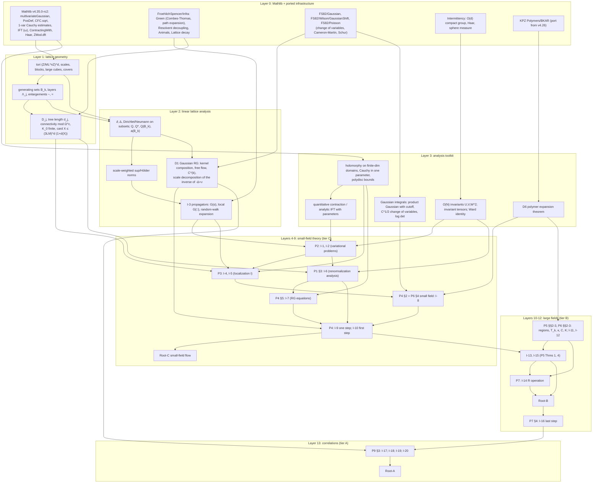

# Formalizing Balaban's low-temperature O(N) theory in Lean 4: roadmap

Companion to `BIG_PICTURE.md` (read §§1–4 there first; references such as
"BIG §2.6" point to it). Keys P0–P9 as in `SOURCES.md`; page numbers are
journal pages. Methodology follows Scott's skills `lean-project-architecture`,
`lean-orchestrator`, `build-proof-dependency-graph` and `lean-learnings`: a
small author-approved frozen surface of exact Lean declarations (roots and major
interfaces), keystone theorems frozen early with a registered draft body,
definitions given by their mathematics, source-defined unique objects admitted
only after a proved `∃!` theorem, a source dependency graph built after the
anchors exist, and every `.lean` file a module.

Contents

1. What Roland wants, and what that implies for the headline
2. Scope options and recommendation
3. Candidate frozen surface
4. Component dependency graph
5. Infrastructure: Mathlib and Scott's repositories
6. Phasing and milestones
7. Size estimate and risk register
8. Missing sources
9. Questions for Roland
10. Corrections and unconfirmed points (pointer)

---

## 1. What does Roland want?

Roland's words: Balaban applied his method to YM$_3$, YM$_4$ and Heisenberg; 3d
Heisenberg was last and "probably the best written"; "we should try to lean
formalize it".

- **The target is the method, not long-range order.** Spontaneous magnetization of
  the 3d Heisenberg model at low temperature already has a ten-page proof
  (Fröhlich–Simon–Spencer 1976, reflection positivity and infrared bounds).
  Nobody would mount a large campaign for that statement. For YM$_3$/YM$_4$,
  Balaban's multiscale method is the only existing route. So the interest is in
  certifying the machinery: block-spin transformations around exact
  background fields, analyticity domains with a gap, localization expansions with
  decoupling parameters, renormalization conditions and RG equations, and the
  large-field calculus with the $R$ operation. The O(N) series is the cleanest
  complete instance of that machinery.
- **"Best written" is relative.** The reviews and the checks in `BIG_PICTURE.md`
  §7 show a clear gradient. P1–P4 are careful, apart from the external Green's
  function theory. P5–P7 (the large-field part) are written as "analogous
  modifications": statements are spread over three papers, admissibility of
  multi-indices is never defined in one place, the base case is narrative, and
  key combinatorics are cited from the gauge-theory paper CMP 122. P9 is a
  sketch on top of the whole stack. A formalization will have to reconstruct
  substantial mathematics, not only transcribe it.
- **Implication for the headline.** There are two kinds of headline, each with a
  different role.
  - The statement that is new relative to FSS, and clean to state and to audit
    without internal definitions, is P9 Thm 1.1. Its content is the Goldstone
    asymptotics of the transverse two-point function, $\sqrt\nu$ clustering
    uniform in $\beta$, and $|m-1|\le c\beta^{-1+\rho_1}$. It is the right
    *eventual root*.
  - The statement that certifies the method is the RG-flow theorem (P7 Thm 5),
    or its first half, the small-field flow (P1 Thm 2.2 via P4 Thms 1–2). Its
    definitions are heavy, but it is what a YM programme would reuse.

  The recommendation in §2 freezes the clean root early and commits the first
  campaign to the method.

---

## 2. Scope options

Throughout: $d\ge3$, $N\ge2$; constants as in BIG §4. "Hard spins" means
$\lambda=\infty$, i.e. the measure $\prod_x\sigma_{S^{N-1}}(d\phi_x)$ weighted by
$\exp[\beta\sum_{\langle xy\rangle}\phi_x\cdot\phi_y+\beta\nu\sum_xh\cdot\phi_x]$ on
tori $\mathbb T_n=(\mathbb Z/ML^n\mathbb Z)^d$.

### (A) Correlation functions: P9 Theorem 1.1 (full endpoint)

*Headline.* There exist $\beta_0<\infty$ and $c,c',\rho_0,\rho_1>0$, depending
only on $d,N$, such that for all $\beta\ge\beta_0$, $\nu\in(0,1]$ and $h\in S^{N-1}$:

1. the limits $M(x)=\lim_n\langle\phi_x\rangle_{\mathbb T_n}$ and
   $G(x,y)=\lim_n\langle\phi_x;\phi_y\rangle_{\mathbb T_n}$ exist;
2. $M=m(\beta,\nu)h$ with $|m-1|\le c\beta^{-1+\rho_1}$, and
   $G=G_{tr}(I-h\otimes h)+G_{lg}\,h\otimes h$ with
   $|G_{tr}(x)|,|G_{lg}(x)|\le c|x|^{2-d}e^{-c'\sqrt\nu|x|}$;
3. as $\nu\downarrow0$ these converge, and there is $Z(\beta)$ with
   $|Z(\beta)-1|\le c\beta^{-1}$ such that
   $G_{tr}(x)=\frac{m(\beta)^2}{\beta Z(\beta)}(-\Delta)^{-1}(0,x)+R(x)$ and
   $|R(x)|,|G_{lg}(x)|\le c(1+|x|)^{-(d-2+\rho_0)}$.

Here $Z(\beta)$ plays the role of $\gamma_\infty$; stating it existentially keeps
the root free of RG-internal definitions and loses nothing, since $R$ is
subdominant. *Requires:* everything in B, plus P9 (one- and two-point
inductive descriptions, the new two-function truncated localization expansion
P9 Prop 3.1 (3.13), the Gaussian-RG decomposition of $(-\Delta+\nu)^{-1}$, the
asymptotics of $\beta_j$), plus a proof of the thermodynamic limit, which the
bundle does not write out. *Source:* about 450 pages including external inputs.
*Risk:* highest; it inherits every risk of B and adds the P9 gaps (BIG §7
items 17, 18).

### (B) The complete RG flow: P5 Thms 1–4 / P7 Thm 5

*Headline (method form).* For $M,\kappa$ large and $\alpha_1,c_8,c_9$ small
there are $B,\alpha_0,E_0,B_0$ such that the sequence
$\rho_{k+1}=R^{(k+1)}S^{(k)}T^{(k)}\rho_k$ ($k<k_0$), $\rho_{k+1}=S^{(k)}T^{(k)}\rho_k$
($k\ge k_0$), started from the hard-spin density, satisfies P5's H1–H7 for
$k\le k_0$ and H1–H5, H7 with (1.31), $\ell=1$, for $k_0<k\le k_f$ (P7 Thm 5).

*Headline (observable form).* For $\beta\ge\beta_0$, $\nu\in(0,1]$ and every
torus $\mathbb T_n$ with $n>k_f(\nu)$, $\log Z_n(g)$ has the multiscale
representation of P7 (4.15)–(4.17) / P9 (4.7):
$$\log Z_n(g)=\langle g,h\rangle+\sum_{j\le k_f+1}\sum_x\sum_{X\in\mathcal D_j,\,X\ni x}\langle g(x),\mathcal M^{(j)}(x,X;g)\rangle+\sum_Y\mathcal P(Y;g).$$
Here the $j=k_f+1$ terms include the reduced-symmetry pieces
$\mathcal M^{(k_f+1)}_n$, $0\le n\le m$, of P7 (4.17). Each term is analytic in
$\|g\|_{\ell^1}<1$, depends only on $g|_X$ (resp. $g|_Y$), and is independent of
$n$ when $X$ does not wrap around the torus. It is bounded, uniformly in $n$ and
$\nu$, by $c_9\xi^{\frac{d-2}2+\gamma-\alpha_1}e^{-\kappa d_j(X)}$ with
$\xi=L^{-j}$ in the units of P4 (H.7) (resp. $\beta^{-2}e^{-\kappa d(Y)}$, P9
(4.6)).

*Requires:* C, plus the large-field calculus (P5 §§2–3, P6 §§2–3, the counter $K$
from CMP 122, 355, the action lower bounds P6 Prop 3.1), the $R$ operation (P7
§§2–3), the base case with large fields, and the last step (P7 §4).
*Source:* about 420 pages. *Risk:* high; P7 is the least detailed paper, and
the large-field objects are defined across P5, P6 and P7 (BIG §7 items 16,
20, 21).

### (C) One RG step and the small-field flow (P1 Thm 2.2 via P4 Thms 1–2)

*Headline.* With constants as in P4 Thm 1, define the small-field-truncated
sequence
$\rho_k=\chi_kS^{(k-1)}T^{(k-1)}\chi^{(k-1)}\cdots S^{(0)}T^{(0)}\chi^{(0)}\rho_0$
(P1 (1.16); $\chi^{(j)}$ as in P4 (2.39)–(2.40)). Then there is
$\bar\nu_1$ (comparable to $\nu L^2$) such that
$\rho_k\in\mathbb R_k(\beta,a,\infty,\nu,BL^{(k-1)(d-2)},\bar\nu_1L^{2(k-1)};M,\kappa,\alpha_0,\alpha_1,\gamma,E_0,c_8,c_9)$
for every $k\ge1$ with $\bar\nu_1L^{2(k-1)}\le\frac78L^{-2}$, where $\mathbb R_k$
is P4's space (1.4). The exact indexing of $B$ and $\bar\nu$ along the flow is
to be fixed when the statement is authored. Membership requires the data
$(\beta_k,a_k,\nu_k,\mathcal E^{(j)},\mathcal M^{(j)})$ to exist with (H.1)–(H.7);
in particular $|\mathcal E_k|\le C|T^{(k)}_1|$ uniformly, and the coefficients obey
the RG equations with $\gamma_k\to\gamma_\infty$.

A narrower variant ("one step") is P4 Thm 1 alone: $\mathbb R_k\to\mathbb R_{k+1}$.

*Requires:* P1 (definitions, §3 renormalization analysis), P2 (variational
problems), P3 (localization I), P4 (step, first step, RG equations), the
small-field part of P6 §4 (localization and cluster expansion of fluctuation
expectations, which is where P4's deferred Props 2.1, 2.2, 4.1, 4.2 are
proved), and the scalar versions of the propagator and random-walk bounds of CMP
96 (1984) 223 and CMP 89 (1983) 571. *Source:* about 240 pages. *Risk:*
moderate-high; the external Green's function theory and the analyticity
bookkeeping are the hard parts, but the papers are detailed.

*Meaning.* C says nothing about the Gibbs measure: the truncated densities
discard the large-field configurations. It is the full small-field half of
Balaban's method — the counterpart of his YM small-field papers (CMP 109, 116).

### (D) Self-contained components and warm-ups

Each of these is a genuine theorem with source premises only; none is
conditional.

- **D1 Gaussian block-spin RG.** Composition of Gaussian kernels and the free
  flow $a_{k+1}=aa_k/(a_k+aL^{-2})$ (P2 (4.2)–(4.8), Lemma 4.1; P4 (2.8)–(2.14)).
  The exact scale decomposition of the massive Green's function,
  $(-\Delta+\nu)^{-1}=\sum_jL^{-j(d-2)}a_j^2G_jQ_j^*C^{(j)}_{tr}Q_jG_j+\text{(last scale)}$,
  is the identity behind P9 (4.17). Exact algebra plus Fourier analysis on the
  torus. About 15 pages of source.
- **D2 Scalar propagator theory.** For $-\Delta^D_\Omega+Q^*aQ+\nu+\alpha$ on
  multiscale generating sets: positivity, exponential decay of local Green's
  functions, the random-walk expansion with partition of unity, and
  scale-weighted sup and Hölder bounds. This is the scalar content of CMP 96
  §§2, A and CMP 89 §5, as used in P2 §3 and P3 §2. About 40–60 pages, mostly
  external. It is the most valuable single warm-up: it is needed by everything
  and reusable for YM.
- **D3 Variational problems.** P2 Prop 1.1/Cor 1.1, Prop 3.1, Prop 4.1 — the
  well-definedness theorems for the background fields. Needs D2. 36 pages.
- **D4 Renormalization analysis.** P1 §3, Prop 3.10 and Cor 3.11: from (H.3)–(H.7)
  to $|\mathcal E_k|\le C|T^{(k)}_1|$. The proof is conditional on D3 for bound
  (3.107), so it is a component of C rather than a standalone theorem unless D3
  is done. 33 pages.
- **D5 RG equations.** P4 §5, Prop 5.1 and (5.33): contraction on a polydisc in
  $\mathbb C^3$, and existence of $\gamma_\infty,\delta_\infty$. Stated with the
  analytic effective-potential data as source premises. 12 pages.
- **D6 Polymer-expansion theorem.** A Kotecký–Preiss-type theorem for activities on
  connected unions of cubes weighted by tree length, with the counting bounds
  $K_0=\sum_{X\ni y}e^{-\kappa d(X)}<\infty$ and
  $|X|\le(3LM)^d(1+d(X))$ (P6 (4.11), proved there in full). Needed by P6, P7
  and P9.
- **D7 P8's method (bosonic version).** Correlation functions from the last
  effective action via Gaussian decomposition and translation. Cheap, but P9
  does not use it. Low value; skip unless needed for exposition.

### Model restrictions

- **$d$ and $N$.** Keep general $d\ge3$, $N\ge2$.
  - Nothing in the proofs simplifies at $d=3$ or $N=3$. Power counting is in
    real exponents, and the $O(N)$ arguments use only the stabilizer of
    $e_1,e_2$ (BIG §1.4).
  - Specializing would make every frozen statement a non-source specialization
    needing a ruling.
  - Provide $d=N=3$ instances of the roots as one-line corollaries for display.
- **$\lambda$.** Restrict to hard spins, $\lambda=\infty$. This is the Heisenberg /
  O(N) model, and P9 Thm 1.1 covers it.
  - With $\lambda=\infty$ every $\lambda_k=\lambda L^{2k}$ is $\infty$. So the
    estimates needed only for uniformity in large finite $\lambda$ drop out,
    e.g. the bound on $\lambda G(\lambda)$ (P2 (3.40)–(3.41), P3 (2.31)–(2.34)).
  - The first step becomes a chart of the sphere rather than P4's
    $\lambda_0$-uniform change of variables.
  - The singular constraint equation is *not* removed. It is singular precisely
    at $\lambda=\infty$, so the Leibniz-rule device of P2 (3.31)–(3.38) and P3
    §2.3 remains.
  - Soft spins ($\lambda<\infty$) can be added later by carrying $1/\lambda_k$ as
    a parameter, as the papers do.
- **Finite versus infinite volume.** State B and C on tori $\mathbb T_n$, with
  bounds uniform in $n$ and with torus-independence of localized terms. The
  source does exactly this (P4 p. 680: "families of densities corresponding to
  all admissible tori"). Infinite volume appears only in A, as limits along
  $\mathbb T_n$; the existence of these limits must be proved (BIG §7 item 17).

### Recommendation

**Recommendation.** Freeze P9 Theorem 1.1 for the hard-spin model (all $d\ge3$,
$N\ge2$) as the long-term root, together with the model definitions. Commit the
first campaign to tier C: the complete small-field RG flow, with the variational
problems, the scalar propagator and random-walk bounds, the localization
expansions and the fluctuation cluster expansion all proved rather than assumed.
Decide on tier B (large fields) and then tier A at a stop/go review at the end of
C.

Justification:

1. C contains every component of Balaban's method except the large-field
   calculus. It is the part of the series with the most detailed proofs, and
   its external dependencies (CMP 96/89 propagators) are needed for YM anyway.
2. The large-field part is where the papers are least complete. Committing to B
   up front would commit to an open-ended reconstruction before the
   infrastructure exists. A gate after C lets the team estimate B from
   experience and from Roland's answers (§9), and gives time to obtain CMP 122
   and Dimock's exposition.
3. Freezing A's statement and the model definitions at the start fixes the
   meaning of the project, prevents statement drift, and makes C's interfaces
   point the right way.
4. Within C, the warm-ups D1, D2, D5, D6 give early, independently useful
   results (§6).

---

## 3. Candidate frozen surface

In mathematical form; the Lean declarations must be written, reviewed against
the sources, and approved by Scott before freezing. About 20 theorem anchors
plus the meaning-carrying definitions. Items marked [C] are in the
recommended first campaign; [B] and [A] are frozen when those phases open
(roots A can be frozen at once as `DRAFT_SORRY`).

### 3.1 Definitions to freeze with the roots

- **Def-1 Model [C].** Tori $\mathbb T_n=(\mathbb Z/ML^n\mathbb Z)^d$ with
  nearest-neighbour bonds; hard-spin configurations $\phi:\mathbb T_n\to S^{N-1}$;
  the a priori measure $\prod_x\sigma(d\phi_x)$ (normalized surface measure);
  density
  $\rho_0(\phi)=\exp[-\beta(\frac12\|\partial\phi\|^2+\frac\nu2\|\phi-h\|^2)+\langle g,\phi\rangle-E]$;
  $Z_n(g)$; finite-volume expectations and truncated two-point functions.
- **Def-2 RG transformation [C].** Block average $Q$; the Gaussian kernel
  operator $T^{(k)}$ with parameters $(\beta_k,a)$; scaling $S$; normalization
  $\int T\rho=\int\rho$ (P1 (1.11)).
- **Def-3 Geometry [C].** Scale-$j$ lattices $T^{(j)}$, large cubes and covers
  $\pi_j,\pi'_j$, localization domains $\mathcal D_j$ and tree length $d_j(X)$
  (P1 (2.26)–(2.27)); generating sets $\mathbb B_k$ (P2 (1.1)–(1.3)).
- **Def-4 Small-field sets [C].** $\Phi_j(\sigma,\varepsilon)$,
  $\Xi_j(\sigma,\varepsilon)$, $\Xi^c_j(\mathbb B_j(X);1,\varepsilon_j)$ (P1 (2.15),
  (2.20); P3 §4), $\chi_k$ (P4 p. 679), $\chi^{(k)}$ (P4 (2.39)–(2.40)).
- **Def-5 Background fields [C].** $\phi_k(\psi)$, $\psi^{(j)}_k(\psi)$, and the
  general $\phi(\mathbb B_k;\psi)$, $\psi(\mathbb B_j,\mathbb B'_k;\psi')$. Each
  is defined only *after* its `∃!` theorem I-1/I-2 is proved, then landed with a
  characterization theorem.
- **Def-6 Inductive class $\mathbb R_k$ [C].** P4 (H.1)–(H.7) and (1.4), as a
  literal predicate on families of densities indexed by tori. Corrected per BIG
  §7; numbering per the BIG §2.4 concordance.
- **Def-7 Large-field class [B].** P5 H1–H7 and (1.42). It depends on the
  explicit inductive definitions of $\mathbb A_k$, $\mathbb T_k$, $\kappa_k$,
  $C$, $K$ (P6 (3.1)–(3.19)), so it is frozen only after phase 5 has
  reconstructed them.

### 3.2 Roots

- **Root-A [A]** (P9 Thm 1.1, hard spins): the statement in §2(A).
- **Root-B [B]**: the observable form in §2(B), or P7 Thm 5 with Def-7 if
  Roland prefers the method form.
- **Root-C [C]**: the small-field flow in §2(C).

### 3.3 Major interfaces

**Background fields and propagators [C]**

- **I-1 (P2 Prop 1.1 / Cor 1.1).** For generating sets $\mathbb B_k$ and data
  $(\psi+\psi',h+h')\in\tilde\Psi^c(\mathbb B_k;\delta,\varepsilon)$ with
  $0<\delta\le\varepsilon\le c_0$, $\delta\le c_1$, $\nu\varepsilon^2\le\delta^2$:
  there is a unique solution $(\phi,\alpha)$ of the Euler–Lagrange system with
  $|\alpha|_2<c_0$. It is analytic in the data and satisfies P2 (1.15)–(1.16).
  For real data it is the unique minimizer (`∃!` form). The constants $c_0$,
  $c_1$, $K_1$ depend on $d,L$ only.
- **I-2 (P2 Prop 4.1).** Existence and uniqueness of
  $\psi(\mathbb B_j,\mathbb B'_k;\psi')$, formula (4.21), and the composition
  identities (4.39).
- **I-3 (scalar CMP 96 (2.57), (2.33); CMP 89 §5).** Let
  $G(\alpha)=(-\Delta^{D,\eta}_{\Omega_1}+Q^*(\mathbb B_k)a(\mathbb B_k)Q(\mathbb B_k)+\nu+\alpha)^{-1}$
  with $|\alpha|_2<\gamma_1$.
  - $G(\alpha)$ satisfies the scale-weighted sup and Hölder bounds used in P2
    §3.
  - The local Green's functions on cubes satisfy
    $L^j\eta|\chi_\Delta\partial G(\square,\alpha)\chi_{\Delta'}f|+|\chi_\Delta G(\square,\alpha)\chi_{\Delta'}f|\le B_0e^{-\gamma_0d(y,y')}(L^{j'}\eta)^2|\chi_{\Delta'}f|$.
  - The random-walk expansion converges.

  The constants depend on $d,L$ only. This is the one place where an external
  theorem is turned into a frozen internal interface.
- **I-4 (P3 Props 2.1–2.3, 3.1).** The analytic decoupling extensions of
  $\delta\phi_k,\delta\alpha_k$, $\psi(\mathbb B_j,\mathbb B'_k)$ and $C^{(k)1/2}$
  in $|s_\square|\le e^{\kappa_1}$, with their localization property and bounds.
- **I-5 (P3 Prop 4.3).** The localization expansion of
  $\mathcal E(X;\psi^{(j)}_k(\psi^{(k)}(\theta)+\psi'))$, with bound
  $Ee^{-\kappa_0d_j(X)-2\kappa\tilde d_{k+1}(Y)}$, including the "simple
  variations" used later (P3 p. 81).

**Effective action, fluctuation integrals and the small-field step [C]**

- **I-6 (P1 Prop 3.10 / Cor 3.11).** If the $\mathcal E^{(j)}$ satisfy the
  analyticity, symmetry, localization and renormalization hypotheses, then
  $|\mathcal E_k|\le C E_0|T^{(k)}_1|$ on $\Xi^c_k(1,\varepsilon_k)$, with the
  representation (3.126).
- **I-7 (P4 Prop 5.1, (5.31)–(5.33)).** The RG equations have a unique small
  solution, and the coefficients obey (H.6) with limits $\gamma_\infty$,
  $\delta_\infty$.
- **I-8 (P6 §4, small-field case = P4 Props 2.1, 2.2, 4.1, 4.2).** The new
  contributions $\mathcal E^{(k+1)}_0$, $\mathcal F^{(k+1)}_0$, $C^{(k+1)}$ and
  $\mathcal E^{(k+1)}_u$ have localization expansions with the stated
  analyticity and bounds. The proof goes through P6 Lemma 4.1, the cluster
  expansion (4.39)–(4.52) and $|X|\le(3LM)^d(1+d(X))$.
- **I-9 (P4 Thms 1–2).** One small-field step:
  $\mathbb R_k\to\mathbb R_{k+1}$, with the RG equations (1.9)–(1.10).
- **I-10 (first step).** $\chi_1ST\chi^{(0)}\rho_0\in\mathbb R_1$ for the hard-spin
  $\rho_0$ (P4 (2.42)–(2.50), in sphere-chart form).

**Large fields [B]**

- **I-11 (P6 Prop 3.1).** The lower bounds (3.5)–(3.6) on $\beta_{k+1}A^*_{k+1}$
  (stated as "very simple", no proof in the bundle).
- **I-12 (P6 Prop 3.2).** Properties (i)–(iii) of the counter $K$ (from CMP 122,
  355, pp. 383–387).
- **I-13 (P5 Thm 1).** One full step with H6 weakened.
- **I-14 (P5 Thm 2 = P7 Thm 2).** The $R$ operation, with normalization (1.43).
- **I-15 (P5/P6 Thm 4).** The regime $k\ge k_0$.
- **I-16 (last step).** The representation of $\log Z_n(g)$ (P7 (4.15)–(4.17))
  with uniform bounds; this is Root-B in observable form.

**Correlation functions [A]**

- **I-17 (P9 §3).** The one- and two-point descriptions (H.1)–(H.2) survive one
  step, including P9 Prop 3.1 (3.13) for truncated pairs.
- **I-18 (D1).** Exact Gaussian-RG decomposition of $(-\Delta+\nu)^{-1}$ and
  uniform exponential decay of the scale propagators $G_j$, $C^{(j)}$.
- **I-19 (P9 (4.18)).**
  $\beta_j^{-1}=(\beta\gamma_\infty)^{-1}L^{-j(d-2)}+O(\beta^{-1})L^{-j(d-2+2\gamma)}$.
- **I-20.** Existence of the thermodynamic limit and of the $\nu\downarrow0$
  limit of the generating functional (P5 (1.46)).

Statement-integrity notes for the authoring phase:

- **Constants.** Quantifier order must follow the theorems (BIG §4). In
  particular "for $M,\kappa,\alpha_1,\gamma,c_8,c_9$ … there exist
  $B,\alpha_0,E_0$", with $L$ and the large-field exponents fixed before.
  Silent dependence of a constant on $n$, $k$ or $\nu$ invalidates a root.
- **The definition of $\mathbb R_k$.** It is existential over data and families
  over tori. Torus-independence of localized terms should be encoded by defining
  each localized term on finite subsets of $\mathbb Z^d$ and pushing it to tori,
  not as a separate hypothesis.
- **No smuggled premises.** I-6 has (H.3)–(H.7) as genuine premises (it is a
  source lemma of that form). By contrast, I-9 may not take I-8's conclusions as
  hypotheses.
- **Splits need rulings.** Each place where one source result is split
  (e.g. P4 Thm 1 and Thm 2; P5 Thms 1–4) needs an explicit author ruling on
  shared constants.

---

## 4. Component dependency graph

Module organization suggested by the layers:

- `Balaban/Infra/{Lattice,Geometry,Linear,Propagator,GaussianRG,Holomorphic,Contraction,ON,Polymer,Gaussian}`;
- `Balaban/Small/{Variational,Localization,Renormalization,RGEquations,Fluctuation,Step,FirstStep,Flow}`;
- `Balaban/Large/{Regions,Operators,Counter,FullStep,ROperation,LastStep}`;
- `Balaban/Correlation/*`;
- `Balaban/Surface/*` for the frozen files.

Keep reusable infrastructure in `Infra` (it is what YM would import), separate
from paper-specific assembly.

---

## 5. Infrastructure

From a read-only survey of Mathlib (as pinned in `/home/scott/FroehlichSpencer`,
v4.35.0-rc2) and of the repositories under `/home/scott`; several items were
spot-checked by grep.

### 5.1 Mathlib

**Available:**

- **Gaussians.**
  - `ProbabilityTheory.gaussianReal` and `IsGaussian`.
  - `multivariateGaussian μ S` for positive semidefinite `S`, with its
    characteristic function and covariance. It is a pushforward of
    `stdGaussian`; there is no density formula with $\det$.
- **Matrices.** `Matrix.PosDef`, `det_eq_prod_eigenvalues`, `CFC.sqrt` with
  `(CFC.sqrt A).det = sqrt A.det`, Schur complements.
- **Analyticity.**
  - `HasFPowerSeriesOnBall`, `AnalyticOnNhd`, `cauchyPowerSeries`.
  - One-variable Cauchy estimates
    (`norm_deriv_le_of_forall_mem_sphere_norm_le`,
    `norm_iteratedDeriv_le_of_forall_mem_sphere_norm_le`).
  - `DifferentiableOn.analyticOnNhd` for `f : ℂ → E`.
- **Implicit functions and fixed points.**
  - `ImplicitFunctionData` / `HasStrictFDerivAt.implicitFunction`, with
    `contDiffAt_implicitFunction` for $n=\omega$ (analytic, but local and
    without explicit radius).
  - `ContractingWith` / `efixedPoint`.
- **Groups and spheres.** `Measure.haarMeasure`, `Matrix.orthogonalGroup`
  (without `CompactSpace` / topological-group instances), `Measure.toSphere`.
- **Other.** `SimpleGraph` connectivity and trees, `ZMod.dft`.

**Lacking:**

- several-variable Cauchy formula on polydiscs (`torusIntegral` exists without
  it), Hartogs/Osgood;
- quantitative analytic implicit-function or contraction theorems with explicit
  radii and analytic parameter dependence;
- Wick/Isserlis and Gaussian integration by parts for general covariance, and
  the density formula identifying `multivariateGaussian` with
  $\det(2\pi C)^{-1/2}e^{-\frac12\langle x,C^{-1}x\rangle}$;
- log-det expansions;
- lattice-animal counting and polymer/cluster expansions;
- lattice Laplacians and Green's functions;
- $d$-dimensional discrete tori with block structure.

### 5.2 Reusable code in Scott's repositories (concrete paths)

**`/home/scott/FroehlichSpencer`** (v4.35.0-rc2; 1,658 files, 365,728 lines; 0
sorry; 425 sealed anchors; git history 2026-10-06 to 2026-10-10, 1,278
commits). Paths below are relative to `FroehlichSpencer/`.

- **Resolvents (core of I-3).**
  - `Infra/Green/Basic.lean :: restrictedOp, resolventColumn`: generic kernel
    on a finite set.
  - `Infra/Green/CombesThomas.lean :: norm_resolventColumn_le_exp`.
  - `Infra/Green/CombesThomasGap.lean :: norm_resolventColumn_le_exp_of_gap, norm_resolventColumn_le_exp_of_lower_bound`.
    These are Combes–Thomas exponential decay under a spectral gap, for
    Hermitian kernels with bounded row sums and nearest-neighbour range in a
    pseudo-metric. Applicability to $Q^*aQ$ with a block-rescaled metric is
    plausible but untested.
  - `Infra/Green/PathExpansion.lean :: norm_resolventColumn_le_of_diag_dominant`:
    a Neumann/path-expansion bound. Balaban's random-walk expansion is a
    block version.
  - `Infra/Green/Iteration.lean`, `Infra/Resolvent/Decoupling.lean :: resolvent_apply_eq_decoupled_sub_coupling_sum`:
    the geometric resolvent identity.
  - `Infra/Spectral/*`: min–max, Weyl, interlacing.
- **Lattice tools.**
  - `Infra/Lattice/{Basic,Balls,Decay}.lean`: sums of exponentially decaying
    kernels on $\mathbb Z^\nu$.
  - `Surface/{Laplacian,DirichletLaplacian,FiniteGreen}.lean` on $\mathbb Z^\nu$.
  - `Multiscale/{Basic,Clusters}.lean`, `T12/{Cubes,SubordinateCovers,FirstExit,Tower}.lean`:
    cube covers and scale bookkeeping.
- **Counting.** `Infra/Combinatorics/Animals.lean :: animals, card_animals_le, card_animals_latticeGraph_le`
  and `Infra/Combinatorics/UnionBound.lean`: lattice animals, the basis for
  $K_0<\infty$ and polymer counting.
- **Gaussian toolkit (D1, T5).**
  - `FS82/Gaussian/MeasureJacobian.lean :: map_withDensity_linearEquiv`.
  - `FS82/Gaussian/ConditionalGaussian.lean :: completedSquare_block_mass, chartSplitEquiv_measurePreserving`.
  - `FS82/Gaussian/FiniteQuotientGaussian.lean`.
  - `FS82/Wilson/GaussianShift.lean :: finiteGaussian_tilt_eq_map_add, multivariateGaussian_exp_inner_integrable, multivariateGaussian_inner_complexTransform`:
    Cameron–Martin and complex translations.
  - `FS82/Poisson/{TiltedPoisson,FinRec}.lean`: determinants and Schur
    recursion.
  - `BKT/Gaussian/*`: free field on graphs, exponential moments.
  - `BKT/FiniteGraph/{Laplacian,Green}.lean`: graph Laplacian and Green
    operator.
- **Fourier.** `BKT/Lattice2D/TorusFourier.lean` (2D only) and
  `FS82/Infinite/FourierParseval.lean` ($\mathbb Z^4$): templates for the
  $d$-dimensional torus Fourier analysis needed in D1 and P4 §5.
- **Methodology assets.** `frozen/manifest.json`, `frozen/APPROVALS.md`,
  checkers, `orchestration/LEDGER.md`, `graph/DEPGRAPH.md`,
  `notes/mathlib-inventory.md`, `docs/*.md`. Copy the campaign scaffold.

**`/home/scott/Intermittency/Lean/Intermittency`** (v4.35.0-rc2):
`Analysis/SphereLayer.lean :: OrthogonalGroup` with `CompactSpace`,
`IsTopologicalGroup` and `BorelSpace` instances, `normalizedHaarProbability`,
`sphereSurfaceMeasure`; and
`Analysis/OrthogonalSphereMeasureInvariance.lean :: orthogonalSphereSurfaceMeasure_invariant`.
This is the base for the hard-spin a priori measure, $O(N)$ invariance, and P7's
coset averaging.

**`/home/scott/KPZ/cumulants/Lean`** (v4.26.0; must be ported):

- `Polymers/BKAR/Formula.lean :: bkar_formula` and `Polymers/BKAR/Forest*.lean`:
  the Brydges–Kennedy–Abdesselam–Rivasseau forest formula — the standard route
  to cluster-expansion convergence (D6).
- `Polymers/Resolvent/*`: resolvent expansions with edge parameters.
- `Lean/Phi4/Law/{ProductGaussian,GaussianIBP}.lean`: product Gaussians and
  integration by parts on finite mode sets.

**Analyticity and fixed points (T1, T2):**

- `/home/scott/AVAnomalousRegularization-dev/AVRegularity/CycleWords/BoundedCauchyDerivative.lean :: boundedCauchyDerivative_norm_le`
  ($\|f^{(n)}(c)\|\le n!MR^{-n}$).
- `.../Construction/Preservation/Buffer/DoubleCauchyRepresentation.lean :: double_cauchy_representation`
  (a two-variable bidisc).
- `/home/scott/NavierStokesAndEuler`: `NavierStokes/CauchyRestriction.lean`,
  `HolomorphicFamily.lean` (Banach-valued holomorphic families),
  `MomentRepairPicardConvergence.lean :: exists_small_solution_with_iterates`
  (Banach fixed point on a quantitative ball), `SmoothQuadraticBranch.lean`.
- `/home/scott/EllipticRegularity/lean/PDEFoundation/Analysis/AnalyticOfDerivBound*.lean`
  (analyticity from Cauchy-type derivative bounds).

**Geometry templates:** `/home/scott/CoarseGraining/.../Geometry/TriadicCube.lean`
(cubes in $\mathbb R^d$, parent/child structure) and
`/home/scott/homogenisation_for_field_theories/Lean/HFT/Matrix/*` (matrix
square roots, Loewner order; v4.26.0).

**Not useful here:** CoarseDeGiorgi, MarkovProcess, Superdiffusion*,
CaffarelliKohnNirenberg, EscauriazaSereginSverak (continuum PDE).

A correction to the brief: the "KP" in the FS BKT campaign is Kharash–Peled, not
Kotecký–Preiss. No Kotecký–Preiss, Mayer/Ursell or tree-graph-inequality code
exists in any of the repositories; KPZ's BKAR formula is the nearest.

### 5.3 What must be built

1. $d$-dimensional tori with block hierarchies, $Q$, $Q^*$, multiscale
   $Q(\mathbb B_k)$, generating sets and nested-domain geometry.
2. The scalar propagator theory I-3 for $-\Delta^D+Q^*aQ+\nu+\alpha$ on generating
   sets, in scale-weighted sup and Hölder norms, with random-walk expansions and
   analytic dependence on $\alpha$. Start from FS's Combes–Thomas and path
   bounds.
3. A holomorphy API for finite-dimensional complex domains given by pointwise
   inequalities. Use Cauchy estimates along one-parameter complex lines (this is
   what Balaban uses: parameters $\tau$, $s_\square$, $t_Y$, $\sigma$), plus a
   quantitative analytic contraction theorem with parameters.
4. Gaussian integration with explicit densities and determinants on
   $\mathbb R^{N|\Lambda|}$, change of variables by $C^{1/2}$, and the log-det
   identities.
5. A polymer-expansion theorem (Kotecký–Preiss or BKAR-based) for activities on
   connected unions of cubes, including connectivity modulo a set.
6. $O(N)$ invariant theory in elementary form: invariants $U,V,W^2$, tensors
   invariant under the stabilizer of $e_1,e_2$, Ward identities.
7. Later, for B: the large-field calculus (multi-indices, $\mathbb T_k$,
   $\kappa$, $K$, $R$).

Design notes from `lean-learnings`:

- Use `Fin d → ℤ` / `ZMod` sites and `Fin N → ℝ` (or `ℂ`) spin values, not
  `EuclideanSpace`.
- Extract numeric constant chains as lemmas over abstract reals.
- No heartbeat overrides; zero warnings.
- Toolchain v4.35.0-rc2 (shared with FS, Intermittency, EllipticRegularity,
  CoarseGraining), so that `FroehlichSpencer/Infra` can be imported or copied
  without porting.
- All files are modules.
- Respect the lemma.farm compile limits (at most 5 concurrent Lean compiles,
  core-aware throttling).

---

## 6. Phasing and milestones

**Phase 0 — preparation (before any Lean).**

1. Obtain the sources in §8.
2. Obtain rulings (§9): hard spins, general $d,N$, tori $\mathbb T_n$, quantifier
   order in Root-A.
3. Write an errata ledger from BIG §7.
4. **Write the global constant chain** (BIG §4) as a document, checking every
   "for $\beta$ large" and "$M,\kappa$ large" condition in P1–P4 and P6 §4 for
   consistency. This is the cheapest high-value de-risking step.
5. Scaffold the repository (modules, checkers, manifest) from the FS template.
6. Draft, review and freeze Def-1, Def-2 and Root-A (`DRAFT_SORRY`); draft
   Root-C. Root-C's statement depends on Defs 3–6, which depend on I-1/I-2 for
   the background fields, so Root-C can be frozen only after phase 2. Freeze
   I-1 and I-2 as theorems first.

**Phase 1 — early wins (de-risk the infrastructure).**

- **W1 (D1).** Gaussian block-spin identities and the exact multiscale
  decomposition of $(-\Delta+\nu)^{-1}$ on $\mathbb T_n$. Self-contained, and
  checks the torus/block/Fourier API.
- **W2 (D2/I-3, first slice).** Positivity of $-\Delta+aQ^*Q$ with gap
  $\ge cL^{-2}$, and exponential decay of its inverse on the torus via FS
  Combes–Thomas. Then the local Green's functions on cubes with
  Dirichlet/Neumann conditions and the random-walk expansion with partition of
  unity (P3 (2.2)–(2.11)).
- **W3 (D6).** Polymer-expansion theorem; $K_0<\infty$; $|X|\le(3LM)^d(1+d(X))$.
- **W4 (D5/I-7).** RG equations: contraction on the polydisc in
  $\mathbb C^3$, $\gamma_\infty$.
- **W5.** Constant-configuration variational problem (P2 §2, Prop 2.1) and the
  $O(N)$ reductions (P1 (3.24)–(3.28)).

Milestone M1: W1–W5 sealed. These are independently useful, and W2 is reusable
for YM.

**Phase 2 — variational problems (P2).** I-3 in full (scale-weighted Hölder
bounds on generating sets), P2 Lemma 3.1, Prop 3.1, Prop 1.1, Prop 4.1.
Milestone M2: I-1, I-2 sealed; Def-5 landed with characterization theorems;
Root-C frozen.

**Phase 3 — localization and renormalization analysis.** P3 (I-4, I-5) and P1 §3
(I-6). Milestone M3.

**Phase 4 — fluctuation integrals and the small-field flow.**

- P4 §§2–4 (fluctuation integral, scaling, renormalization).
- The small-field part of P6 §4 (I-8).
- I-9, the hard-spin first step I-10, and the induction to Root-C.

Milestone M4 = tier C. **Stop/go review:** actual size versus estimate;
whether to proceed to B; status of CMP 122 and of Dimock's exposition.

**Phase 5 — large-field calculus.** Reconstruct and freeze Def-7. Then P5 §§2–3,
P6 §§2–3, I-11, I-12 (CMP 122), I-13, I-15, and the base case with large fields.

**Phase 6 — the $R$ operation and the last step.** P7 §§2–4: I-14, I-16, Root-B.

**Phase 7 — correlation functions.** P9 §§2–4: I-17 (including the
two-function expansion), I-18, I-19, I-20 (thermodynamic and $\nu\downarrow0$
limits), Root-A.

The graph (`build-proof-dependency-graph`) is extracted per phase, after that
phase's anchors are frozen. Workers are assigned from the dependency-ready
frontier.

---

## 7. Size estimate and risk register

### 7.1 Size

Comparison with Scott's completed campaigns (raw `wc -l` of project `.lean`
files):

| Campaign | Source | Lean lines | Lines per source page |
|---|---|---|---|
| FS83, Anderson localization (FroehlichSpencer, FS83 part incl. its Infra) | CMP 88 (1983) 151–184, 34 pp. | ≈27k | ≈0.8k |
| FS82, Villain/Wilson/XY (FroehlichSpencer/FS82) | CMP 83 (1982) 411–454, 44 pp. | ≈137k | ≈3.1k |
| BKT via Kharash–Peled (FroehlichSpencer/BKT) | arXiv:1711.04720 | ≈201k | — |
| FroehlichSpencer total | three campaigns | 365,728 | — |
| CoarseGraining | monograph | 561k | — |
| EllipticRegularity | — | 309k | — |

Balaban's pages are denser than FS83's and many proofs are sketched, so the
FS82 ratio (about 3k lines per page) is the better guide, and reconstruction
work pushes it up.

| Tier | Source pages (bundle + external) | Rough Lean size |
|---|---|---|
| D, single warm-up | 10–60 | 15k–150k each |
| C (recommended first campaign) | ≈240: P1 52, P2 36, P3 50, P4 48, P6 §4 ≈15, CMP 96/89 ≈40 | 0.5M–1.0M |
| B | ≈420: C + P5 37, P6 rest ≈30, P7 42, CMP 122:355 38, parts of CMP 119/122:175 ≈30, unwritten base case and admissibility | 1.0M–1.7M |
| A | ≈450: B + P9 28, thermodynamic limit | 1.1M–1.9M |

Tier C alone is about the size of CoarseGraining; tier A would be three to five
times the whole FroehlichSpencer library. The bottleneck is mathematical
reconstruction (constant chains, sketched proofs, external theory), not Lean
volume.

### 7.2 Risk register

Severity: H = could block the tier; M = expensive; L = local.

| # | Risk | Where | Sev. | Mitigation |
|---|---|---|---|---|
| 1 | **External propagator theory.** The bounds on $G(\alpha)$ in scale-weighted sup/Hölder norms, the local exponential decay and the random-walk expansion come from gauge-theory papers (CMP 96 (2.57), (2.33), Prop 2.2; CMP 89 §5) and must be re-proved for the scalar multiscale operator on generating sets with Dirichlet conditions. P2 asserts applicability without proof (p. 622); P3 says the $x$-dependent case "can be easily extended" (p. 63). | P2 §3, P3 §§2–3, P4 (2.25) | H | Obtain the papers; W2 first; reuse FS Combes–Thomas; consider Dimock's write-up. |
| 2 | **Large-field part is sketched and scattered.** Admissible multi-indices are never defined in one place (P5 p. 495); $\mathbb T_k$, $\kappa$, $C$, $K$ are defined inductively across P5/P6; the step counter is cited from CMP 122 (P6 Prop 3.2); P7 relies on "obviously the same", "similar remarks"; the base case with large fields is narrative (P5 pp. 486–487). | P5–P7 | H | Gate after C; reconstruct Def-7 on paper first; obtain CMP 119/122 and Dimock II. |
| 3 | **No global order of constants.** Each paper adds "for $\beta$ (or $M,\kappa,A_0$) large enough" conditions; possible circularities ($M$ vs $\kappa$; $H_0$ vs $B_0$; $A_0$ vs $M,R_0$); notation clashes ($\gamma_0$ has three meanings). | all | H | Phase 0 constant-chain document; freeze quantifier order in roots; keep constants as explicit functions where possible. |
| 4 | **Analyticity bookkeeping.** Nested complex domains $\Phi^c,\Xi^c,\Psi^c,\bar\Psi^c$ with $(\sigma,\varepsilon,\delta)$; inclusion chains (P1 Lemma 3.2, P3 (4.34)–(4.40)); Mathlib lacks several-variable Cauchy theory. | P1 §3, P2, P3 §4, P6 §4 | M–H | Design a holomorphy-on-product-domains API early (T1); use one-parameter Cauchy estimates as the papers do. |
| 5 | **Localization combinatorics.** Decoupling parameters, Mayer interpolation, resummation over domains, tree-length geometry, connectivity mod $\Omega^c$; the polymer expansion with non-small boundary terms (P7 (3.27)–(3.28)). | P3 §4, P6 §4, P7 §3 | M–H | D6 as a reusable abstract theorem; prove geometric inequalities as standalone lemmas. |
| 6 | **Unwritten or sketched steps.** P9 Prop 3.1 (3.13) (two sentences); P6 Prop 3.1 and P2 Prop 2.2 (no proofs); P3 "simple variations" (p. 81); P4 first step (3 pp.); the $c=0,d=b$ renormalization choice (P4 p. 717); the thermodynamic limit; P9's need for $\lambda\ge\lambda_0$. | P2–P9 | M | Record each as a graph node with source range and status; write proofs on paper before assigning. |
| 7 | **Definitions by uniqueness.** $\phi_k$, $\psi^{(j)}_k$, $\phi(\mathbb B_k)$ are unique minimizers; under the frozen-surface rules they cannot be defined until I-1/I-2 are proved, so $\mathbb R_k$ and Root-C cannot be frozen in phase 0. | P2 | M | Freeze I-1/I-2 as theorems first (phase 0); Root-A needs none of them. |
| 8 | **Statement design for families over tori.** $\mathbb R_k$ is existential over data and quantifies over admissible tori with torus-independence of localized terms. | P4 (1.4), P5 (1.42) | M | Localized terms defined on finite subsets of $\mathbb Z^d$ and transported; review by an independent auditor. |
| 9 | **Citation defects hide inputs.** P4's "[3]" and "[2c]" (BIG §7 item 6): "the theorem in Sect. 5 of [3] on unit lattice operators" is used for the decay of $C^{(k)}$ and its localization expansion, and its source is unsettled. | P4 pp. 687, 693 | M | Obtain CMP 89 and CMP 85; identify the theorem before phase 4. |
| 10 | **Scale and machine load.** 0.5–1.9M lines; lemma.farm caps Lean compiles at 5. | — | M | Phase gates; module granularity; elaboration discipline from `lean-elaboration`. |
| 11 | **Hard-spin-specific gaps.** The first step for $\lambda=\infty$ is written for $\lambda_0$ uniform; the sphere-chart version must be written; P7's analytic coset trick (local analytic sections of $O(N)\to S^{N-1}$) is described in words. | P4 pp. 691–694, P7 pp. 520–521 | M | Write both on paper; reuse Intermittency's $O(N)$ Haar. |

Disproportionately expensive formalization items, in order: (1) I-3 propagators
in Hölder norms on generating sets; (2) the large-field multi-index/operator
calculus and $R$; (3) P3 §2.3 (singular constraint equation with decoupling
parameters and differences); (4) analyticity-domain inclusion chains; (5) P1 §3
invariant-tensor and gradient expansions with explicit constants.

---

## 8. Missing sources to obtain before starting

Essential:

1. T. Balaban, Commun. Math. Phys. **96** (1984) 223–250 ("Propagators and
   renormalization transformations for lattice gauge theories. II"; title to
   confirm).
2. T. Balaban, Commun. Math. Phys. **89** (1983) 571–597 ("Regularity and decay of
   lattice Green's functions"; title to confirm).
3. T. Balaban, Commun. Math. Phys. **122** (1989) 355–392 ("Large field
   renormalization. II"; title to confirm).

Needed to settle citations and as the originals of the large-field method:

4. T. Balaban, Commun. Math. Phys. **85** (1982) 603 (P4's printed [3]); **109**
   (1987) 249; **119** (1988) 243–285; **122** (1989) 175–202; **95** (1984)
   17–40 (Propagators I, likely needed to read 96).
5. D. Brydges, "A short course on cluster expansions", Les Houches 1984 (Elsevier
   1986); C. Cammarota, Commun. Math. Phys. **85** (1982) 517–528; or a modern
   Kotecký–Preiss/BKAR reference.

Helpful secondary sources:

6. J. Dimock, "The renormalization group according to Balaban", I–III (Rev.
   Math. Phys. 2013; J. Math. Phys. 2013; Ann. Henri Poincaré 2014): a complete
   write-up of Balaban's small/large-field method for $\phi^4_3$.
7. The P0 volume (LNP 446, *Constructive Physics*, 1995) for bibliographic
   confirmation only.

Context only (not needed for proofs): Fröhlich–Simon–Spencer CMP 50 (1976);
Bricmont–Fontaine–Lebowitz(–Lieb)–Spencer CMP 78; Parisi, *Statistical Field
Theory*.

---

## 9. Questions for Roland

1. **Goal.** Is the aim to certify Balaban's *method* as a pilot for YM, or to
   obtain the Goldstone theorem? Concretely: is the complete small-field flow
   (tier C) an acceptable first deliverable, and is the large-field $R$
   operation (P5–P7) essential to you?
2. **Model.** May we restrict to hard spins ($\lambda=\infty$, the Heisenberg /
   O(N) model), keeping general $d\ge3$, $N\ge2$? Is $d=N=3$ only ever needed for
   display?
3. **Volume.** Are finite-volume statements on tori $(\mathbb Z/ML^n\mathbb Z)^d$,
   uniform in $n$, sufficient for the flow, with infinite volume only in the
   final correlation theorem (limits along that sequence of tori)?
4. **External theory.** Should the propagator and random-walk theory (CMP 96, 89)
   and the large-field counter (CMP 122) be formalized in full, or may they first
   enter as frozen external interfaces proved later? Is it acceptable to replace
   Balaban's random-walk expansions by other proofs of the same bounds (e.g.
   Combes–Thomas-type) where the statements agree?
5. **Errata and copies.** Do you know of errata, later corrections, or unpublished
   notes for this series — especially for P7, the base case with large fields,
   P9 Prop 3.1, and the identity of P4's "[3]"? Can you supply CMP 85, 89, 95, 96,
   109, 119, 122 (both)?
6. **Root statement.** For P9 Thm 1.1, is the intended reading that
   $c,c',\rho_0,\rho_1$ depend only on $d,N$ (not on $\beta$), and is it known why
   P9 requires $\lambda\ge\lambda_0$ large when P1–P7 claim $\lambda\in[1,\infty]$?

---

## 10. Corrections and unconfirmed points

See `BIG_PICTURE.md` §7 for the full list (22 items). Those that bear directly
on this roadmap:

- P6 Thm 1 has $\frac32\kappa$, not $\frac35\kappa$.
- P4 Thm 1 produces $\alpha_0$ as an output.
- The hypothesis numberings of P0 and P4 differ.
- P4's reference "[3]" is defective, and an input ("theorem in Sect. 5 of [3]
  on unit lattice operators") is unidentified.
- The P9 remainder concern (review weak spot 7) is not a gap.
- P6's forward reference to P7 Lemma 2.5 is not circular.
- Unconfirmed: the large-field base case; the thermodynamic limit;
  admissibility; the global constant chain; P9's $\lambda\ge\lambda_0$; the venue
  of P0.

Two survey corrections:

- The brief's "Kotecký–Preiss" in FroehlichSpencer is Kharash–Peled; no
  cluster-expansion code exists in Scott's repositories.
- The KPZ BKAR forest formula is the nearest existing component, on Lean v4.26.0.
